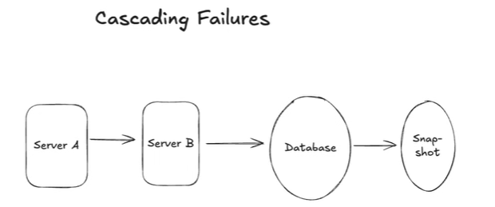
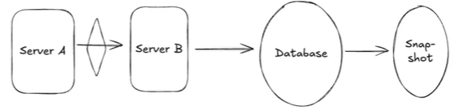

# 3.11 Cascading Failures

- **Cascading Failures (Senior/Staff Level Topic):**

    - **Concept:** A failure in one component causes a chain reaction of failures in upstream components that depend on it.

    - **Example:** A slow database causes timeouts in Service B. Service B's retries add more load to the DB. Service A, which calls B, also starts timing out and retrying, crushing the already struggling Service B.

    - **Solution: Circuit Breaker Pattern:**

        - **Mechanism:** A proxy or client wrapper monitors the failure rate of calls to a downstream service.

        - **Trip (Open):** If the failure rate exceeds a threshold, the circuit "opens." All subsequent calls fail *immediately* without being sent, giving the downstream service a break.

        - **Reset (Half-Open/Closed):** After a cooldown period, the circuit enters a "half-open" state, allowing a few test calls. If they succeed, the circuit "closes" and resumes normal operation. If they fail, it remains open.

        - **Benefit:** Prevents system-wide collapse, allows for graceful degradation, and enables services to self-heal once the underlying issue is resolved.

[Cascading Failure \| System Design](<https://www.youtube.com/watch?v=oVGOUh6-m4E>)

[How to avoid cascading failures in a distributed system ](<https://www.youtube.com/watch?v=xrizarXJgC8>)[💣💥🔥](<https://www.youtube.com/watch?v=xrizarXJgC8>)

[Designing Resilient Systems to Prevent Cascading Failures](<https://www.youtube.com/watch?v=zRwv6piW8JY>)

[Stop Cascading Failures  - Circuit Breaker & Bulkhead](<https://www.youtube.com/watch?v=4FxrxLYjvRg>)
