# 3.2 Load Balancing

| Load Balancer |  | [Load Balancer - Introduction, Types and Load Balancing Algorithms \| Sticky Session](<https://www.youtube.com/watch?v=1qEobRRFuIo>) | [What is LOAD BALANCING? ](<https://www.youtube.com/watch?v=K0Ta65OqQkY>)[⚖️](<https://www.youtube.com/watch?v=K0Ta65OqQkY>) | [Load Balancing in Stateful Systems \| System Design Fundamentals \| Scaler](<https://www.youtube.com/watch?v=a0rFl3_BAt0>) | [Load Balancing and Traffic Routing Strategies Simplified \| System Design Fundamentals 2022](<https://www.youtube.com/watch?v=mswjnBHHd1M>) |
| --- | --- | --- | --- | --- | --- |
| [High-Level Design Part 12 : Load Balancing](<https://www.youtube.com/watch?v=GiWM6LkCuDg>) | [Load Balancer and Proxy \| System Design \| By Ex-FAANG Engineer](<https://www.youtube.com/watch?v=NRgkNVcq7Uc>) | [Load Balancers for System Design Interviews](<https://www.youtube.com/watch?v=chyZRNT7eEo>) | [How Load Balancer Work with Animation \| System Design Interview Basics](<https://www.youtube.com/watch?v=ZcNaOuxcuyA>) |  | [Load Balancing - The Right Way To Do It \| Systems Design Interview 0 to 1 With Ex-Google SWE](<https://www.youtube.com/watch?v=PERKHUJYotM>) |

[L3. Scaling & Load Balancing Explained \| System Design for Beginners](<https://www.youtube.com/watch?v=FVvfBl6CqPg>)

[What is a LOAD BALANCER really about?](<https://www.youtube.com/watch?v=LQuuoHTyYz8>)

[Load Balancer - System Design Interview Question](<https://www.youtube.com/watch?v=ZGVbgwyTLGA>)

[How Google designed their Highly Available Load Balancers using Anycast](<https://www.youtube.com/watch?v=WjT253DBlXk>)

[The Ultimate Guide to Load Balancers (System Design Fundamentals)](<https://www.youtube.com/watch?v=xg7Dj2AXLyk>)

[Google SWE teaches systems design \| EP33: Load Balancing ](<https://www.youtube.com/watch?v=wJcG1Rzr8i4&list=PLjTveVh7FakKjb4UYzUazqBNNF-WGurXp&index=33&pp=iAQB>)

[How load balancers work - System Design Interview knowledge \[Beyond the interview\]](<https://www.youtube.com/watch?v=escR-07yVAs>)

[System Design - Part 3 \| Load Balancer \| Different Techniques explained with animations](<https://www.youtube.com/watch?v=jHR-gj5T1Vw&list=PLFdAYMIVJQHOWJgRrjv_RH-ng95B2h3ON&index=3&pp=iAQB0gcJCU0KAYcqIYzv>)

[Load Balancing - The Right Way To Do It \| Systems Design Interview 0 to 1 With Ex-Google SWE](<https://www.youtube.com/watch?v=PERKHUJYotM&list=PLjTveVh7FakLdTmm42TMxbN8PvVn5g4KJ&index=57&pp=iAQB0gcJCU0KAYcqIYzv>)

[What is LOAD BALANCING? ](<https://www.youtube.com/watch?v=K0Ta65OqQkY&list=PLMCXHnjXnTnvo6alSjVkgxV-VH6EPyvoX&index=4&ab_channel=GauravSen>)[⚖️](<https://www.youtube.com/watch?v=K0Ta65OqQkY&list=PLMCXHnjXnTnvo6alSjVkgxV-VH6EPyvoX&index=4&ab_channel=GauravSen>)

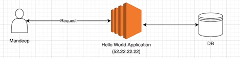

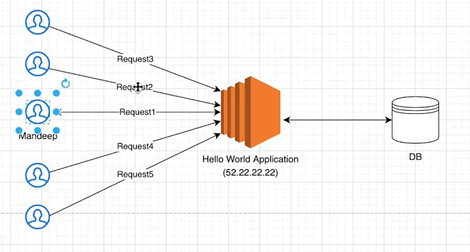

How to Handle?

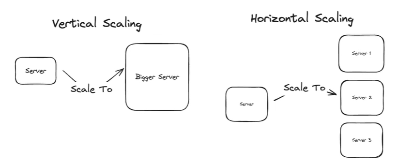

Scale Horizontally:

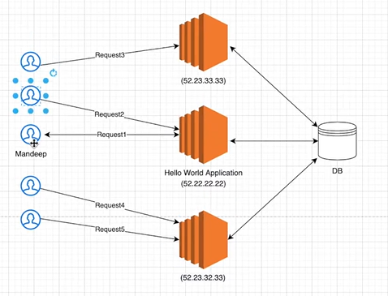

Load Balancer Add:

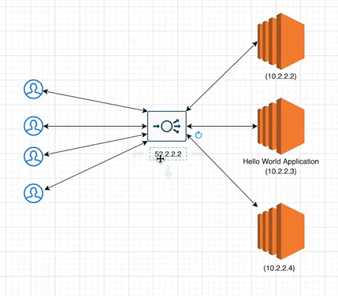

## **Load Balancing**

    - **Context:** Required for horizontal scaling (duplicating servers) to spread load and provide high availability.

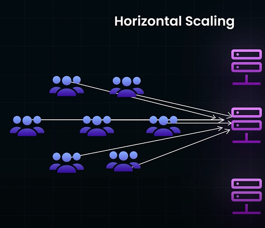

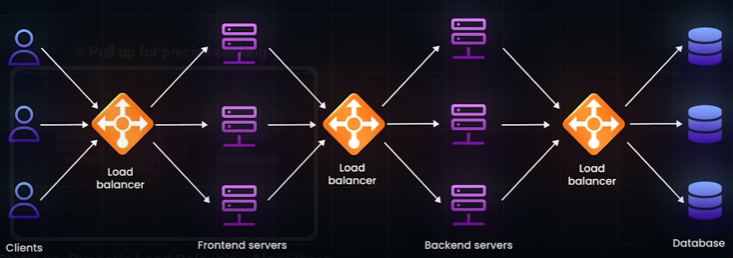

**Health Check**

| Health Check | 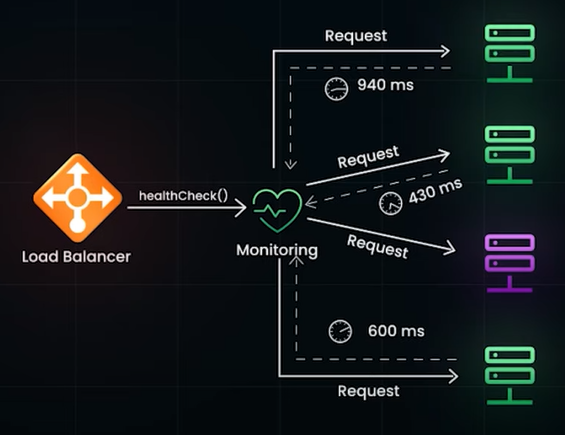 | 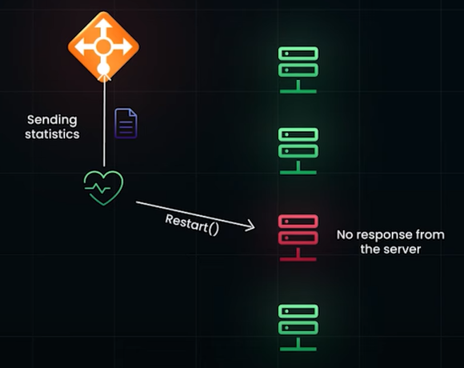 |
| --- | --- | --- |
|  |  |  |

**Types of Load Balancing: (Software Load Balancing)**

**Client-Side Load Balancing:**

    - **Mechanism:** The client is aware of all available server IPs (from a service registry or by asking a peer) and chooses one to connect to directly.

    - Aka SMART CLIENTS : Maintains a pool of backend service hosts. It can:

        - Detect and avoid unresponsive hosts

        - Recover previously unavailable hosts

        - Add new hosts dynamically

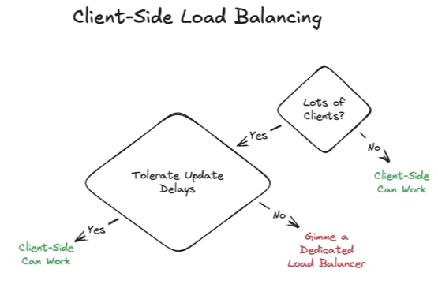

    - **Pros:** No extra network hop, very low latency.

    - **Cons:** Client must be smart enough to handle this; can be slow to react to server changes.

    - **Use Case:** Internal microservices (gRPC supports this), or systems like DNS where clients are numerous and can tolerate update delays.

    - Good for small scale systems. At scale, better to use standalone/dedicated Load Balancers (software or hardware)

**Dedicated Load Balancer (Appliance/Proxy):**

    - **Mechanism:**

A dedicated piece of hardware or software sits between the clients and the backend servers. It distributes the traffic of client requests towards server.

Load Balancer is also another server. Divides incoming request load. Checks health of the servers. If a server is down, it forwards request to another server. Load Balancer can be called using Public IP. And it provides security to internal server Private IP.

        - **Hardware:**

            - e.g., F5 networks, capable of millions of transactions per second. Citrix NetScalar

            - High Performance, Reliable, Expensive

            - Used as the **first point of contact** for handling user requests

            - Intra-network traffic often still uses **smart clients** or **hybrid setups**

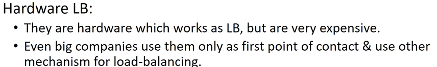

        - **Software:**

            - e.g., HAProxy (Popular OSS Load Balancer), NGINX, Apache.

            - No need to build smart clients. No expensive hardware purchases. Easy to deploy (often open-source, e.g., HAProxy)

            - **Deployment Scenarios**:

**1️⃣** **Running on Client Machine**

                    - HAProxy runs **locally**.

                    - Client communicates via a **locally bound port** (e.g., localhost:9000).

                    - HAProxy manages forwarding requests to backend servers.

                    - Efficient management of traffic **without requiring smart logic in the client**.

**2️⃣** **Running on Intermediate Server**

                    - HAProxy runs on a **proxy server** between client and backend.

                    - Responsibilities:

                        - Health checks

                        - Dynamic removal/addition of backend machines

                        - Balances requests across pools

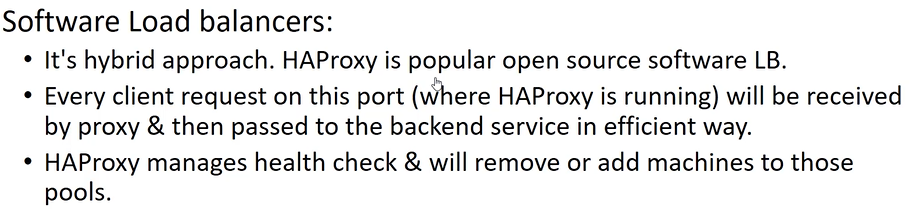

        - **Cloud:** e.g., AWS Application Load Balancer (ALB), Elastic Load Balancer (ELB).

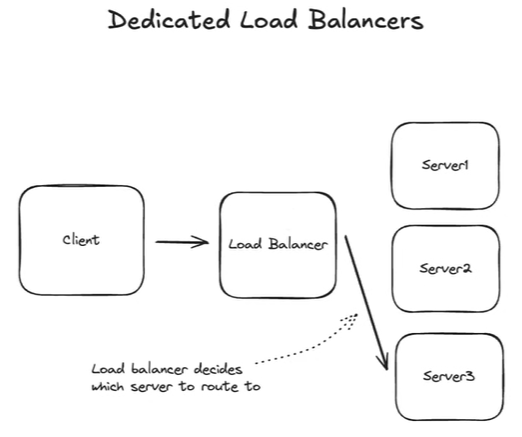

    - **Operational Flow:**

        1. **Registration:** When a new server starts, it "announces itself" to the load balancer to be added to the pool of available servers.

        1. **Health Checks:** The load balancer continuously sends requests to the servers to check if they are healthy and can accept traffic.

            - **Shallow Check:** Is the server accepting a TCP connection? (Very fast)

            - **Deep Check:** Is the server returning a valid HTTP response (e.g., 200 OK)? (More reliable)

        1. **Routing:** If a server passes its health checks, the load balancer starts routing traffic to it. If it fails, it is removed from the rotation.

**Load Balancer Layers:**

    1. **Network Load Balancer (L4 Balancer)**

        1. **Protocol: TCP / UDP, Client and Destination port, IP address of Source and Destination**

        1. **It can only use above information (Network and Transport Layer info) to route the traffic. **

        1. **Faster**

    1. **Application Load Balancer (L7 Balancer)**

        1. **Read your Header/ Session/ Data / Response / Cookies**

        1. **Take decision based on data / header to distribute the traffic**

        1. **It can also do caching. Advanced.  Complex Routing Decisions. **

        1. **Has much more info about request then L4 balancer. It has HTTP header info. Application Level Info. **

**Layer 4 Load Balancer (Transport Layer):**

    - **How it Works:** Operates at the TCP/UDP level. It is "unaware" of the application-level data (like HTTP headers or URLs). It simply forwards network packets from the client to a chosen server.

    - It initiates a parallel Layer 4 connection to server for every inbound connection that it receives. Layer 4 load balancer acts as if it doesn't exist, behaves as if client is connected directly to server and that connection of LB and Server acts as a proxy for the connection with the client.

    - **Analogy:** It acts as a simple pass-through. "It's as if the client has a connection directly with the server."

    - **Pros:**

        - **Extremely High Performance:** Very little processing overhead as it doesn't need to parse application data.

    - **Cons:**

        - **Less "Smart":** Cannot make routing decisions based on the content of the request (e.g., it can't route /api to one service and /images to another).

    - **Interview Use Case:**

        - When you need the absolute **highest performance**.

        - For **connection-oriented protocols** that are not HTTP, such as **WebSockets**, raw TCP streams, or gaming servers.

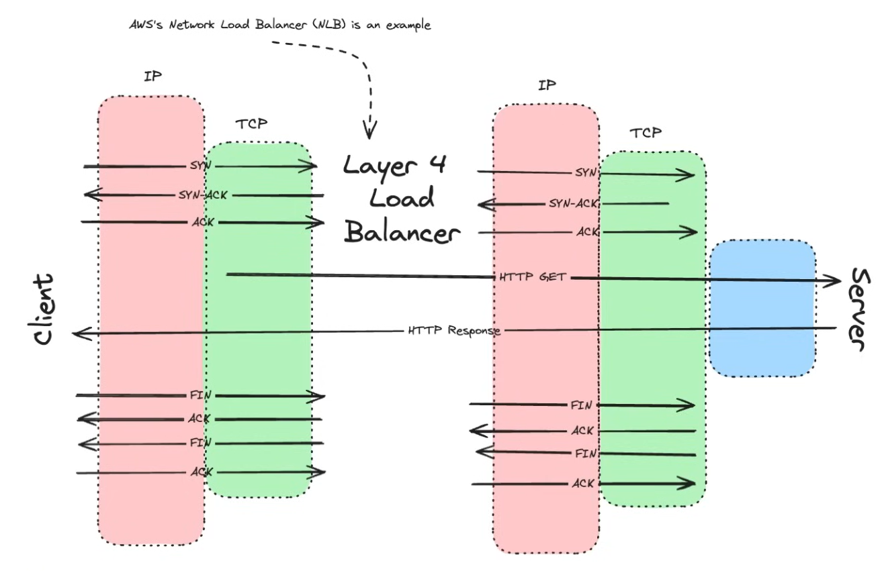

**Layer 7 Load Balancer (Application Layer):**

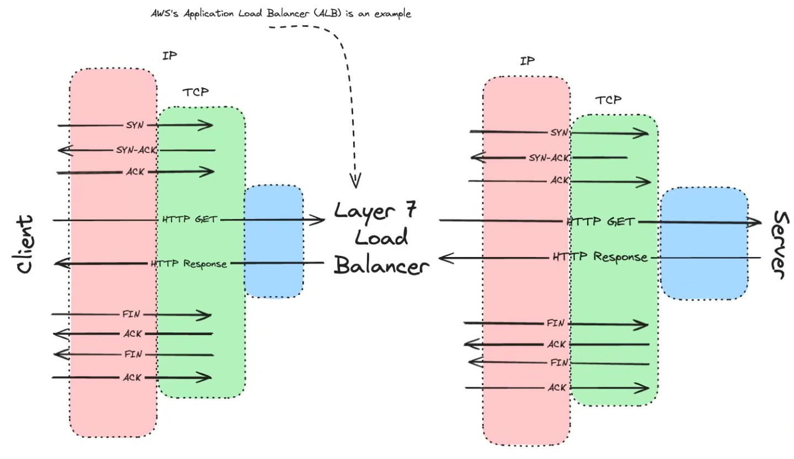

- **How it Works:** Operates at the application level (e.g., HTTP). It terminates the client's connection, inspects the request, and then initiates a *new* connection to a backend server.

- **Key Feature:** It can make intelligent routing decisions because it understands the application protocol.

- **Functionality:**

    - **Content-Based Routing:** Route based on URL path (/users vs. /orders), host header, or other HTTP headers.

    - **SSL/TLS Termination:** The load balancer can handle the encryption/decryption, offloading this work from the backend servers.

    - **Request/Response Modification:** Can add, remove, or modify headers.

- **Pros:**

    - **Flexible and Powerful:** Provides much more functionality and control.

    - **Efficient Connection Management:** Can multiplex many incoming client requests over a smaller, persistent set of connections to the backend servers (connection pooling).

- **Cons:**

    - **Higher Overhead:** Requires more CPU to parse application-level requests, making it slightly slower than a Layer 4 LB.

- **Interview Use Case:**

    - This is the **default and recommended choice** for most modern web applications and APIs.

    - Use this unless you have a specific reason to use a Layer 4 LB (e.g., WebSockets, ultra-high performance).

| 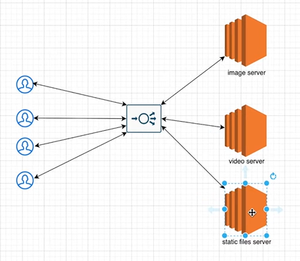 |  |
| --- | --- |

**Load Balancer ****Algorithms:**

**Network Layer Load Balancing Algorithms**

**Layer 4 Load Balancer Algorithms (Transport Layer)**

These operate at the TCP/UDP level and make routing decisions based on IP address and port.

| **Algorithm** | **Description** |
| --- | --- |
| **Round Robin** | Distributes connections sequentially to each server in the pool. |
| **Least Connections** | Sends traffic to the server with the fewest active connections. |
| **Source IP Hash** | Uses a hash of the client's IP address to consistently route to the same server. |
| **Destination IP Hash** | Routes based on hash of destination IP (less common). |
| **Weighted Round Robin** | Like round robin but gives preference to servers with higher weights. |
| **Weighted Least Conn.** | Combines least connections with server weight for better distribution. |
| **IP Range/Port-Based** | Routes based on IP range or specific TCP/UDP ports. |

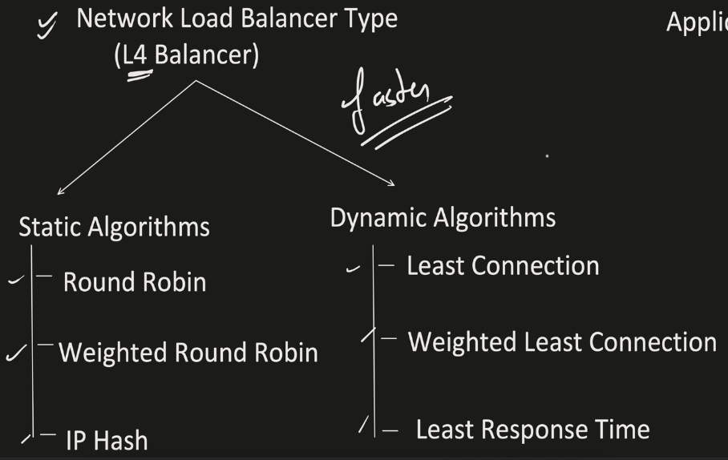

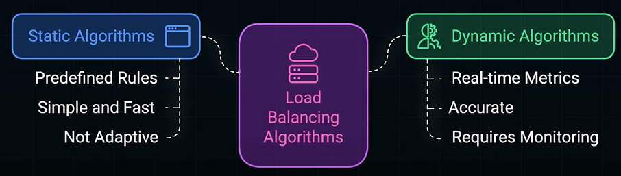

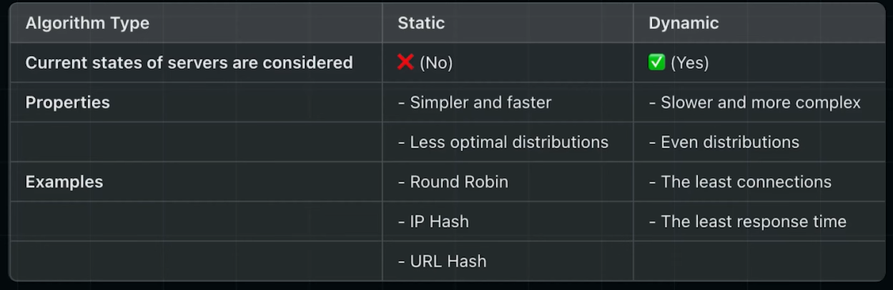

**Static Algorithms:**

Predefined rules (CPU capacity, connection limits)

    - **Random:**

        - Distributes load randomly to each server. Works well when each server is identical in capacity, and traffic is evenly distributed over time.

        - Doesn't account for load and capacity, may lead to congestion if load is high.

    - **Round Robin:**

        - **Mechanism:** Distributes requests sequentially (A, B, C, A, B, C...) or randomly to servers in the pool.

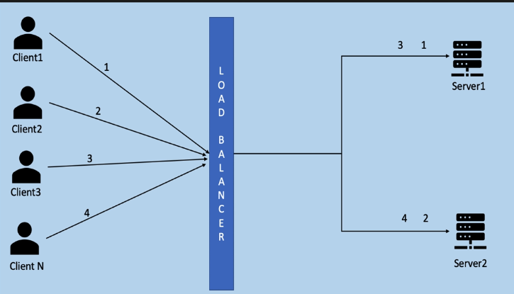

        - **Best For:** **Stateless services** (e.g., most simple HTTP API servers) where each request is independent and takes a roughly similar amount of time to process. The assumption is that random distribution will even out the load over time.

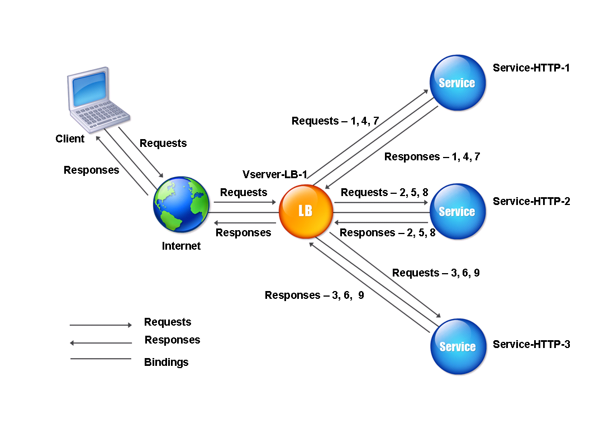

        - Advantages: Easy to implement, equal lod distribution to all servers

        - Disadvantage: Serverd with high and low capacity/resources are treated equal, Bottleneck at low capacity server.

**Dynamic Algorithms: **

Real Time Metrics (Active Connections, Response Time)

    - **Least Connections:**

        - **Mechanism:** The load balancer tracks the number of active connections to each server and sends the next new request to the server with the fewest connections. Tracks active connections, and sends request to server with least connections.

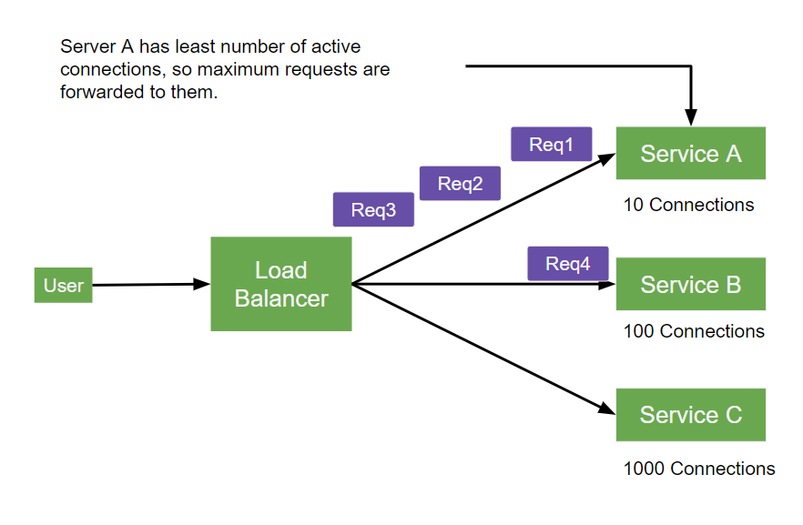

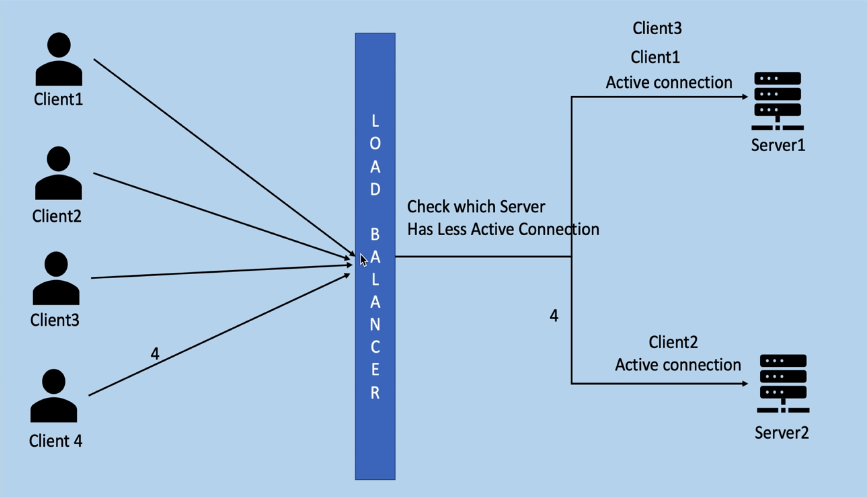

**Application Layer Load Balancing Algorithms**

**Layer 7 Load Balancer Algorithms (Application Layer)**

These consider HTTP headers, cookies, URLs, etc., and make content-aware routing decisions.

| **Algorithm / Strategy** | **Description** |
| --- | --- |
| **Round Robin** | Same as Layer 4, but on HTTP requests instead of TCP connections. |
| **Least Connections** | Routes HTTP requests to server with fewest ongoing HTTP sessions. |
| **IP Hash / Cookie Sticky** | Ensures session persistence based on IP or HTTP cookie (session affinity). |
| **URL-Based Routing** | Routes based on request URL path (/api, /login, etc.). |
| **Host-Based Routing** | Routes based on domain name (api.example.com, shop.example.com). |
| **Header-Based Routing** | Routes based on HTTP headers like User-Agent or custom headers. |
| **Query String Routing** | Routes based on URL query parameters. |
| **Weighted Routing** | Sends more traffic to higher-capacity servers based on defined weights. |
| **AB Testing / Canaries** | Sends a portion of traffic to specific servers (used for gradual rollouts). |
| **Geolocation Routing** | Routes based on the geographic location of the client. |
| **Rate-Based Routing** | Throttles or redirects requests based on defined rate limits. |

### What if the load balancer goes down?

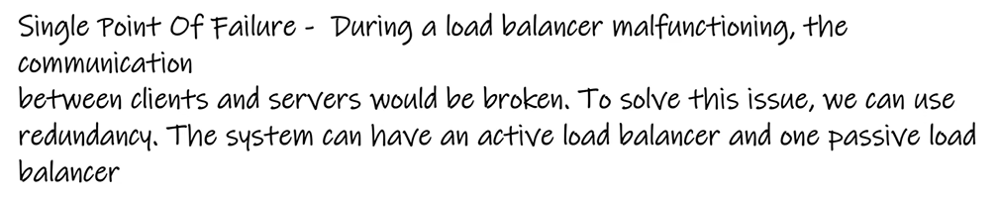
