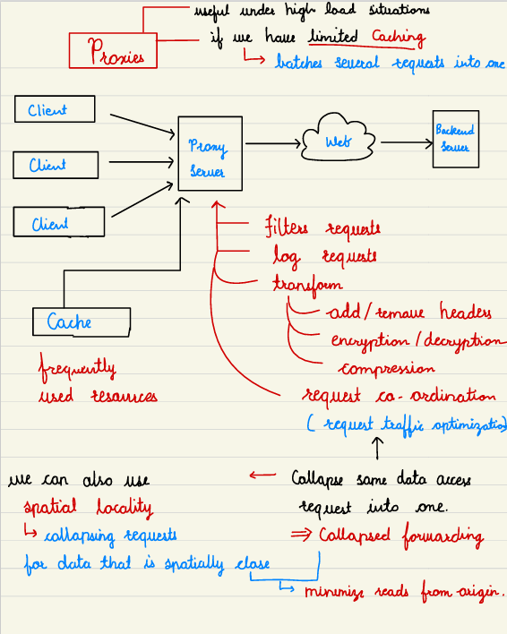
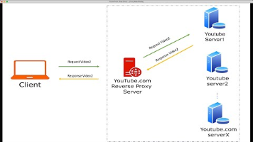
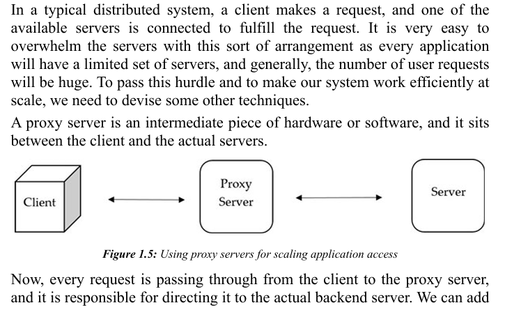
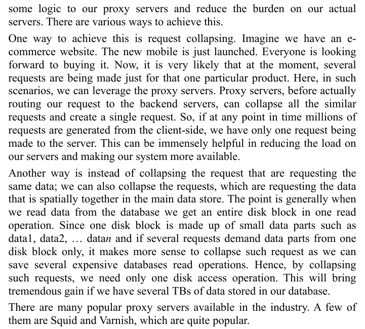
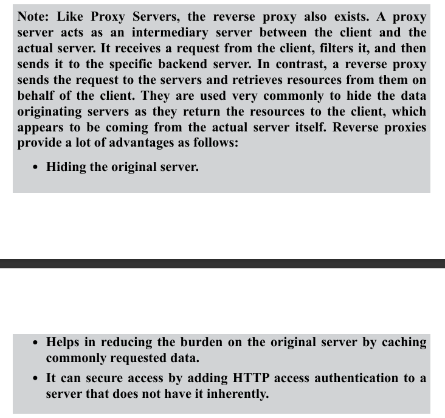
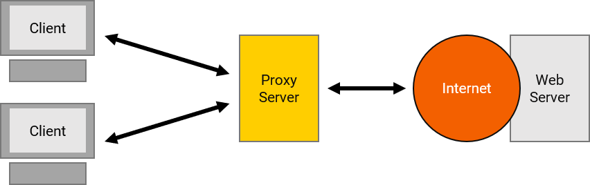
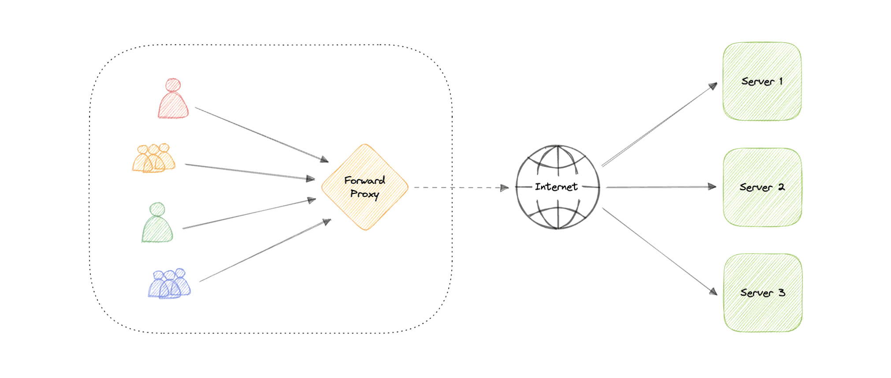
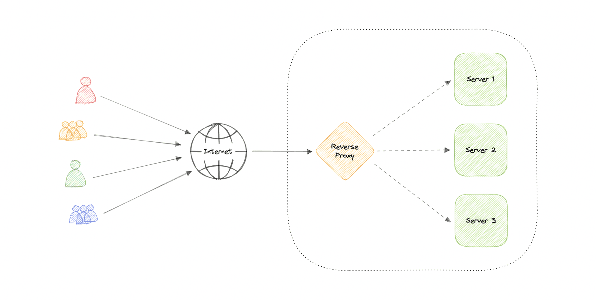

# 3.3 Proxy Server / nginx

| Proxy | [Understanding Proxy, Forward Proxy, and Reverse Proxy](<https://www.youtube.com/watch?v=HrG0MHkSsCA>) | [17. Proxy vs Reverse Proxy (Example) \| How Proxy differs from VPN, LoadBalancer \| SystemDesign](<https://www.youtube.com/watch?v=yeaPUFaXgdA>) | [Forward Proxy and Reverse Proxy \| System Design Interview Basics](<https://www.youtube.com/watch?v=qbuMKSTv3yU>) |
| --- | --- | --- | --- |

[How Nginx handles 1 MILLION Concurrent Connections? - Shocking Truth](<https://www.youtube.com/watch?v=UCuUW9gtn2k>)

[Proxy vs Reverse Proxy (Real-world Examples)](<https://www.youtube.com/watch?v=4NB0NDtOwIQ&pp=ygUacHJveHkgc2VydmVyIHN5c3RlbSBkZXNpZ24%3D>)

[Reverse Proxy \| High Level Design: Lecture - 5 \| DNS  Reverse Proxy \| Loadbalancer  Reverse Proxy \|](<https://www.youtube.com/watch?v=lGVa0_zuFYU>)

[System Design - Part 8 \| Forward and Reverse Proxy \| Difference and use cases](<https://www.youtube.com/watch?v=JedHPaRtfkY&list=PLFdAYMIVJQHOWJgRrjv_RH-ng95B2h3ON&index=8&pp=iAQB>)

[System Design - Proxy Server](<https://www.youtube.com/watch?v=XhNQbuf-NTk&list=PLt4nG7RVVk1g_LutiJ8_LvE914rIE5z4u&index=5&pp=iAQB>)

[Forward proxy and reverse proxy Explained in Hindi ](<https://www.youtube.com/watch?v=dBtpV7aN_20&list=PLA3GkZPtsafZdyC5iucNM_uhqGJ5yFNUM&index=31&pp=iAQB>)

From < https://www.youtube.com/watch?v=dBtpV7aN_20&list=PLA3GkZPtsafZdyC5iucNM_uhqGJ5yFNUM&index=31&pp=iAQB>

[Reverse proxy server in Hindi ](<https://www.youtube.com/watch?v=Q5jPD2ECEgM&list=PLA3GkZPtsafZdyC5iucNM_uhqGJ5yFNUM&index=32&pp=iAQB>)

From < https://www.youtube.com/watch?v=Q5jPD2ECEgM&list=PLA3GkZPtsafZdyC5iucNM_uhqGJ5yFNUM&index=32&pp=iAQB>

[Proxies \| System Design Tutorials \| Part 4 \| 2020 ](<https://www.youtube.com/watch?v=Nu-4Q3OoR4E&list=PLTCrU9sGyburBw9wNOHebv9SjlE4Elv5a&index=4&pp=iAQB>)

From < https://www.youtube.com/watch?v=Nu-4Q3OoR4E&list=PLTCrU9sGyburBw9wNOHebv9SjlE4Elv5a&index=4&pp=iAQB>

[System Design - Proxy \| Forward Proxy vs Reverse Proxy vs Load Balancer \| with real life examples](<https://www.youtube.com/watch?v=WMkOC9s9vWI>)

[Reverse Proxy \| High Level Design: Lecture - 5 \| DNS  Reverse Proxy \| Loadbalancer  Reverse Proxy \|](<https://www.youtube.com/watch?v=lGVa0_zuFYU&pp=0gcJCfYJAYcqIYzv>)

[Proxy vs Reverse Proxy vs Load Balancer \| Simply Explained](<https://www.youtube.com/watch?v=xo5V9g9joFs&pp=ygUacHJveHkgc2VydmVyIHN5c3RlbSBkZXNpZ24%3D>)

[Proxy Server \| System Design  Fundamentals](<https://www.youtube.com/watch?v=uekymojZFs4&pp=ygUacHJveHkgc2VydmVyIHN5c3RlbSBkZXNpZ24%3D>)

[Forward Proxy vs Reverse Proxy vs Load Balancer Explained #systemdesign #software #microservices](<https://www.youtube.com/watch?v=KM7msd2HVRg&pp=ygUacHJveHkgc2VydmVyIHN5c3RlbSBkZXNpZ24%3D>)

[System Design Interview Basics: Forward Proxy vs. Reverse Proxy](<https://www.youtube.com/watch?v=OdBB9Tm79x8&pp=ygUacHJveHkgc2VydmVyIHN5c3RlbSBkZXNpZ27SBwkJfgkBhyohjO8%3D>)

[Load Balancer and Proxy \| System Design \| By Ex-FAANG Engineer](<https://www.youtube.com/watch?v=NRgkNVcq7Uc&pp=ygUacHJveHkgc2VydmVyIHN5c3RlbSBkZXNpZ24%3D>)

[Build your own Web server \| Multithreaded Proxy Web Server in C](<https://www.youtube.com/watch?v=eTvSgOoc_BE&t=24s&pp=ygUZcHJveHkgc2VydmVyIGZyb20gc2NyYXRjaA%3D%3D>)

## PROXY SERVER

A proxy server is an intermediary piece of hardware/software sitting between the client and the backend server. It receives requests from clients and relays them to the origin servers. All the requests pass through the proxy, no client and server can directly talk to each other.

Typically, proxies are used to filter requests, log requests, or sometimes transform requests (by adding/removing headers, encrypting/decrypting, or compression).

## Types of Proxy Server (Differ in Direction)

1. ### Forward Proxy

A forward proxy, often called a proxy, proxy server, or web proxy is a server that sits in front of a group of client machines. When those computers make requests to sites and services on the internet, the proxy server intercepts those requests and then communicates with web servers on behalf of those clients, like a middleman.

Forward proxy hides the client's network (intranet)

### Advantages

- Block access to certain content

- Allows access to [geo-restricted](<https://en.wikipedia.org/wiki/Geo-blocking>) content

- Provides anonymity

- Avoid other browsing restrictions

A reverse proxy is a server that sits in front of one or more web servers, intercepting requests from clients. When clients send requests t o the origin server of a website, those requests are intercepted by the reverse proxy server.

The difference between a forward and reverse proxy is subtle but important. A simplified way to sum it up would be to say that a forward proxy sits in front of a client and ensures that no origin server ever communicates directly with that specific client. On the other hand, a reverse proxy sits in front of an origin server and ensures that no client ever communicates directly with that origin server.

Introducing reverse proxy results in increased complexity. A single reverse proxy is a single point of failure, configuring multiple reverse proxies (i.e. a failover) further increases complexity.

### Advantages

Here are some advantages of using a reverse proxy:

- Improved security

- Caching

- SSL encryption

- Load balancing

- Scalability and flexibility

### Load balancer vs Reverse Proxy

Wait, isn't reverse proxy similar to a load balancer? Well, no as a load balancer is useful when we have multiple servers. Often, load balancers route traffic to a set of servers serving the same function, while reverse proxies can be useful even with just one web server or application server. A reverse proxy can also act as a load balancer but not the other way around.

**Examples**

Below are some commonly used proxy technologies:

- [Nginx](<https://www.nginx.com/>)

- [HAProxy](<http://www.haproxy.org/>)

- [Traefik](<https://doc.traefik.io/traefik>)

- [Envoy](<https://www.envoyproxy.io/>)

