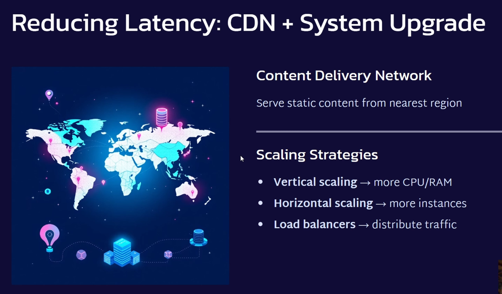

# 3.5.1 CDN

[What is latency in networking in Hindi | How to reduce latency in network | CDN vs Caching](<https://www.youtube.com/watch?v=cG3LMd2hIXY&list=PLA3GkZPtsafZdyC5iucNM_uhqGJ5yFNUM&index=4&pp=iAQB>)

[Google SWE teaches systems design | EP31: Content Delivery Networks (CDNs) ](<https://www.youtube.com/watch?v=w2USXdq58Yc&list=PLjTveVh7FakKjb4UYzUazqBNNF-WGurXp&index=31&pp=iAQB>)

From < https://www.youtube.com/watch?v=w2USXdq58Yc&list=PLjTveVh7FakKjb4UYzUazqBNNF-WGurXp&index=31&pp=iAQB>

[System Design: Content Delivery Networks (Simplified) ](<https://www.youtube.com/watch?v=8zX0rue2Hic&list=PLMCXHnjXnTnvo6alSjVkgxV-VH6EPyvoX&index=16&pp=iAQB>)

| CDN | [What is a CDN (Content Delivery Network)?](<https://www.youtube.com/watch?v=b4_6thkYZXs>) | [Content Delivery Network (CDN) \| System Design \| Learning from EX-FAANG Engineer](<https://www.youtube.com/watch?v=miPrECSdtV0>) | [Content Delivery Networks - You Need Them \| Systems Design Interview 0 to 1 With Ex-Google SWE](<https://www.youtube.com/watch?v=h5YK640kwXY>) | [CDNs in High-Performance System Design](<https://www.youtube.com/watch?v=rwBv7FqZ77g>) |
| --- | --- | --- | --- | --- |

[What is CDN? Complete Guide to Content Delivery Networks | CDN System Design](<https://www.youtube.com/watch?v=AvtQSl0zPZQ&list=PL0zBvCLNlDwFrYw-WgM7LCZW5JVNQoEdT&index=3&pp=iAQB0gcJCU0KAYcqIYzv>)

[Content Delivery Networks - You Need Them | Systems Design Interview 0 to 1 With Ex-Google SWE](<https://www.youtube.com/watch?v=h5YK640kwXY&list=PLjTveVh7FakLdTmm42TMxbN8PvVn5g4KJ&index=55&pp=iAQB>)

[Multithreading in CDN to PROTECT backend from CRASH During High Peak.](<https://www.youtube.com/watch?v=sjK20erOdg8>)

[L4. Caching & CDN Explained | System Design for Beginners](<https://www.youtube.com/watch?v=aFg2Q9PRTBw>)
