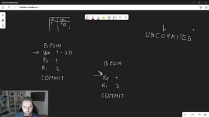
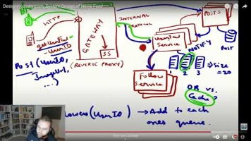

# 3.9 Rate Limiter \*\*

[Atlassian Interview Question \| System Design: Rate Limiter (5+ Approaches)](<https://www.youtube.com/watch?v=NvQXO7tleDI&list=PLlvnxKilk3aJXqDN65Sm8vIqSyfJy4-v0&index=39&pp=iAQB0gcJCX4JAYcqIYzv>)

[EP8: High Level Systems Design: Rate-limitting in Distributed Systems](<https://www.youtube.com/watch?v=p7-AZWwqEeg&list=PLoaQAd6R8JXyTpYZTOWT8JrVASNeyoBZu&index=4&pp=iAQB>)

[System Design - Part 11 \| Design a Rate Limiter](<https://www.youtube.com/watch?v=Rn7L1j63FnI&list=PLFdAYMIVJQHOWJgRrjv_RH-ng95B2h3ON&index=11&pp=iAQB>)

[Rate Limiter - System Design Interview Question](<https://www.youtube.com/watch?v=dpEOhfEEoyw>)

- 2 Alex Xu - Chapter 4

- 1 Zhiyong Tan - Chapter 8

[Rate Limiter System Design Deep Dive \| Design API Rate Limiter \| Most asked Interview question](<https://www.youtube.com/watch?v=el1FKMe6Eeg>)

[Chapter 1: Introduction \| Design a Rate Limiter \| System Design Roadmap](<https://www.youtube.com/watch?v=G2z-8zeeG1M>)

[Chapter 2: Algorithms : Part1 \| Design a Rate Limiter \| System Design Roadmap](<https://www.youtube.com/watch?v=G4v1eb2Xq5U>)

[Chapter 3: Algorithms : Part 2 \| Design a Rate Limiter \| System Design Roadmap](<https://www.youtube.com/watch?v=CU5wmgQRE_M>)

[Chapter 4: High Level Architecture \| Design a Rate Limiter \| System Design Roadmap](<https://www.youtube.com/watch?v=k0SGPrfwUx4&pp=0gcJCfYJAYcqIYzv>)

[Chapter 5: Design Deep Dive \| Design a Rate Limiter \| System Design Roadmap](<https://www.youtube.com/watch?v=ov6rpyE3nfs>)

[Chapter 6: Rate Limiter in Distributed Systems \| Design a Rate Limiter \| System Design Roadmap](<https://www.youtube.com/watch?v=Vm4gzY9V_Dc&pp=0gcJCfYJAYcqIYzv>)

[System Design Interview - Rate Limiting (local and distributed)](<https://www.youtube.com/watch?v=FU4WlwfS3G0>)

[System Design High Level - Distributed Rate Limiting](<https://www.youtube.com/watch?v=m6NqmjilMUU&list=PL4kkT38HV3DvYqKhVayGDJyTZtH-ylco3&index=5&pp=iAQB>)

[Master Rate Limiting - System Design](<https://www.youtube.com/watch?v=CVItTb_jdkE&list=PLmbHVmxVu9jLcmbvLBIUEz3CtX3CMz8cM&index=7&pp=iAQB>)

[System Design High Level - Rate Limiting and Distributed Cache](<https://www.youtube.com/watch?v=Iy2Y9p6xD5I&list=PL4kkT38HV3DvYqKhVayGDJyTZtH-ylco3&index=6&pp=iAQB>)

[What is Rate Limiting? Rate Limiting Strategies \| Token Bucket and Leaky Bucket Algorithm](<https://www.youtube.com/watch?v=8ePa8aIUwik>)

[Master Rate Limiting: Rate Limiting PART-2](<https://www.youtube.com/watch?v=ECgfAUfdufY>)

[Rate Limiting One Shot : All Rate Limiting Strategies](<https://www.youtube.com/watch?v=uy33Ls74EKs>)
