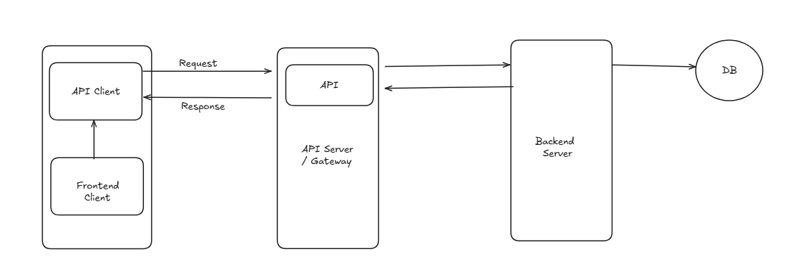

# 4.1 What are APIs?

- API = Application Programming Interface

    - **Application:** When application have to interact with each other (allowing software applications to communicate and use functions from other software applications or services)

    - **Programming:** One piece of code can interact programatically (tell what it wants to do SEND, FETCH) with another piece of code, both of which can be running on same/different machine, can be of same/different language.

    - **Interface:** Abstraction. One code can interact with API, but it doesnt know how the other code interacts and implements it.

1. API client

The API client is responsible for starting the conversation by sending the request to the API server. The request can be triggered in many ways. For instance, a user might initiate an API request by entering a search term or clicking a button. API requests may also be triggered by external events, such as a notification from another application.

2. API request

An API request will look and behave differently depending on the type of API, but it will typically include the following components:

- Endpoint: An [API endpoint](<https://blog.postman.com/what-is-an-api-endpoint/>) is a dedicated URL that provides access to a specific resource. For instance, the /articles endpoint in a blogging app would include the logic for processing all requests that are related to articles.

- Method: The request's method indicates the type of operation the client would like to perform on a given resource. REST APIs are accessible through standard [HTTP methods](<https://blog.postman.com/what-are-http-methods/>), which perform common actions like retrieving, creating, updating, and deleting data.

- Parameters: Parameters are the variables that are passed to an API endpoint to provide specific instructions for the API to process. These parameters can be included in the API request as part of the URL, in the query string, or in the request body. For example, the /articles endpoint of a blogging API might accept a “topic” parameter, which it would use to access and return articles on a specific topic.

- Request headers: Request headers are key-value pairs that provide extra details about the request, such as its content type or authentication credentials.

- Request body: The body is the main part of the request, and it includes the actual data that is required to create, update, or delete a resource. For instance, if you were creating a new article in a blogging app, the request body would likely include the article's content, title, and author.

3. API server

The API client sends the request to the API server, which is responsible for handling authentication, validating input data, and retrieving or manipulating data.

4. API response

Finally, the API server sends a response to the client. The API response typically includes the following components:

- Status code: [HTTP status codes](<https://blog.postman.com/what-are-http-status-codes/>) are three-digit codes that indicate the outcome of an API request. Some of the most common status codes include 200 OK, which indicates that the server successfully returned the requested data, 201 Created, which indicates the server successfully created a new resource, and 404 Not Found, which indicates that the server could not find the requested resource.

- Response headers: [HTTP response headers](<https://blog.postman.com/what-are-http-headers/>) are very similar to request headers, except they are used to provide additional information about the server's response.

- Response body: The response body includes the actual data or content the client asked for—or an error message if something went wrong.

[EP4: High Level Systems Design: API First Thinking](<https://www.youtube.com/watch?v=xLn_FIX1_WQ&list=PLoaQAd6R8JXyTpYZTOWT8JrVASNeyoBZu&index=8&pp=iAQB>)

[EP5: High Level Systems Design: API Strategy - REST vs GraphQL vs gRPC](<https://www.youtube.com/watch?v=Kr8jgjZm5QE&list=PLoaQAd6R8JXyTpYZTOWT8JrVASNeyoBZu&index=7&pp=iAQB>)
