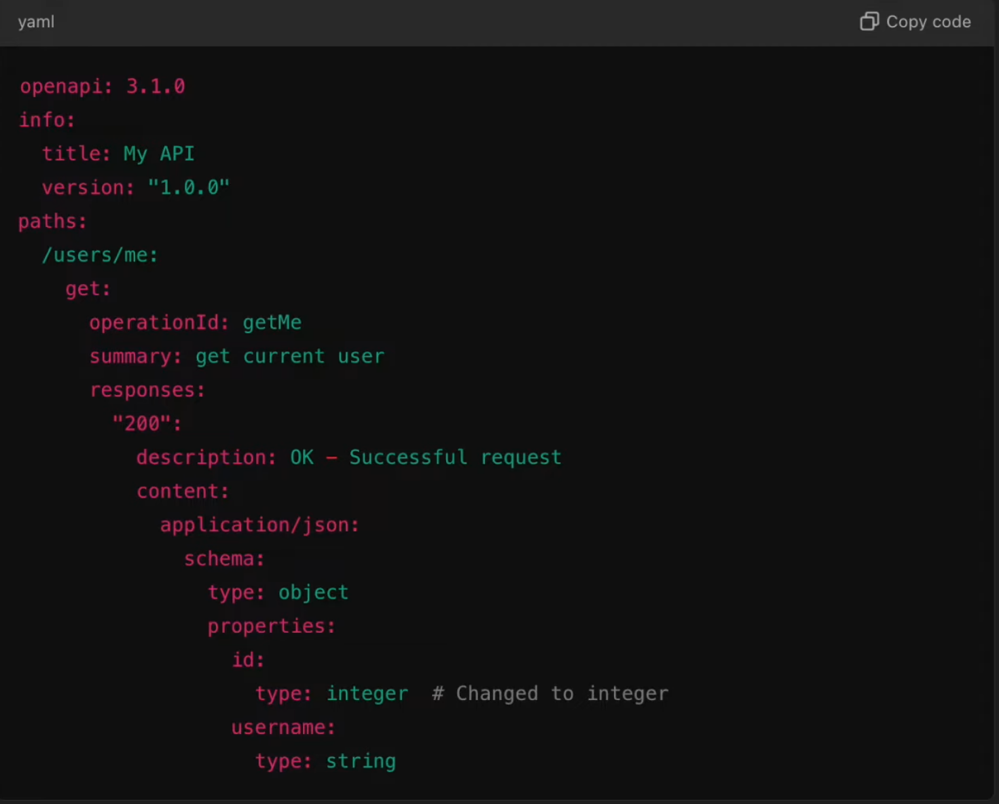
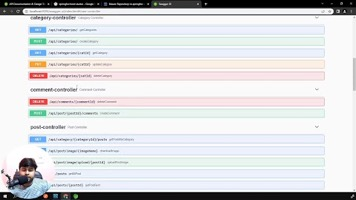

# 4.2 API Paradigms

[🔥](<https://youtu.be/A-lqrhhMEYY?si=5kusOANzVp4kuk2Q>)[Documenting APIs using Swagger Step by Step | Backend Course in Hindi](<https://youtu.be/A-lqrhhMEYY?si=5kusOANzVp4kuk2Q>)

[🌟🌟](<https://youtu.be/CaFuhwFt1KY?si=WkishVwaWm532fOP>)[ Documenting Spring Boot REST APIs using OpenAPI, Swagger ](<https://youtu.be/CaFuhwFt1KY?si=WkishVwaWm532fOP>)[🌟🌟](<https://youtu.be/CaFuhwFt1KY?si=WkishVwaWm532fOP>)
