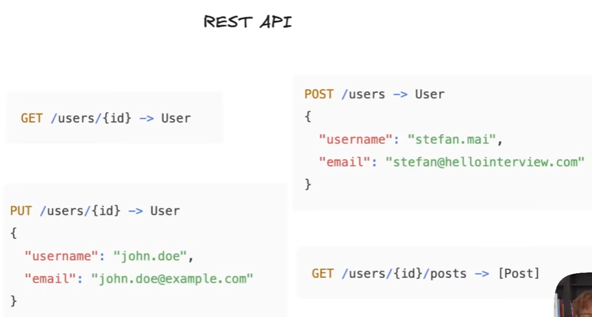

# 4.6.1 Rest API

[REST APIs - System Design | What is REST APIs](<https://www.youtube.com/watch?v=AY9DPjxtCe4&list=PLt4nG7RVVk1g_LutiJ8_LvE914rIE5z4u&index=9&pp=iAQB>)

[REST API | SOA | Microservices architecture | Tier architecture](<https://www.youtube.com/watch?v=SvBnrJKzH8k&list=PLA3GkZPtsafZdyC5iucNM_uhqGJ5yFNUM&index=26&pp=iAQB>)

[What is a REST API? | CRUD APIs| REST vs HTTP | System Design Tutorials | Part 10 | 2020 ](<https://www.youtube.com/watch?v=nUuAWn0AAiY&list=PLTCrU9sGyburBw9wNOHebv9SjlE4Elv5a&index=10&pp=iAQB>)

From < https://www.youtube.com/watch?v=nUuAWn0AAiY&list=PLTCrU9sGyburBw9wNOHebv9SjlE4Elv5a&index=10&pp=iAQB>

[L6. APIs & REST Explained with Demo | When to Use REST | System Design in Hindi](<https://www.youtube.com/watch?v=woeqTo2wcBI>)

[L7. Authentication & Authorization in APIs ](<https://www.youtube.com/watch?v=UBO6Kq7sA4U>)[🔑](<https://www.youtube.com/watch?v=UBO6Kq7sA4U>)[ | Demo + API Headers Explained | System Design](<https://www.youtube.com/watch?v=UBO6Kq7sA4U>)

[Pagination in REST APIs – Offset  vs Cursor (Full Guide + Live Demo)](<https://www.youtube.com/watch?v=PzLWo3rf89g>)

[REST v GraphQL v gRPC | API Design](<https://www.youtube.com/watch?v=Rlv54zos8uc>)

[Everything you need to know about REST](<https://www.youtube.com/watch?v=uFGJVQvR59A&list=PLsdq-3Z1EPT36NJXTutvKcreetuHCr9a-&index=2&pp=iAQB>)

REST APIs generally operate at the application layer of the OSI model, leveraging existing application layer protocols like HTTP. While REST itself is an architectural style, not a protocol, it utilizes protocols like HTTP for communication between systems. REST APIs are designed to be stateless and operate on resources identified by URIs, using HTTP methods like GET, POST, PUT, and DELETE.

## REST API - **(Representational State Transfer)**

**REST - The Default API Style**

- An architectural style built on HTTP.

- **Core Principles:**

    1. **Use HTTP Verbs for Actions:** GET (read), POST (create), PUT (update/replace), DELETE.

    1. **Focus on Resources Identified by URLs:** /users, /users/{id}, /users/{id}/posts.

- **RESTful Thinking:** Model operations as state changes to resources, not as function calls. Organising API around "URLs" and "Verbs".

    - Eg: Update user is an action, not a resource.

    - **Bad:** POST /updateUser (action in URL).

    - **Good:** PUT /users/{id} (verb describes the action on the resource).

- **Interview Use Case:** The default, recommended choice for APIs due to its wide adoption and generality.
