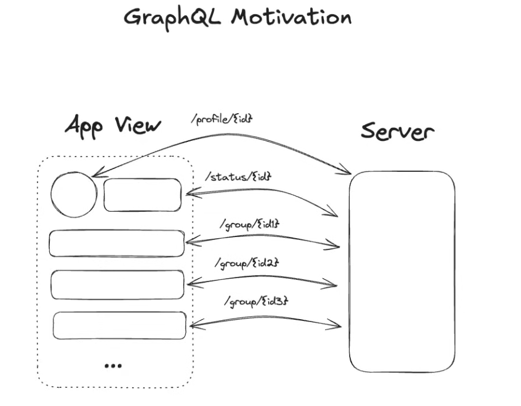
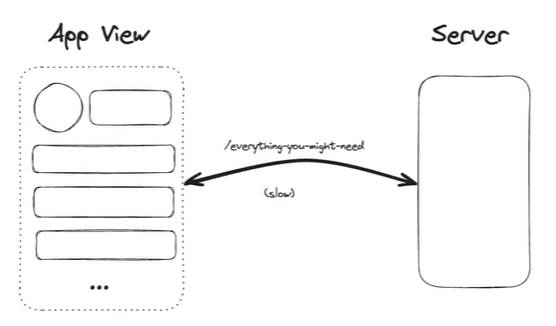
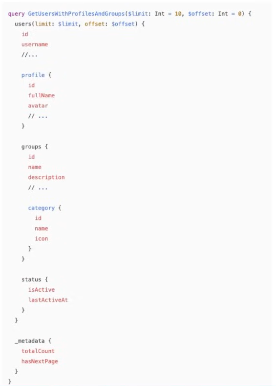

# 4.6.2 GraphQL

[L8. GraphQL Tutorial | Hands-On Demo: Queries, Mutations & Subscriptions](<https://www.youtube.com/watch?v=NKHZ1g9yDRM>)

## GraphQL: For Flexible Frontends

- **Problem it Solves:**

    - **Under-fetching:** Making many separate API calls to build a single view, which increases latency.

    - **Over-fetching:** Having a single endpoint that returns too much data, wasting bandwidth and time.

- **Mechanism:** The client sends a single query that specifies the exact shape of the data it needs. The server returns a JSON object that matches that shape, and nothing more.

- **Interview Use Case:**

    - When front-end requirements change rapidly (e.g., A/B testing).

    - When front-end teams need to fetch data from multiple, disparate backend services.

    - For designing systems with arbitrary query patterns, like a newsfeed.
