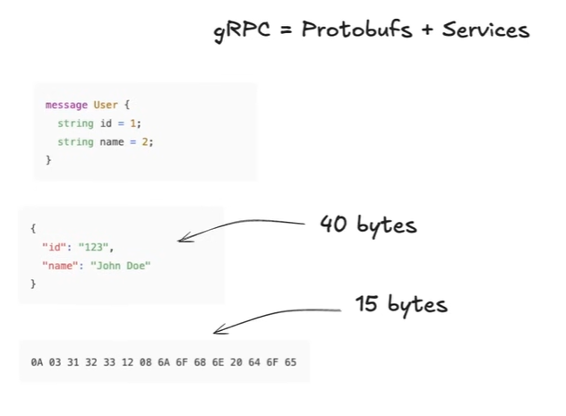
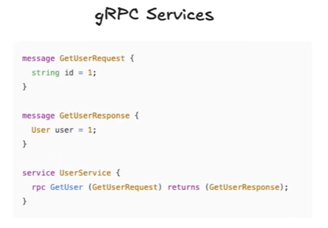
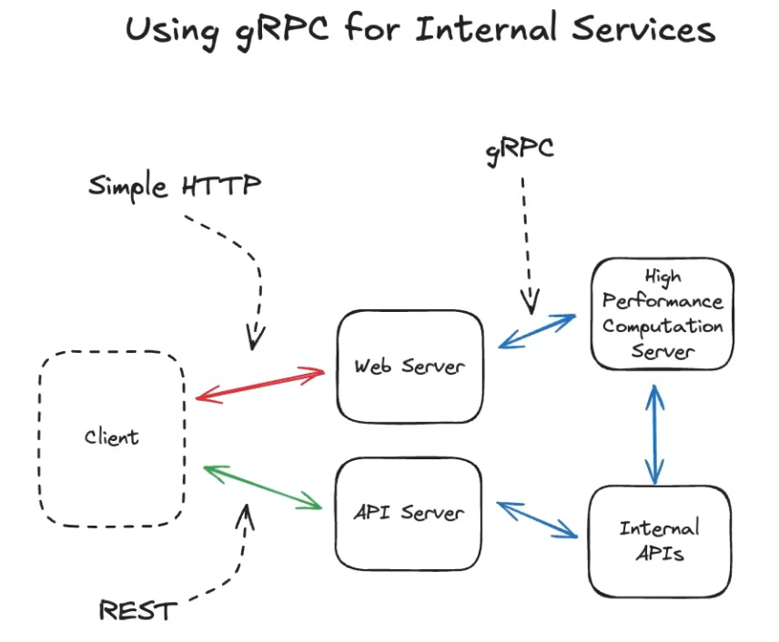

# 4.6.3 gRPC

[L10. gRPC Explained with Hands-On Demo (System Design)](<https://www.youtube.com/watch?v=cxwUT02j5HM>)

| RPC | [Introduction to RPC - Remote Procedure Calls](<https://www.youtube.com/watch?v=eRndYq8iTio>) |
| --- | --- |

**gRPC (Google RPC): For High-Performance Internal Services**

