# 5.1 All things caching

- Understanding Caching:  https://drive.google.com/file/d/1OKeAs4tA44toEiJ1dfrtY5fmJHPsDBg3/view

- [Cache | Cache Patterns | Cache Invalidation | Cache Eviction |  System Design Fundamentals](<https://www.youtube.com/watch?v=3y7XBuhiLUI>)

[System Design - Part 4 \| Caching \| Key concepts, eviction techniques and challenges](<https://www.youtube.com/watch?v=uGxmt-fIxSI&list=PLFdAYMIVJQHOWJgRrjv_RH-ng95B2h3ON&index=4&pp=iAQB>)

[EP7: High Level Systems Design: Caching in Distributed Systems](<https://www.youtube.com/watch?v=E8ssBpLsKG4&list=PLoaQAd6R8JXyTpYZTOWT8JrVASNeyoBZu&index=5&pp=iAQB>)

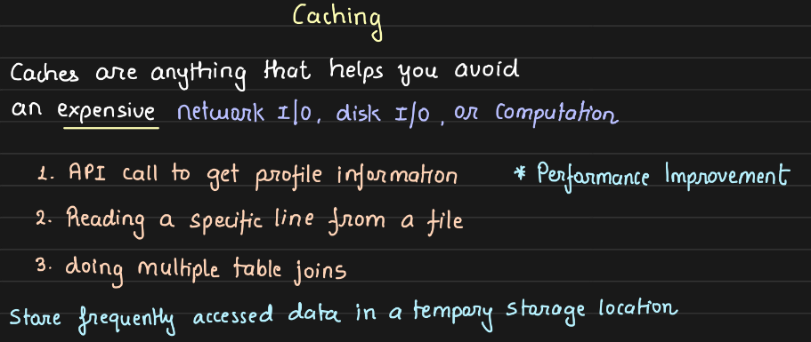

Store frequently accessed data in a place that is faster.

Caches = temporary storage place where we store data

caching = process

redis = most famous cache

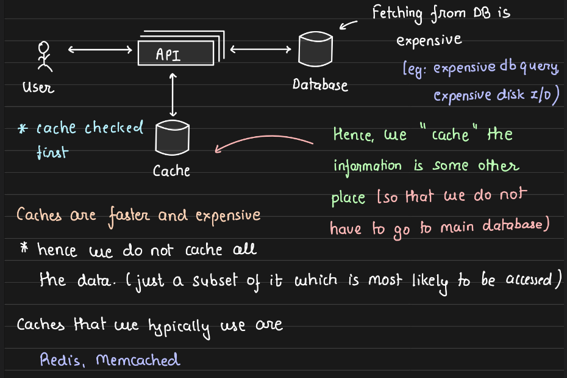

If user makes a request, it checks in cache, if present return data directly and fastly. Else if data is not present, then fire an expensive query to DB, store response in cache, and return the response to user. If cache is down, then expensive query made to DB which was anyways done before.

Cache  (like RAM) is faster than database, so expensive. It reduces load on database, save expensive joins in db  tables.

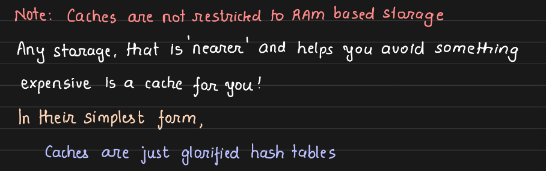

Cache typically has key: value based access pattern.  If key exist in cache, return the reposne directly. Else go to db, search for response and store it with key in the cache and return the response.

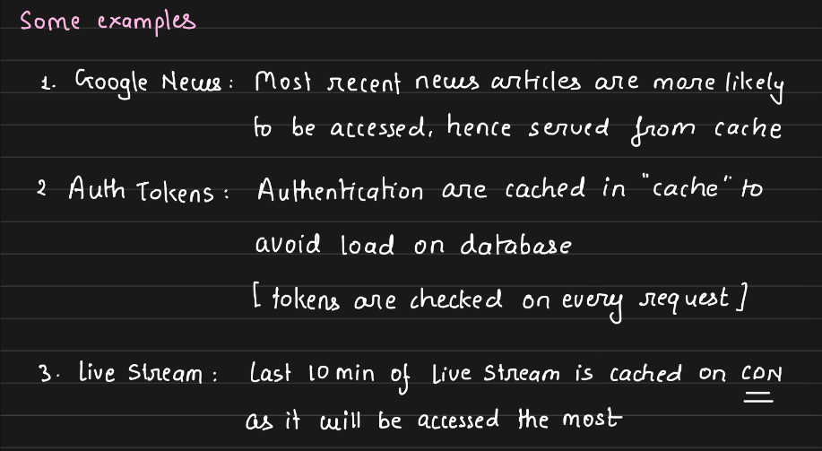

Optimizing for most common behaviour.

- Populating & Scaling Caches: https://drive.google.com/file/d/15YNYOGqI4GxXqAeonVWQ6sQlkks8aM7g/view

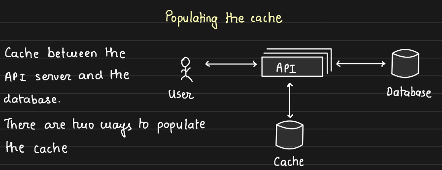

User  search, cache miss, goes to db, then response populates the cache. Every key in cache has an expiry after which the key gets deleted to reduce the memory footprint of the cache

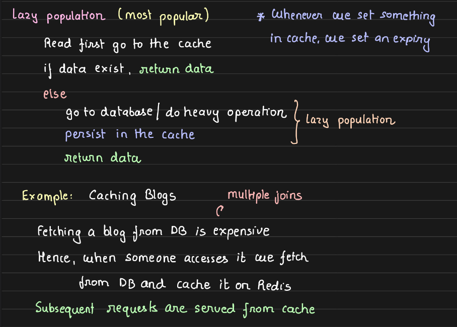

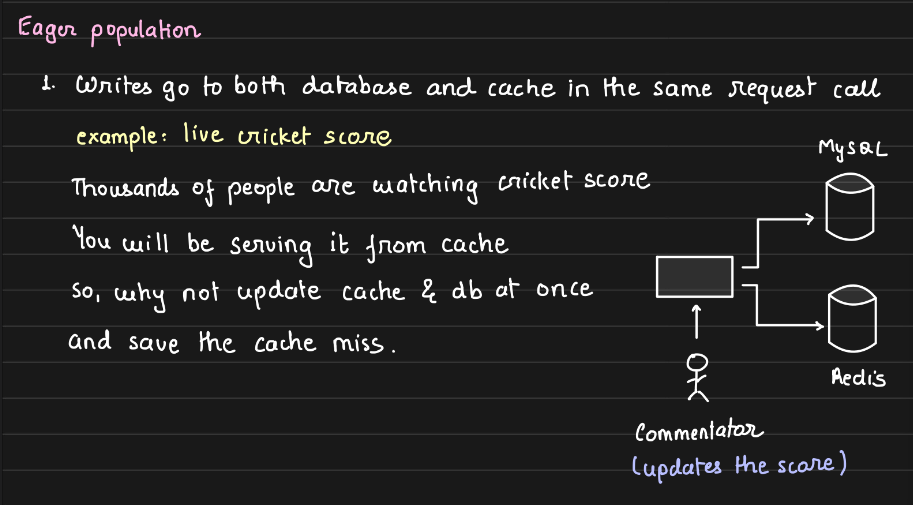

this is happening synchronously

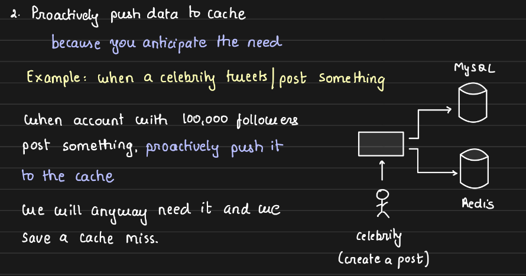

this is asynchronous way of doing it

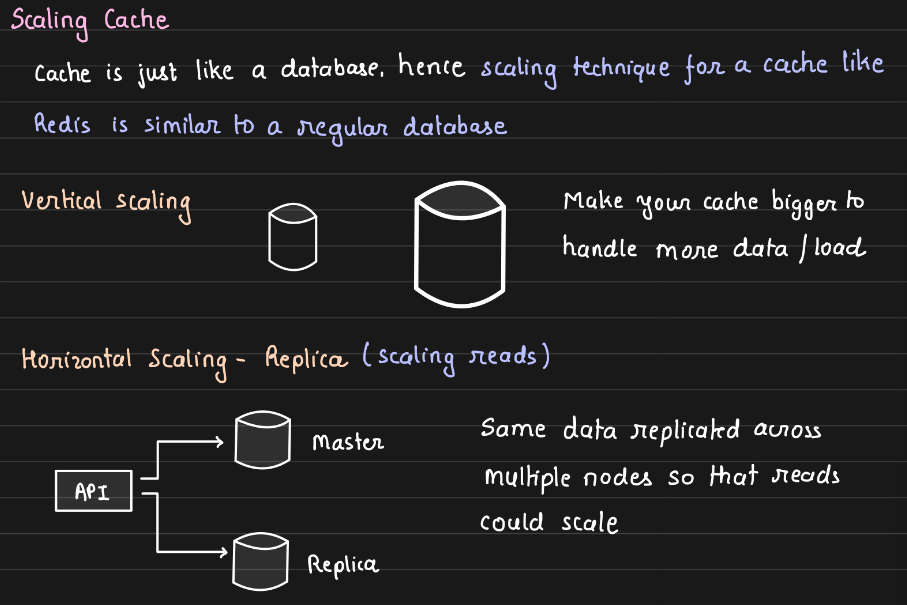

DISTRIBUTED CACHES:

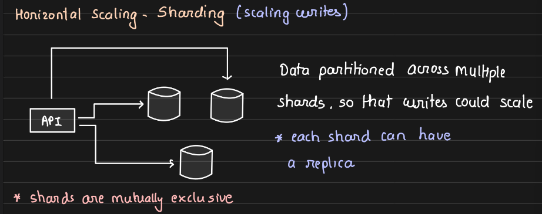

- Caching at different levels of architecture: https://drive.google.com/file/d/1nsDQUdMHyZCb94_ja5GwNjLDqGNGOkdK/view

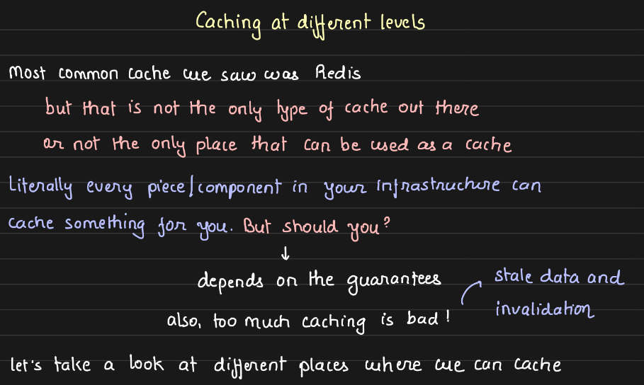

Disadvantages of scaling: Staleness (unless key is expired serving the stale data) and invalidation

If needed to see most consistent and recent data, can't use cache. Invalidation -  if we want to proactively update the cache the we are invalidating the key before expiry or deleting it.

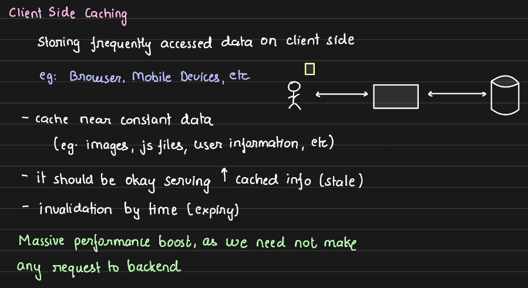

This gives inconsistency when accessing same content from different devices say amazon prime from web and mobile. But storing on client side gives massive performance boost since we're directly serving from client device.  Works for nearly static data.

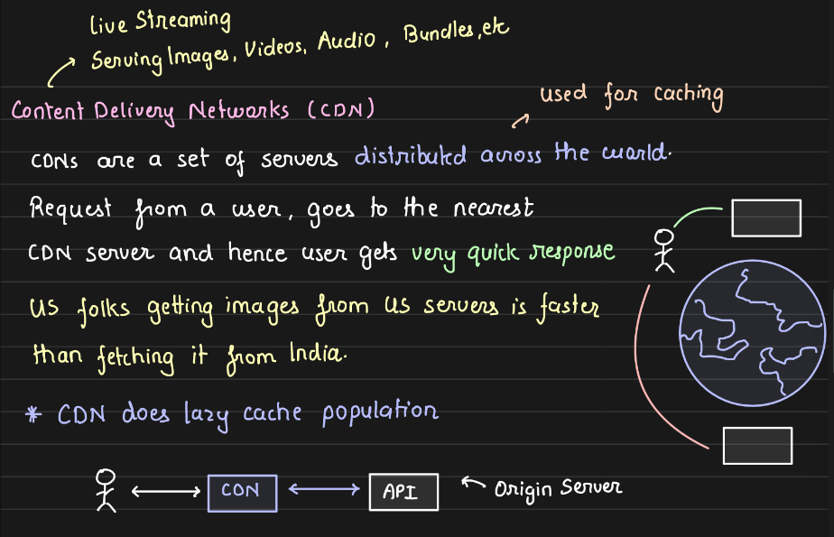

Served from nearest (geographically) server. If CDN has  data, it serves it. If CDN  doesn't have data, it requests origin server, then the origin server sends data, it caches it, and serves it. CDN makes cache miss call to the origin server.  CDN minimizes latency by a lot.

CDN is a geographically distributed cache, which is lazily populated in general.

CDN: Cloudflare

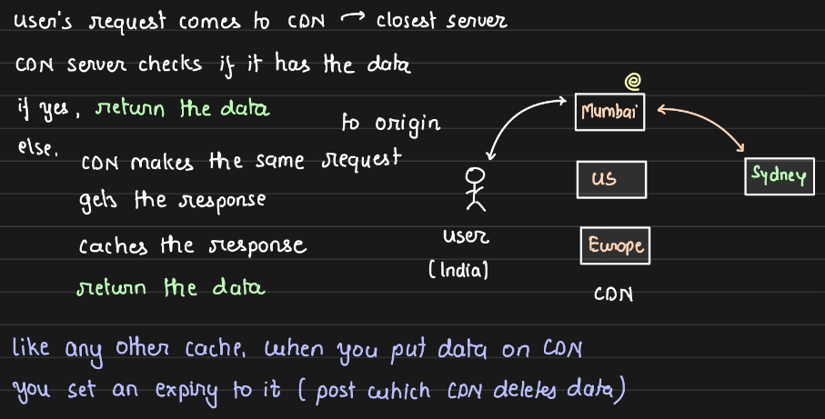

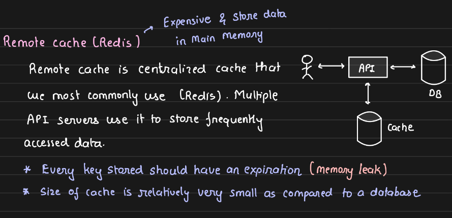

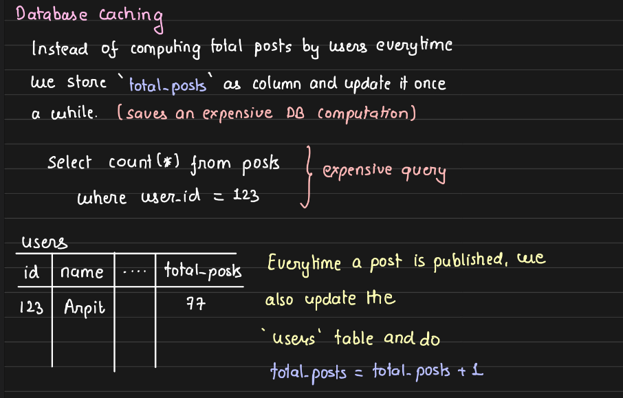

EAGER population above

Every single component in the system can have some cached data. We can, but doesn't mean we should. Every cache adds some staleness and invalidation, with it.  Over-caching is an anti-practise due to massive staleness and massive invalidation.

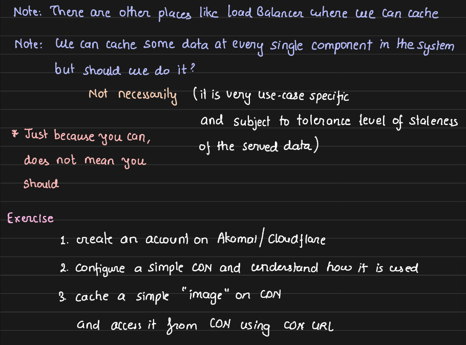

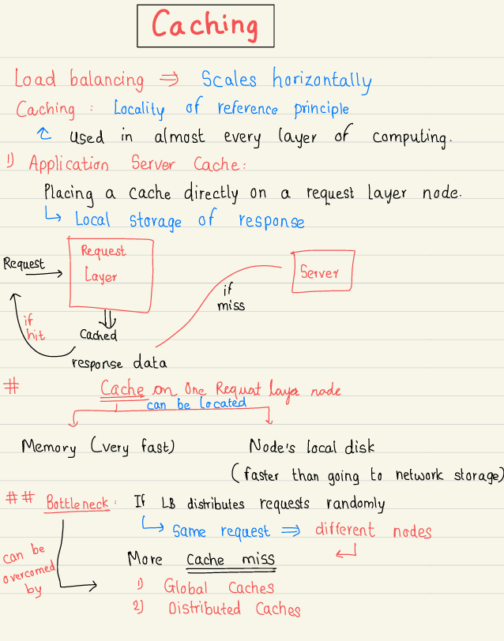

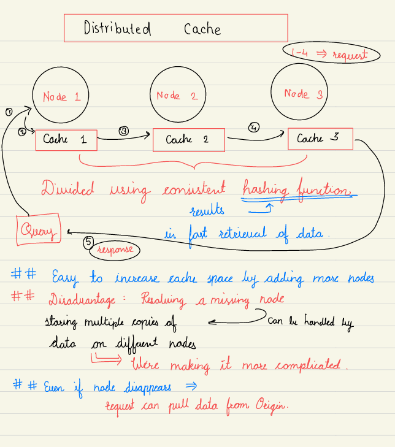

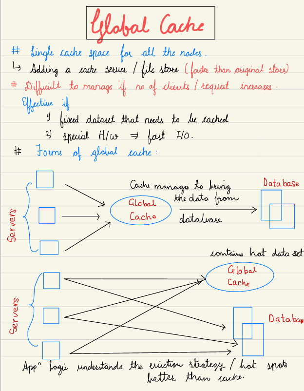
