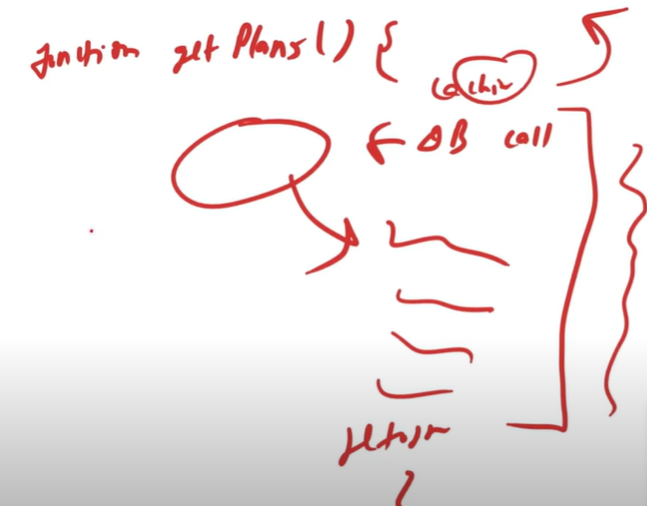

# 5.2 Basics

  - Caching works on locality of reference principle: recently requested data is likely to be requested again.

  - It's like short-term memory which has limited space but is faster & contains most recently accessed items.

  - **Where it can be added?** Cache can be used in almost every layer: hardware, OS, Web browsers, web application, but are often found nearest to the front end.

Types of cache:

  1. Application Server Cache

    1. Placing a cache on request layer node enables the local storage of response data.

    1. When a request is made, node will quickly return the cached data, if exists. If not it'll query from disk.

    1. But when you've many nodes with load balancer, it randomly distribute across the nodes, the same request will go to different nodes, thus increasing cache misses.

    1. Two choices are to overcome this: global cache & distribute cache.

  1. Distribute Cache:

    1. In it, each of its nodes own part of cached data.

    1. The cache is divided up using a consistent hashing function, such that if a request node is looking for a certain piece of data, it can quickly know where to look within distributed cache to check if data is available.

    1. Easily we can increase the cache space just by adding nodes to the request pool

  1. Global Cache:

    1. In this, all nodes use the same single cache space. Each of the request nodes queries the cache in the same way it would a local one.

    1. There can two type of global cache:

      1. First, when a cached response not found in cache, cache itself becomes responsible for retrieving the missing piece of data.

      1. Second, it's the responsibility of request nodes to retrieve any data that is not found. It can be used when low cache hit % would cause the cache buffer with cache misses. In this situation, it helps to have a large % of data set in cache.

  1. CDN

    1. It's Content Distribution Network for serving large amount of static media which is common to all.

    1. First request ask the CDN for data, if not CDN will query the back-end servers & then cache it locally

    1. If your system is not that big for CDN, you can serve static media from a separate subdomain using a lightweight HTTP server like Nginx

Cache Invalidation

  - When data is modified in DB, it should be invalidated in the cache.

  - Types:

    - write-through cache: - Data is written into the cache & the DB at the same time. - This allow cached to be fast - Data consistency also there between cache & DB, which make sure nothing get lost in case of power failure - This minimizes the risk of data loss, but has disadvantage of higher latency for write operations.

    - write-around cache: - Data is written directly to storage, bypassing the cache. - This reduces flooded write operations but has disadvantage that a read request for recently written data will create a cache miss & must be read from slower back-end.

    - write-back cache: - Data is written to cache alone & completion is immediately confirm to client & write to permanent storage is done after specified intervals. - This results in low latency & high throughput, however this speed comes with the risk of data loss in case of crash.

Cache eviction policy

- FIFO

- LIFO

- LRU (Least Recently Used - best): Implement using Doubly Linked list & a hash function containing the reference of node in list

- Most Recently Used

- Least frequently Used

- Random Replacement

[Caching \| Cache Patterns \| Cache Invalidation & Eviction \| System Design Tutorials \| Part 9 \| 2020 ](<https://www.youtube.com/watch?v=Ez1GK2imrsY&list=PLTCrU9sGyburBw9wNOHebv9SjlE4Elv5a&index=9&pp=iAQB>)
