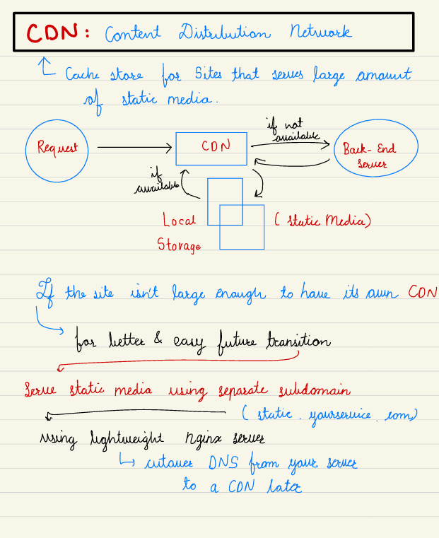

# 5.3 Distributed Caching

[Google SWE teaches systems design | EP25: Distributed Caching Primer ](<https://www.youtube.com/watch?v=JIAAlb3AtjA&list=PLjTveVh7FakKjb4UYzUazqBNNF-WGurXp&index=25&pp=iAQB>)

[What are Distributed CACHES and how do they manage DATA CONSISTENCY? ](<https://www.youtube.com/watch?v=U3RkDLtS7uY&list=PLMCXHnjXnTnvo6alSjVkgxV-VH6EPyvoX&index=11&pp=iAQB>)

[Introduction to Distributed Caching - Systems Design Interview 0 to 1 with Ex-Google SWE](<https://www.youtube.com/watch?v=crPoHnhkjFE&list=PLjTveVh7FakLdTmm42TMxbN8PvVn5g4KJ&index=51&pp=iAQB>)

[Distributed Cache Writes: What You Have To Know | Systems Design Interview 0 to 1 With Ex-Google SWE](<https://www.youtube.com/watch?v=ULgXBImWVWQ&list=PLjTveVh7FakLdTmm42TMxbN8PvVn5g4KJ&index=52&pp=iAQB>)

[System Design Interview - Distributed Cache](<https://www.youtube.com/watch?v=iuqZvajTOyA>)

[Cache Evictions: Don't Mess Them Up | Systems Design Interview 0 to 1 with Ex-Google SWE](<https://www.youtube.com/watch?v=4wEQ9_tkqvE&list=PLjTveVh7FakLdTmm42TMxbN8PvVn5g4KJ&index=53&pp=iAQB>)

[Redis vs. Memcached - Who Wins? | Systems Design Interview 0 to 1 With Ex-Google SWE](<https://www.youtube.com/watch?v=Gyy1SiE8avE&list=PLjTveVh7FakLdTmm42TMxbN8PvVn5g4KJ&index=54&pp=iAQB>)

[Distributed Caching for System Design Interviews](<https://www.youtube.com/watch?v=Gdfj-544AkA&pp=ygUXY2Fzc2FuZHJhIHN5c3RlbSBkZXNpZ24%3D>)

