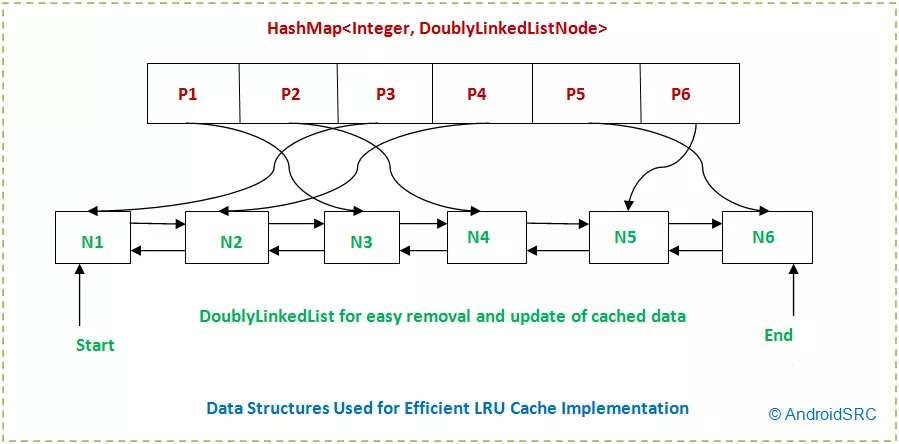

# 5.6 LRU Cache

- LRU is Cache Eviction policy used in Caches, according to which Least Recently Used item should get evicted in case cache is full.

- LRU Cache is implemented using doubly linked list (to store list of pages with most recently used pages at the start of list) and hash map. So, as more pages are added to the list, least recently used pages are moved to the end of the list with page at tail being the least recently used page in the list.

