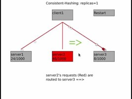

# 6.1 Hashing

[Hashing - System Design | How Hashing Works](<https://www.youtube.com/watch?v=tQM-dhWMrgI&list=PLt4nG7RVVk1g_LutiJ8_LvE914rIE5z4u&index=10&pp=iAQB>)

[A simple introduction to basics of hashing & need for Consistent Hashing|System Design Primer Course ](<https://www.youtube.com/watch?v=cITtFpz3a3Y&list=PLTCrU9sGyburBw9wNOHebv9SjlE4Elv5a&index=25&pp=iAQB>)

[Hashing - System Design | How Hashing Works](<https://www.youtube.com/watch?v=tQM-dhWMrgI&list=PLt4nG7RVVk1g_LutiJ8_LvE914rIE5z4u&index=10&pp=iAQB>)

From < https://www.youtube.com/watch?v=cITtFpz3a3Y&list=PLTCrU9sGyburBw9wNOHebv9SjlE4Elv5a&index=25&pp=iAQB>

[Hashing Simplified | System Design Interview Basics](<https://www.youtube.com/watch?v=pU1uifHXhE4&pp=ygUWaGFzaGluZyBzeXN0ZW1zIGRlc2lnbg%3D%3D>)

Modular Hashing

[System design: Mod-hashing vs Consistent-hashing](<https://www.youtube.com/watch?v=2F88x0qiqlU&pp=ygUWaGFzaGluZyBzeXN0ZW1zIGRlc2lnbg%3D%3D>)

[System design: Modular hashing](<https://www.youtube.com/watch?v=80XzRsMcxdw&pp=ygUWaGFzaGluZyBzeXN0ZW1zIGRlc2lnbg%3D%3D>)
