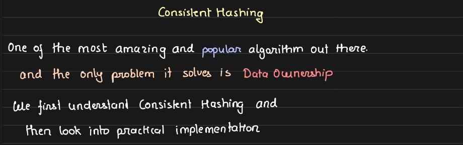
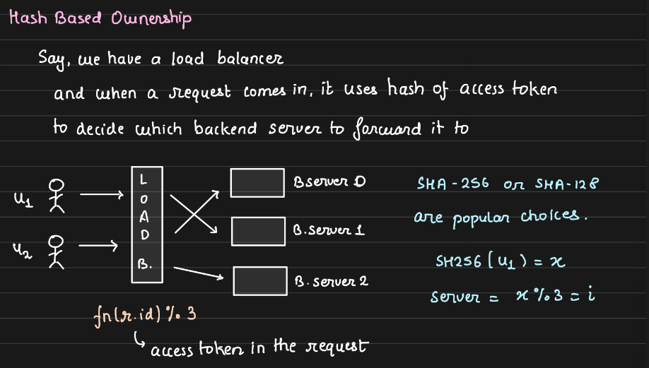
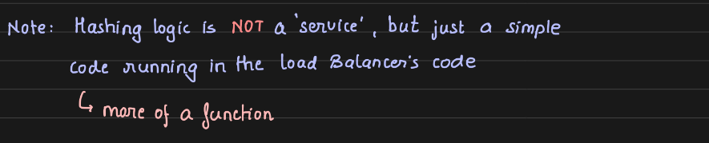
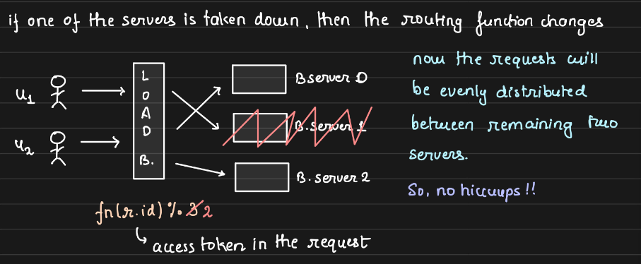
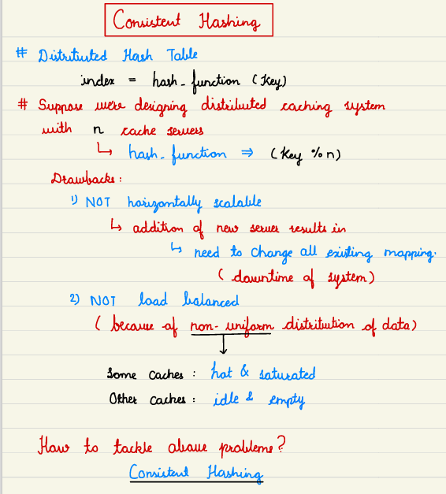
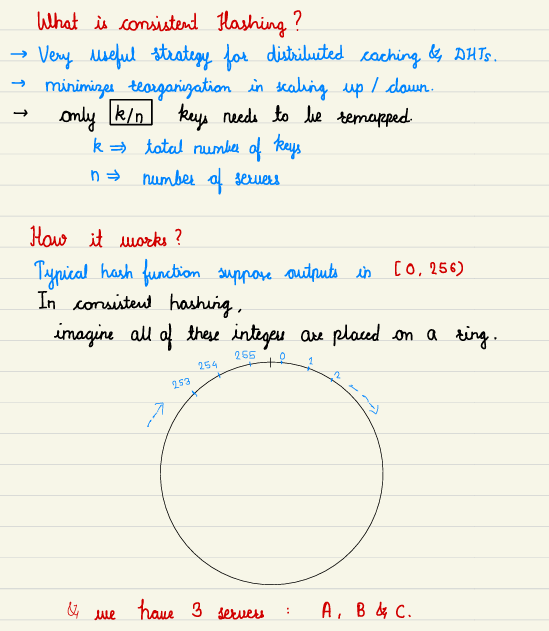
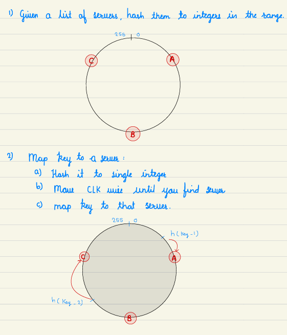
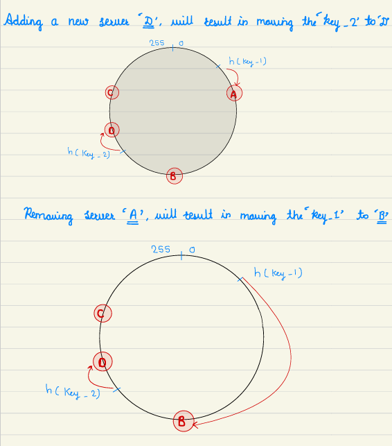
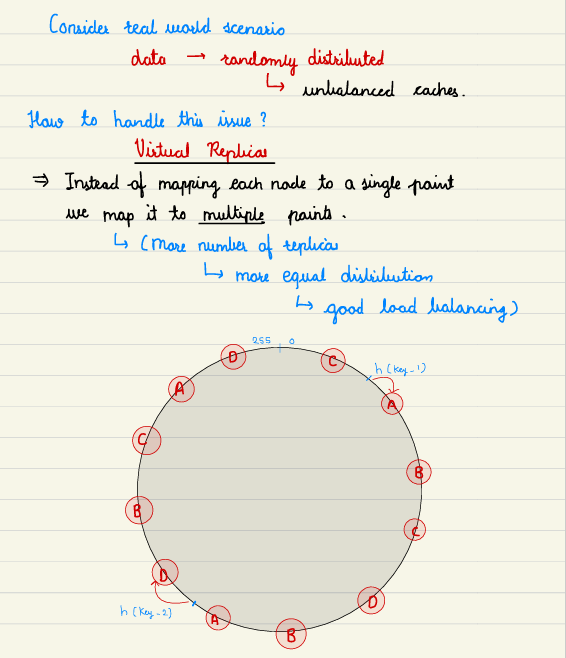

# 6.2 Consistent Hashing \*

[Learn Consistent Hashing in Under 1 Hour | Complete Tutorial](<https://www.youtube.com/watch?v=ydu3UlFzf6w>)

[Consistent Hashing: Easy Explanation](<https://www.youtube.com/watch?v=vccwdhfqIrI>)

[Consistent Hashing | Algorithms You Should Know #1](<https://www.youtube.com/watch?v=UF9Iqmg94tk&pp=ygUWaGFzaGluZyBzeXN0ZW1zIGRlc2lnbg%3D%3D>)

[What is CONSISTENT HASHING and Where is it used?](<https://www.youtube.com/watch?v=zaRkONvyGr8&pp=ygUWaGFzaGluZyBzeXN0ZW1zIGRlc2lnbg%3D%3D>)

[Google SWE teaches systems design | EP17: Consistent Hashing ](<https://www.youtube.com/watch?v=kiCbLOPmBh4&list=PLjTveVh7FakKjb4UYzUazqBNNF-WGurXp&index=17&pp=iAQB>)

[Consistent Hashing - A Common Mistake in Choosing Partitioning Keys](<https://www.youtube.com/watch?v=sLbOz2QBZgc>)

[Hashing & Consistent Hashing | Explanation with real life examples | System Design Fundamentals](<https://www.youtube.com/watch?v=hzDzgAv4PfY>)

From < https://www.youtube.com/watch?v=kiCbLOPmBh4&list=PLjTveVh7FakKjb4UYzUazqBNNF-WGurXp&index=17&pp=iAQB>

[6. Consistent Hashing in Hindi with Example | System Design - Consistent Hashing | High Level design](<https://www.youtube.com/watch?v=jqUNbqfsnuw&list=PL6W8uoQQ2c63W58rpNFDwdrBnq5G3EfT7&index=10&pp=iAQB>)

[System Design - Part 17 | Consistent Hashing | Concepts, ideas and tackling problems](<https://www.youtube.com/watch?v=9KEp9aDKI7U&list=PLFdAYMIVJQHOWJgRrjv_RH-ng95B2h3ON&index=17&pp=iAQB>)

[Consistent Hashing - Rebalancing Partitions | Systems Design Interview 0 to 1 with Ex-Google SWE](<https://www.youtube.com/watch?v=z-xxLoJAfmY&list=PLjTveVh7FakLdTmm42TMxbN8PvVn5g4KJ&index=27&pp=iAQB0gcJCU0KAYcqIYzv>)

[Consistent Hashing - System Design](<https://www.youtube.com/watch?v=IC5Y1EE-aj4&list=PLmbHVmxVu9jLcmbvLBIUEz3CtX3CMz8cM&index=8&pp=iAQB>)

[Consistent Hashing - System Design Interview](<https://www.youtube.com/watch?v=4kd40gEKaLM&pp=ygUWaGFzaGluZyBzeXN0ZW1zIGRlc2lnbg%3D%3D>)

[Basics of consistent hashing in plain english | System Design fundamentals ](<https://www.youtube.com/watch?v=oKAU6LaYFhw&list=PLTCrU9sGyburBw9wNOHebv9SjlE4Elv5a&index=26&pp=iAQB>)

From < https://www.youtube.com/watch?v=oKAU6LaYFhw&list=PLTCrU9sGyburBw9wNOHebv9SjlE4Elv5a&index=26&pp=iAQB>

[Consistent Hashing - System Design](<https://www.youtube.com/watch?v=IC5Y1EE-aj4&list=PLmbHVmxVu9jLcmbvLBIUEz3CtX3CMz8cM&index=8&pp=iAQB>)

[What is CONSISTENT HASHING and Where is it used? ](<https://www.youtube.com/watch?v=zaRkONvyGr8&list=PLMCXHnjXnTnvo6alSjVkgxV-VH6EPyvoX&index=4&pp=iAQB>)

From < https://www.youtube.com/watch?v=zaRkONvyGr8&list=PLMCXHnjXnTnvo6alSjVkgxV-VH6EPyvoX&index=4&pp=iAQB>

[#23 Consistent Hashing | System Design Crash Course](<https://www.youtube.com/watch?v=7kQJtir6PDM&pp=ygUWaGFzaGluZyBzeXN0ZW1zIGRlc2lnbg%3D%3D>)

[PT2 :  Hash Ring and  Virtual Nodes | Design Consistent Hashing | System Design](<https://www.youtube.com/watch?v=PWKYvhgL0_c&pp=ygUWaGFzaGluZyBzeXN0ZW1zIGRlc2lnbg%3D%3D>)

[PT1 :  The Rehashing Problem | Design Consistent Hashing | System Design](<https://www.youtube.com/watch?v=wmT_iCmr0VE&pp=ygUWaGFzaGluZyBzeXN0ZW1zIGRlc2lnbg%3D%3D>)

[Consistent Hashing | System Design Roadmap](<https://www.youtube.com/watch?v=3MDxIeQ4yEI>)

[System Design: How to store passwords in the database?](<https://www.youtube.com/watch?v=zt8Cocdy15c&pp=ygUWaGFzaGluZyBzeXN0ZW1zIGRlc2lnbg%3D%3D>)

[Consistent Hashing Explained | System Design with Microsoft SWE](<https://www.youtube.com/watch?v=glShRZhRszA&pp=ygUWaGFzaGluZyBzeXN0ZW1zIGRlc2lnbg%3D%3D>)

[System Design: (P -5): - Consistent Hashing Explained | Scalable and Fault-Tolerant System Design](<https://www.youtube.com/watch?v=l0jc0D_XO1E&pp=ygUWaGFzaGluZyBzeXN0ZW1zIGRlc2lnbg%3D%3D>)

[Consistent Hashing - Hash space & Ring, Adding and Removing Servers, Virtual Nodes | System Design](<https://www.youtube.com/watch?v=5JLE1ClfHUY&pp=ygUWaGFzaGluZyBzeXN0ZW1zIGRlc2lnbg%3D%3D>)

[Consistent Hashing Explained | System Design Concepts | What is Consistent Hashing #systemdesign](<https://www.youtube.com/watch?v=7pYUU7zlEyE&pp=ygUWaGFzaGluZyBzeXN0ZW1zIGRlc2lnbg%3D%3D>)

B: Consistent Hashing

07 July 2024

14:39

