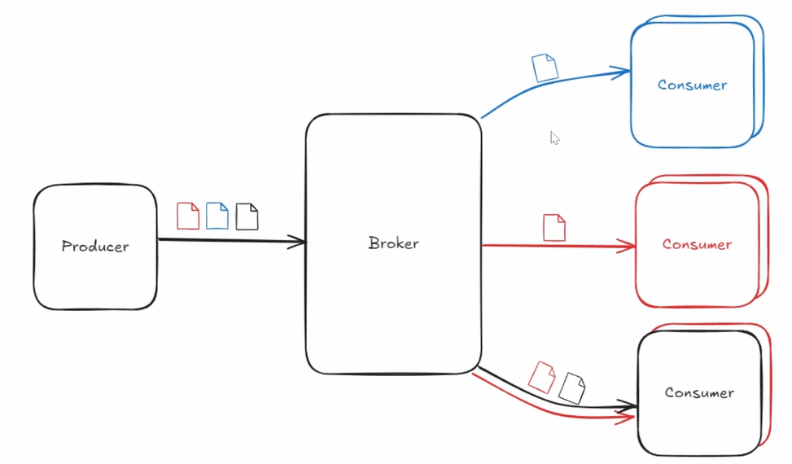
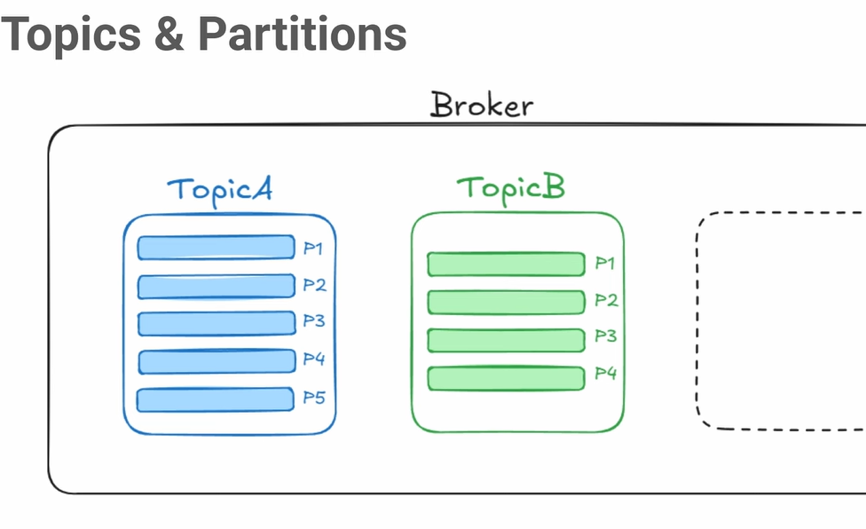
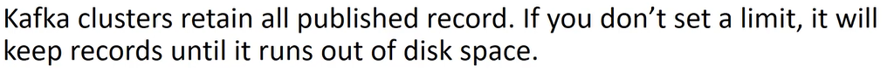
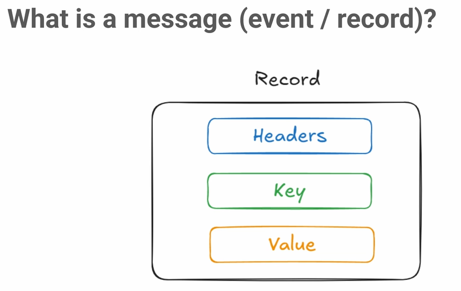
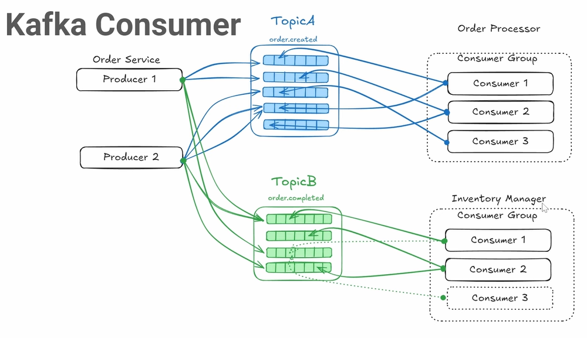
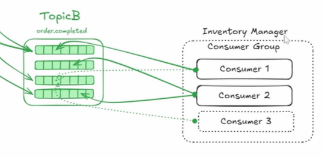
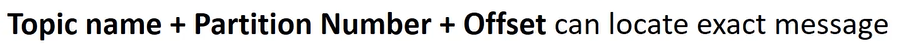
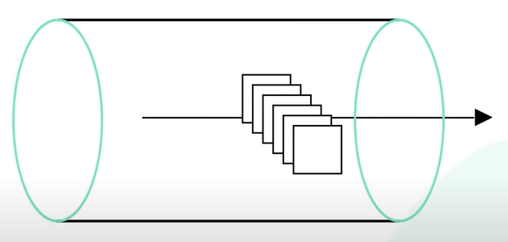
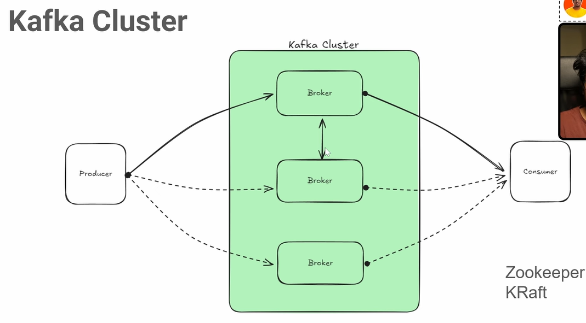
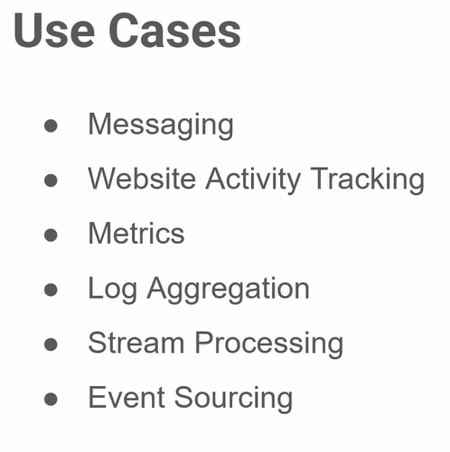

# 7.10 Kafka

**1. Introduction to Kafka**

  - Kafka is a **distributed event store** and **real-time streaming platform**. Scalable message storage.

  - Developed by **LinkedIn** to track user activity and analytics.

  - Works as a **message broker**, facilitating communication between **producers** and **consumers**.

**2. Event Store Concept**

  - Any change in data is considered an **event** (e.g., user login, order placement).

  - Events are captured and sent to Kafka.

  - Kafka enables microservices to consume and process these events efficiently.

  - Brokers = Servers

Example:

  - User places an order → Event sent to Kafka.

  - Email service consumes the event → Sends order confirmation email.

**3. Kafka Architecture**

**3.1 Producers and Consumers**

  - **Producers** send messages to **Kafka brokers**. Producers send messages to specific topics in the Kafka broker, which can be consumed by designated consumer groups.

  - A "topic" is a logical category or channel where messages are published and consumed, acting like a categorized stream of data, while individual "messages" are the actual data units sent to and stored within a specific topic; essentially, a topic is the container for multiple related messages, allowing different applications to subscribe and receive data based on their interest in that topic category.

  - **Consumers** read messages from brokers via **topics**.

  - Consumers belong to **consumer groups**, allowing load balancing.

**3.2 Topics and Partitions**

Kafka topics utilize partitions for efficient message **load balancing** and for efficient message processing and ordering.

**3.3 Retention & Persistence**

  - Messages are **not deleted** after consumption.

  - Kafka retains messages for **7 days by default** (configurable).

  - Ensures event replayability and fault tolerance.

**4. Kafka Messages**

A Kafka **message (record/event)** consists of:

  1. **Headers** – Metadata (e.g., topic name).

  1. **Key** (optional) – Helps distribute messages across partitions.

  1. **Value** – Actual event data.

**5. Kafka Producers**

  - **Producers send messages** to topics, determining the partition using:

    - **Key-based partitioning** (e.g., user ID ensures all orders of a user go to the same partition).

    - **Round-robin partitioning** (if no key is provided).

Example:

  - Producer sends an "order_created" event.

  - Kafka determines partition based on user ID.

**6. Kafka Consumers & Consumer Groups**

**6.1 Consumer Basics**

  - Consumers **pull** messages from topics (not pushed).

  - Consumer **reads messages sequentially** from assigned partitions.

**6.2 Consumer Groups**

  - **Consumer Group**: A group of consumers that cooperatively consume messages from a Kafka topic.

  - Multiple consumers can **cooperate** to read from a topic.

  - The number of consumers in a group should not exceed the number of partitions. A consumer group can only have as many consumers as there are partitions, preventing overlapping consumption of the same partition.

  - Each partition is **assigned to only one consumer** within a group. One consumer can consume for multiple partitions but one partition can serve only one consumer.  **Each event can only be processes by one consumer in the consumer group.  **

Example:

  - 5 partitions & 3 consumers → Some consumers get more than one partition.

  - If a consumer fails, Kafka **rebalances** partitions to active consumers.

**6.3 Message Offset & Ordering**

  - Each message has an **offset** (unique ID within a partition). The boxes inside of partition. Offset is unique identifier of a message within a partition.

  - Each message within a partition has an **offset**, which tracks the position of the consumer within the partition.

  - Consumers **commit offsets** after processing messages. A consumer processes messages sequentially and commits (increasing offset) the offset to track progress.

  - Kafka ensures **ordering within a partition** but not across partitions.

Earlier when consumer 3 is not there then, two partitions allocated to both consumer 1 and 2. When Consumer 3 comes and start consuming then either of the two partititions is de-assigned and assigned to consumer 3.

A single partition can only be consumed by one consumer within the same group but can be accessed by consumers from different groups.

**7. Key Kafka Features**

✔ **Scalability** – Multiple partitions enable parallel processing.

✔ **Fault Tolerance** – Message retention & consumer rebalancing.

✔ **Message Ordering** – Guaranteed within a partition. Order Persistence - key feature.

✔ **High Throughput** – Handles millions of messages per second. Kafka is optimized for high throughput.

**8. ****Kafka Cluster**

  - A Kafka **cluster** is a collection of **Brokers** that coordinate data storage, injection, and processing.

  - Cluster has many servers.

  - Each broker manages specific partitions of topics and communicates with other brokers in the cluster.

Kafka serves as a powerful messaging and data processing system.

- Kafka replaces traditional message brokers by enabling asynchronous communication and decoupling components in microservices architecture.

- It provides use cases including website activity tracking, metrics aggregation, log aggregation, stream processing, and event sourcing.

[System Design - Part 18 | Kafka | Distributed Messaging Architecture | Queues and Streams](<https://www.youtube.com/watch?v=fB0PAVkhn6I&list=PLFdAYMIVJQHOWJgRrjv_RH-ng95B2h3ON&index=18&pp=iAQB>)

APACHE RUN KARKE DIKHA RHA H:

[Kafka fundamentals every developer must know part 2](<https://youtu.be/050j_4FDWBc?si=FtmX3jbAkhTF5_cu>)

[Kafka fundamentals | Brokers](<https://youtu.be/d7Mj1BuNpQE?si=qvqXrjqVXlv5t3zQ>)

[Kafka Explained in 4 minutes](<https://www.youtube.com/watch?v=u3hGU2wTEhM>)
