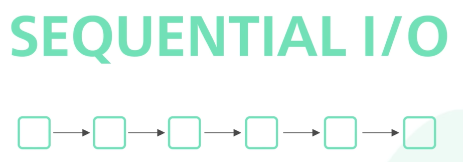
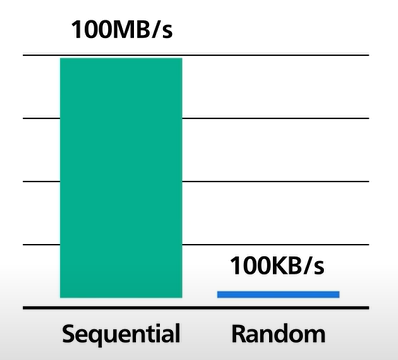
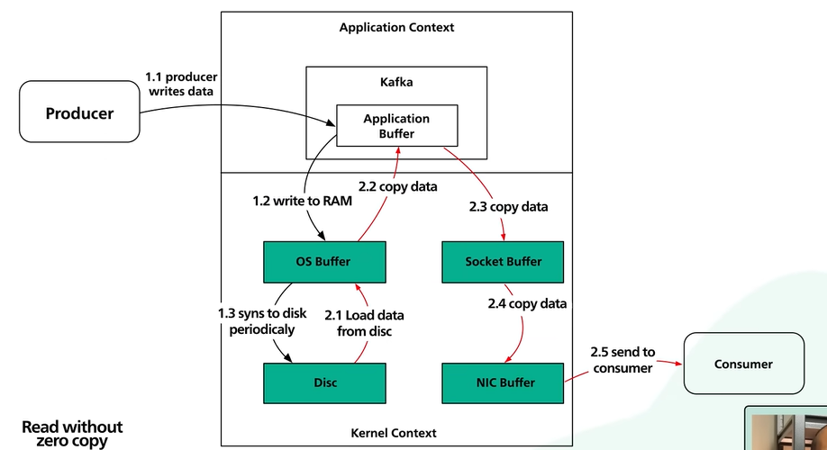
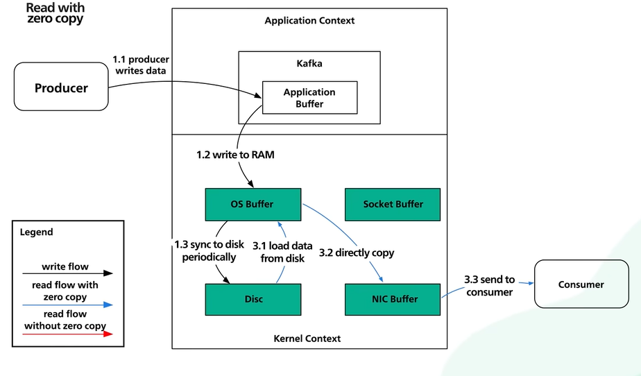

# 7.10.1 Why is Kafka fast?

## **Kafka Efficiency Design Decisions**

Sequential Access

- Disk access patterns significantly influence data retrieval speed; sequential access is much faster than random access.

- Random access involves physical movement of disk arms, leading to delays, while sequential access allows for reading and writing data consecutively.

- **Kafka employs an append-only log structure, favoring sequential I/O, which enhances performance.**

**Cost Efficiency of Storage**

- Using hard disks for sequential writes achieves hundreds of megabytes per second, while random writes are limited to kilobytes per second, showcasing the speed advantage.

- Hard disks are more cost-effective compared to SSDs, offering three times the capacity at one-third the price.

- This allows Kafka to retain messages for extended periods without sacrificing performance, a feature not common in previous messaging systems.

**Efficiency Through Zero Copy Mechanism**

- **Data Transfer Optimization**

- Kafka focuses on reducing the number of data copies during transfers, crucial for efficient network-to-disk and disk-to-network operations.

- Without zero copy, data undergoes multiple copies and system calls, leading to inefficiencies in data transmission.

- The zero copy principle involves using a system call (sendfile()) to directly transfer data from the OS cache to the network interface card, minimizing unnecessary copying.

**Direct Memory Access (DMA)**

- With modern network cards, DMA allows data transfer to occur without CPU involvement, further enhancing efficiency.

- This single-copy approach significantly reduces latency and processing overhead during data transmission.

- The combination of sequential I/O and zero copy mechanism forms the foundation of Kafka's high-performance capabilities.
