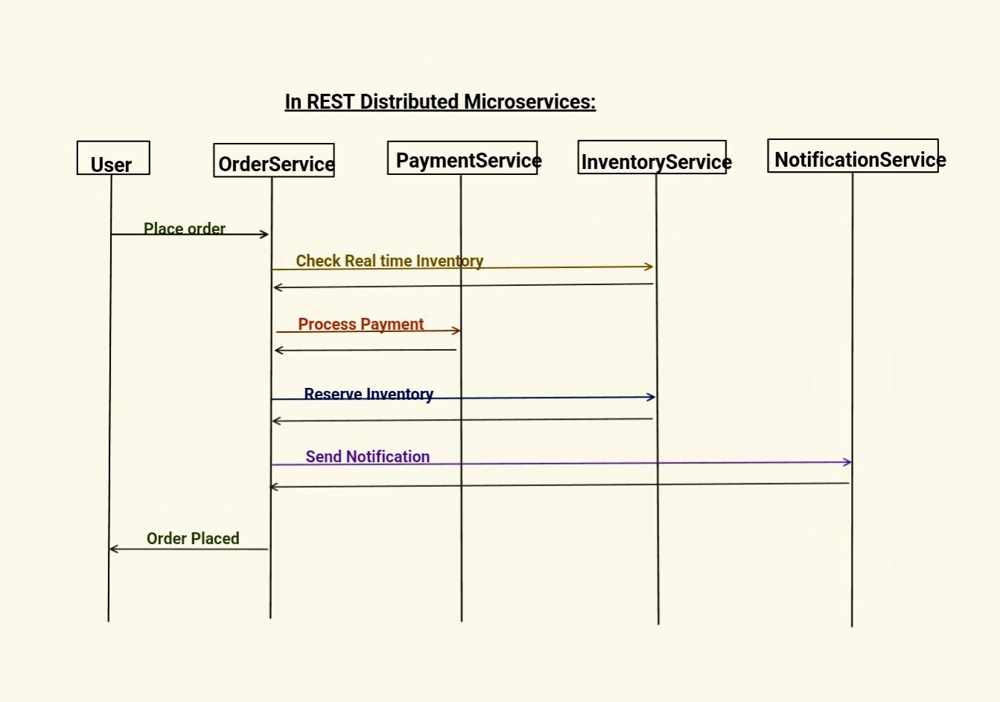
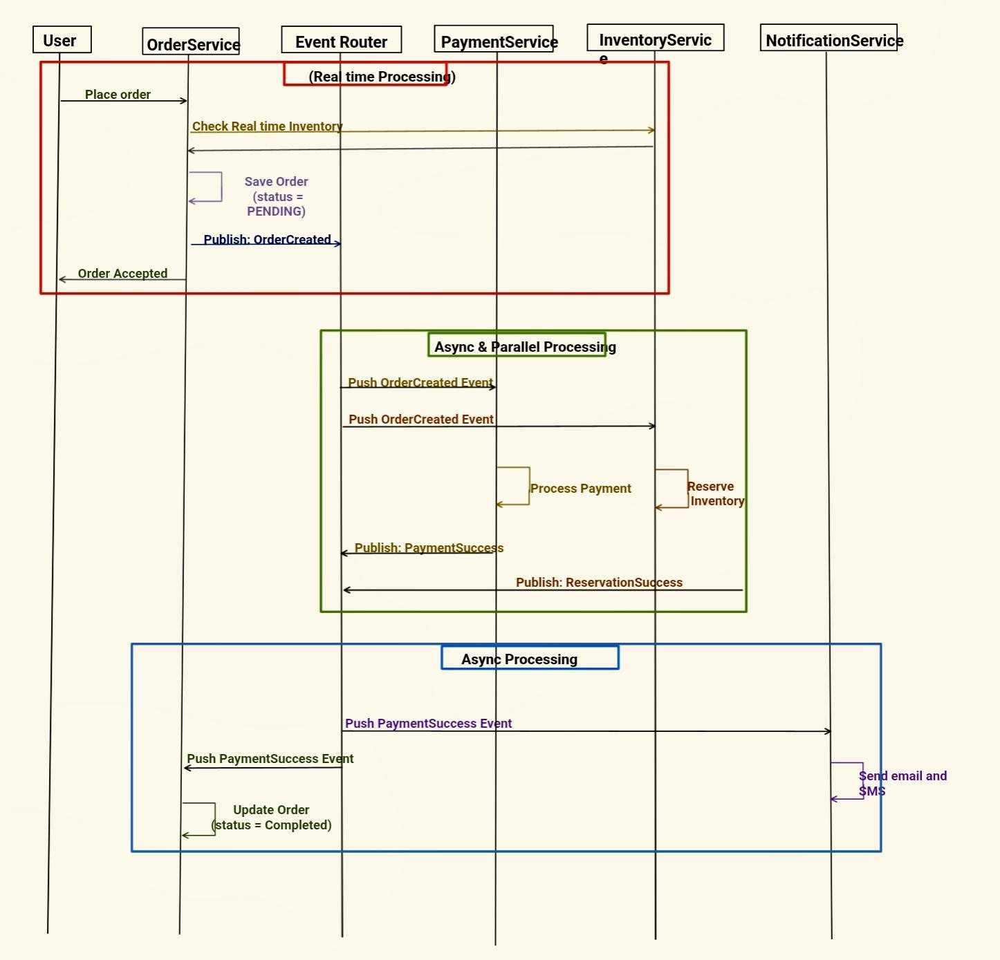

# 7.2 Introduction

Consider EDA as a system design style where:

  - Services do not call each other directly

  - Services emit events and other services react to those events

Event:

  - A fact that something happened in the past

  - It is different from "command" which aims to make something happen or "query" which fetches something

  - Properties:

| Property | Description | Example |
| --- | --- | --- |
| Immutable | Can not be changed once created | OrderCreated at 10:30PM |
| Past Tense | Describes what happened, not what to do | OrderCreated, Not Place Order |
| Self-Contained | Has all info needed to understand it | Contains orderId, amount, timestamp |

Example:

Synchronous Chain - REST Distributed Microservice:

  - Long Running Flow - REST Distributed face various challenges, use EDA for this.

Problems with synchronous Chain:

  1. Availability: All downstream services must be available at the same time. Any service down, request will fail.

  1. Latency accumulation: total latency = sum of all service latency

  1. Cascading Failures: One slow service can bring down other services and entire flow

  1. Tight Coupling: OrderService knows about Payment, Inventory and Notification Service and their endpoints, how to invoke, and their response structure.

  1. Scaling Issue: We cannot scale one service independently based on load.

Above Example using EDA flow:

