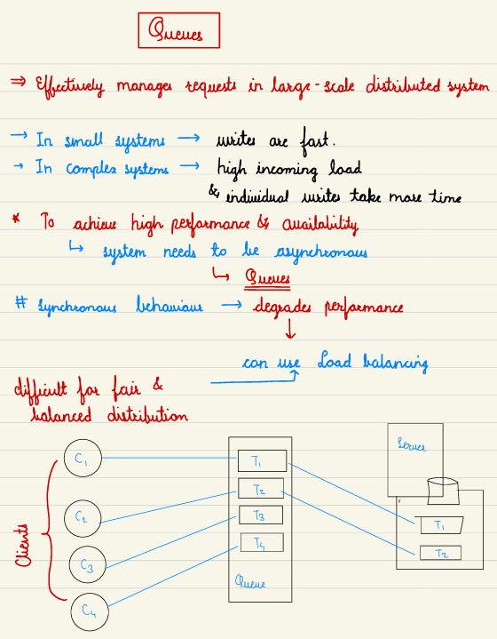
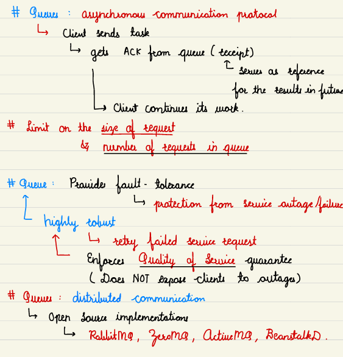

# 7.3 MQ

[System Design - Messaging Queue | Message Queue | Kafka](<https://www.youtube.com/watch?v=j9HxM4H9AfA&list=PLt4nG7RVVk1g_LutiJ8_LvE914rIE5z4u&index=6&pp=iAQB>)

[Message Queues | Producer Consumer Model | System Design Tutorials | Part 11 | 2020 ](<https://www.youtube.com/watch?v=J6CBdSCB_fY&list=PLTCrU9sGyburBw9wNOHebv9SjlE4Elv5a&index=11&pp=iAQB>)

From < https://www.youtube.com/watch?v=J6CBdSCB_fY&list=PLTCrU9sGyburBw9wNOHebv9SjlE4Elv5a&index=11&pp=iAQB>

[What is a MESSAGE QUEUE and Where is it used? ](<https://www.youtube.com/watch?v=oUJbuFMyBDk&list=PLMCXHnjXnTnvo6alSjVkgxV-VH6EPyvoX&index=5&pp=iAQB>)

[System Design - Part 9 | Message Queue and CDN](<https://www.youtube.com/watch?v=G2xEnPugNoo&list=PLFdAYMIVJQHOWJgRrjv_RH-ng95B2h3ON&index=9&pp=iAQB>)

From < https://www.youtube.com/watch?v=oUJbuFMyBDk&list=PLMCXHnjXnTnvo6alSjVkgxV-VH6EPyvoX&index=5&pp=iAQB>

