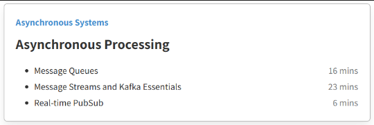

# 7.4 Asynchronous Processing

Asynchronous Processing requires us to study the following topis:

  1. Message Brokers and Queues

  1. Message Streams and (Pub/Sub) Kakfa Essentials

  1. RealTime PubSub

  1. Distributed Message Queue

**Textual Resources:**

https://www.geeksforgeeks.org/message-queues-system-design/ https://medium.com/must-know-computer-science/system-design-message-queues-245612428a22 https://medium.com/@mayankbansal933/design-messaging-queue-515e0e912d93 https://www.educative.io/blog/message-queues-system-design https://systemdesignschool.io/blog/message-queue https://medium.com/@karan99/system-design-message-queues-57758ea9f2e1 https://charlieinden.github.io/System-Design/2019-12-29_System-Design--Chapter-7--Queues-5f3f9bed81.html

**Video Resources:**

https://youtu.be/DYFocSiPOl8?si=YZpyZYKdkSPws3kG [What is a MESSAGE QUEUE and Where is it used?](<https://www.youtube.com/watch?v=oUJbuFMyBDk>) [16. System Design - Distributed Messaging Queue | Design Messaging Queue like Kafka, RabbitMQ](<https://www.youtube.com/watch?v=oVZtzZVe9Dg>)[Design a Distributed Message Queue - System Design Mock Interview](<https://www.youtube.com/watch?v=ZwwYgiT9GH0>) (Grokking question) [Kafka vs. RabbitMQ - who wins and why? | Systems Design Interview 0 to 1 with Ex-Google SWE](<https://www.youtube.com/watch?v=_5mu7lZz5X4>)

**Pub Sub Text Resources:**

https://www.geeksforgeeks.org/what-is-pub-sub/ https://medium.com/geekculture/system-design-basics-pub-sub-messaging-88dfd98e67b7 https://github.com/ashishps1/awesome-low-level-design/blob/main/problems/pub-sub-system.md https://igotanoffer.com/blogs/tech/queues-pubsub-system-design-interview https://www.karanpratapsingh.com/courses/system-design/publish-subscribe https://dev.to/superviz/design-pattern-4-publishersubscriber-pattern-4jg9

PubSub

| [Distributed Messaging Queue \| Pub Sub, P2P in System Design](<https://www.youtube.com/watch?v=tBXK49CB-BU>) |
| --- |
| [Publisher Subscriber Pattern \| Pub Sub \| System Design](<https://www.youtube.com/watch?v=algmP8MGeL4>) |
| [What is the Publisher Subscriber Model?](<https://www.youtube.com/watch?v=FMhbR_kQeHw>) |
| https://www.youtube.com/watch?v=EgJ7xts82Mg&ab_channel=sudoCODE |
| https://www.youtube.com/watch?v=-vd_Ay0pvFY&ab_channel=sudoCODE |
| https://www.youtube.com/watch?v=algmP8MGeL4&ab_channel=ByteMonk |
