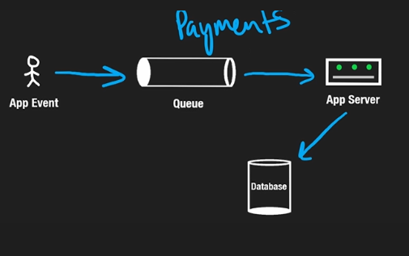
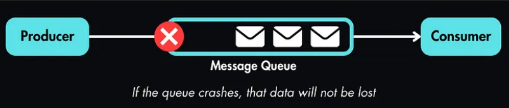
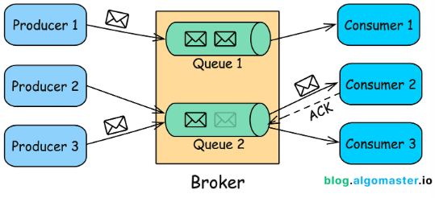
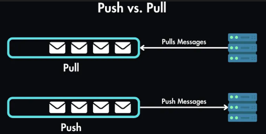
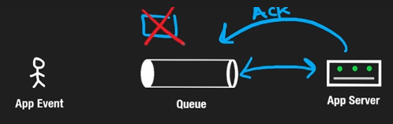

# 7.5 Message Queues

\*\*A message queue is a durable component (communication mechanism) stored in memory that supports asynchronous communication.\*\* It serves as a buffer and distributes asynchronous requests. It enables different parts of a system to send and receive messages \*\*asynchronously\*\*.

\*\*Context:\*\* Large amount of application events are going to the app server so that our server can't handle all of them at once. So, we process these events asynchronously. This will allow us to handle a larger amount of scale.

\* It acts as an \*\*intermediary\*\* that temporarily holds messages sent from \*\*producers (or publishers)\*\* and delivers them to \*\*consumers (or subscribers)\*\*.

\* Key characteristic: it allows services/components (event producer and event receiver) to communicate without needing to be aware of each other's existence, leading to a \*\*decoupled architecture\*\*.

#### \*\*Core Components of MQ:\*\*

##### \*\*1. Producer/Publisher\*\*

Input services, called producers or publishers, create and publish messages to a message queue. Producers push messages into the queue without worrying about the consumer's state.

##### \*\*2. Consumer/Subscriber\*\*

Other services, called consumers or subscribers, connect to the queue and perform actions defined by the messages. The entity that reads messages from the queue. Consumers pull messages from the queue and process them.

##### \*\*3. Queue\*\*

The data structure that stores messages until they are consumed. \*\*The queue is durable. All the events/message stored in queue are persistent/durable/reliable.\*\*

\* Durable: During crash data is not lost as it’s not stored in RAM but in Disk. Consumer retrieve them using \*\*FIFO\*\* method or other.

Reliable: If a worker crashes while processing a message, no problem! The message is still in the queue and will be picked up by another worker. This is because acknowledgement is passes after the processing is completed and then message is deleted from queue.

##### \*\*4. Broker/Queue Manager\*\*

The software or service that manages the message queue, handles the delivery of messages, and ensures that messages are routed correctly between producers and consumers.

##### \*\*5. Message\*\*

The unit of data sent through the queue. A message typically contains the \*\*payload\*\* (the actual data being sent) and \*\*metadata\*\* (such as headers, timestamps, and priority).

#### How Do Message Queues Work?

The basic workflow of a message queue can be broken down into the following steps:

1. \*\*Message Creation\*\*: A producer generates a message containing the necessary data and metadata.

2. \*\*Message Enqueue\*\*: The producer sends the message to the queue, where it is stored until a consumer retrieves it.

3. \*\*Message Storage\*\*: The queue stores the message in a persistent or transient manner based on its configuration.

4. \*\*Message Dequeue\*\*: A consumer retrieves the message from the queue for processing. Depending on the queue's configuration, messages can be consumed in order, based on priority, or even in parallel.

5. \*\*Acknowledgment\*\*:

1. Once the consumer processes the message, it may send an acknowledgment back to the broker, confirming that the message has been successfully handled.

2. Our server acknowledges that it received and processed one message, and the queue removes it so that it is not sent for the second time.

6. \*\*Message Deletion\*\*: After acknowledgment, the broker removes the message from the queue to prevent it from being processed again.

## Push vs Pull between queue and consumer:

Some queues wait for workers to ask for messages (\*\*pull-based queue\*\*), while others actively send messages to workers (\*\*push-based queue\*\*).

1. \*\*Pulling from queue:\*\* Periodically check if the queue has something new, if there is then pull it and process.

2. \*\*Pushing from queue:\*\* The queue can push the events as an when it get the events. If the queue receives back an acknowledgement from the server, this means the server is processing the event and the queue need not send it again.  Else, if the `ack` is not received then it will keep trying again and again either a certain number of times or until the ack is received.

The above figure shown is 1:1 queue. In general, there can be M:N queues where M services are feeding into the queue and queue is passing the events async to N servers for processing aka `PUB-SUB MODEL - MESSAGE QUEUES`

Advantages of Using Message Queues

- \*\*Decoupling\*\*: Message queues decouple producers and consumers, allowing them to operate independently. This enables more flexible and scalable architectures.

- With the message queue, the producer can post a message to the queue when the consumer is unavailable to process it.

- Also, the consumer can read messages from the queue even when the producer is unavailable.

- \*\*Asynchronous Processing\*\*: Producers can send messages to the queue and move on to other tasks without waiting for consumers to process the messages. We can queue them until we can process them. This improves overall system throughput.

- \*\*Load Balancing\*\*: Multiple consumers can pull messages from the queue, allowing work to be distributed and balanced across different consumers.

- \*\*Fault Tolerance\*\*: Persistent message queues ensure that messages are not lost even if a consumer or producer fails. They also allow for \*\*retries\*\* and \*\*error handling\*\*.

- \*\*Scalability\*\*: Message queues can handle a high volume of messages, allowing systems to scale horizontally by adding more consumers to handle extra load/volume.

- \*\*Throttling\*\*: Message queues can help control the rate of message processing, preventing consumers from being overwhelmed.

####  When to Use Message Queues

Message queues are very useful in certain situations:

##### \*\*1. Microservices Architecture\*\*

- \*\*Problem\*\*: Microservices need to communicate with each other, but direct communication can lead to tight coupling and cascading failures.

- \*\*Solution\*\*: Use message queues to enable asynchronous communication between microservices, allowing each service to operate independently and resiliently.

##### \*\*2. Task Scheduling and Background Processing\*\*

- \*\*Problem\*\*: Certain tasks, such as image processing or sending emails, are time-consuming and should not block the main application flow.

- \*\*Solution\*\*: Offload these tasks to a message queue and have background workers (consumers) process them asynchronously.

##### \*\*3. Event-Driven Architectures\*\*

- \*\*Problem\*\*: Events need to be propagated to multiple services or components, but direct communication would be inefficient.

- \*\*Solution\*\*: Use a Pub/Sub message queue to broadcast events to all interested consumers, ensuring that all parts of the system receive the necessary updates.

##### \*\*4. Load Leveling\*\*

- \*\*Problem\*\*: Sudden spikes in requests can overwhelm a system, leading to degraded performance or failures.

- \*\*Solution\*\*: Queue incoming requests using a message queue and process them at a steady rate, ensuring that the system remains stable under load.

##### \*\*5. Reliable Communication\*\*

- \*\*Problem\*\*: Communication between components needs to be reliable, even in the face of network or service failures.

- \*\*Solution\*\*: Use persistent message queues to ensure that messages are not lost and can be retried if delivery fails.

#### Best Practices for Implementing Message Queues

- \*\*Idempotency\*\*: Ensure that your consumers can handle duplicate messages gracefully, as message queues may deliver the same message more than once.

- \*\*Message Durability\*\*: Choose between persistent and transient messages based on the criticality of the data. Persistent messages ensure reliability but may come with performance trade-offs.

- \*\*Error Handling\*\*: Implement robust error handling, including retries, dead-letter queues, and alerting mechanisms to deal with failed message processing.

- \*\*Security\*\*: Secure your message queues by implementing encryption, authentication, and access control to protect the data in transit and at rest.

- \*\*Monitoring and Metrics\*\*: Set up monitoring and metrics to track the performance and health of your message queues, including message throughput, queue length, and consumer lag.

- \*\*Scalability\*\*: Plan for scalability by choosing a message queue solution that can grow with your system, whether by adding more consumers, partitioning queues, or using a distributed messaging system.

#### Popular Message Queue Systems

Several message queue systems are widely used in the industry, each with its own strengths and use cases:

1. \*\*RabbitMQ\*\*: A widely-used open-source message broker that supports multiple messaging protocols, including \[AMQP\](https://en.wikipedia.org/wiki/Advanced_Message_Queuing_Protocol). It's known for its reliability and extensive features.

2. \*\*Apache Kafka\*\*: A distributed streaming platform that excels at handling large volumes of data. Kafka is often used for real-time data processing and event streaming.

3. \*\*Amazon SQS\*\*: A fully managed cloud-based queue service offered by AWS. SQS is highly scalable and reliable, with features like delay queues and dead-letter queues.

4. \*\*Google Cloud Pub/Sub\*\*: A fully managed message queue service offered by Google Cloud, designed for real-time analytics and event-driven applications.

5. \*\*Redis Streams\*\*: A feature of Redis that provides a simple, in-memory message queue with high performance, suitable for lightweight tasks.

6. \*\*ActiveMQ\*\*: An open-source message broker that supports various messaging protocols and is used in enterprise environments for reliable messaging.
