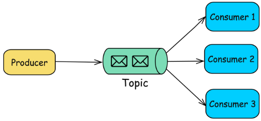
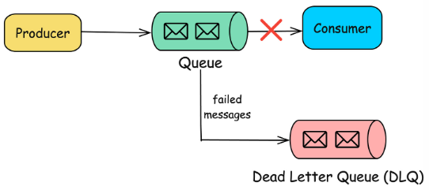

# 7.6 Types of MQ

#### Types of Message Queues

There are several types of message queues, each designed to solve specific problems:

##### \*\*1. Point-to-Point (P2P) Queue\*\*

In this model, messages are sent from one producer to one consumer.

> Used when a message needs to be processed by a \*\*single consumer\*\*, such as in task processing systems.

##### \*\*2. Publish/Subscribe (Pub/Sub) Queue\*\*

In this model, messages are published to a \*\*topic\*\*, and multiple consumers can subscribe to that topic to receive messages.

> Used for broadcasting messages to \*\*multiple consumers\*\*, such as in notification systems.

##### \*\*3. Priority Queue\*\*

Messages in the queue are assigned \*\*priorities\*\*, and higher-priority messages are processed before lower-priority ones.

> Used when certain tasks need to be handled more urgently than others.

##### \*\*4. Dead Letter Queue (DLQ)\*\*

A special type of queue where messages that cannot be processed (due to errors or retries) are sent.

> Useful for troubleshooting and handling failed messages.
