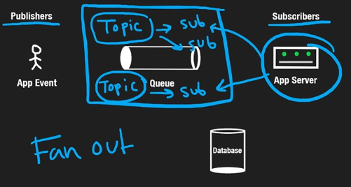

# 7.7 PUB SUB MODEL

Event producers = Publishers

Event receivers = Subscribers

Publisher events are stored into topics and those topics feed the events to subscriptions where each topic can feed to multiple subscriptions. These subscriptions then push the events to subscribers. Subscriptions are used to fan-out the topics. The purpose is to decouple the publishers from the subscribers. All the logic must be written correctly into message queue.

##### Popular Message Queues:

1. RabbitMQ

2. Kakfa

3. Pub/Sub for GCP

[Design a Pub Sub System with MULTITHREADING \| Pub Sub LLD \| Top Multithreading Interview Question](<https://www.youtube.com/watch?v=zyUnwnzYDR4&t=99s>)

[Design Push Based Pub Sub RabbitMQ \| Pub Sub LLD \| Top Multithreading Interview Question](<https://www.youtube.com/watch?v=vckfyxCb-GE&t=23s>)
