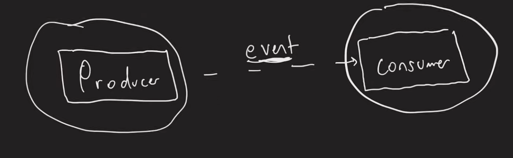

# 7.9 Stream Processing

- So far information in our applications is generally stored on disk somewhere and then read back at a later period of time.

- With stream processing, we react to "events" in real time \[Event Driven Architecture \[EDA\]\]

