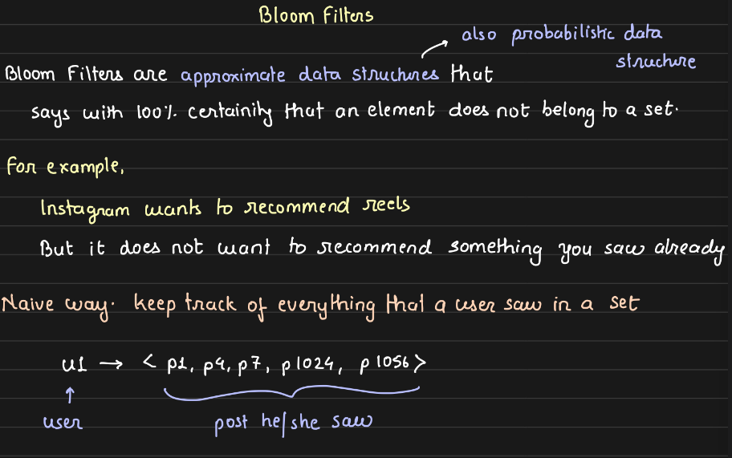
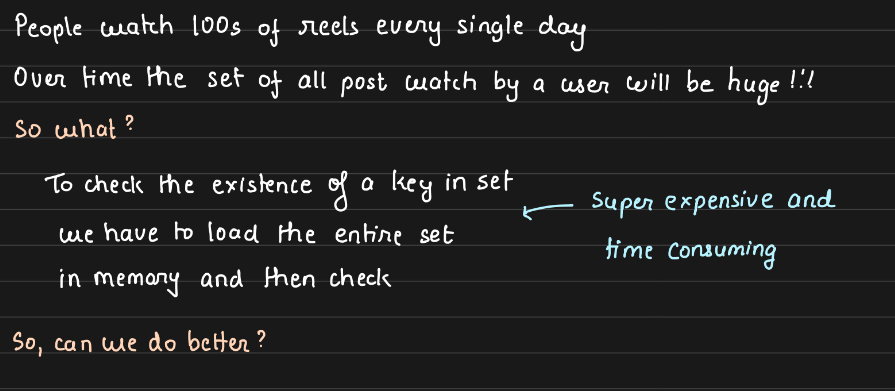
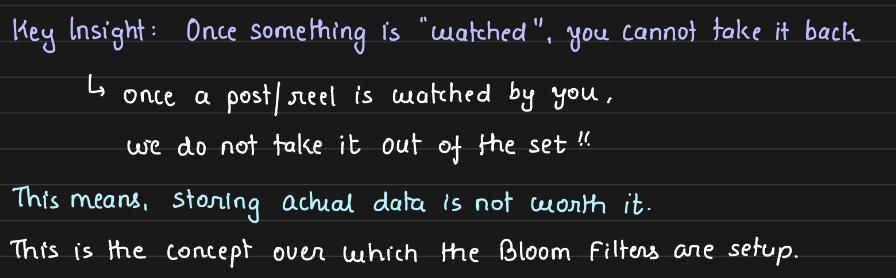
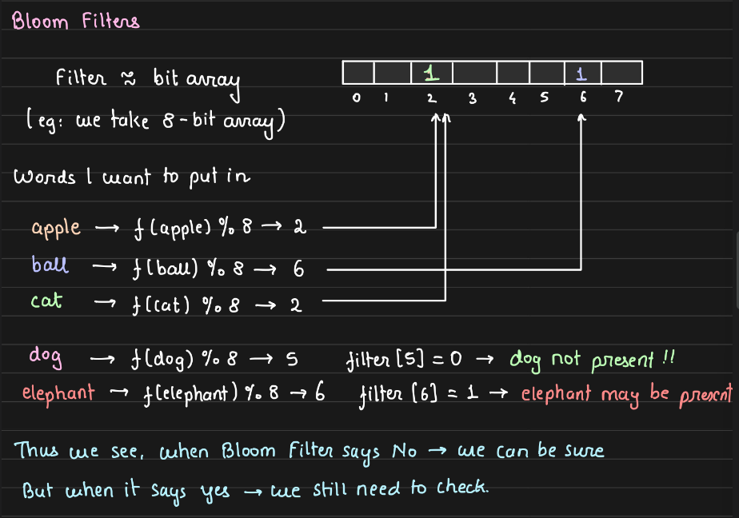
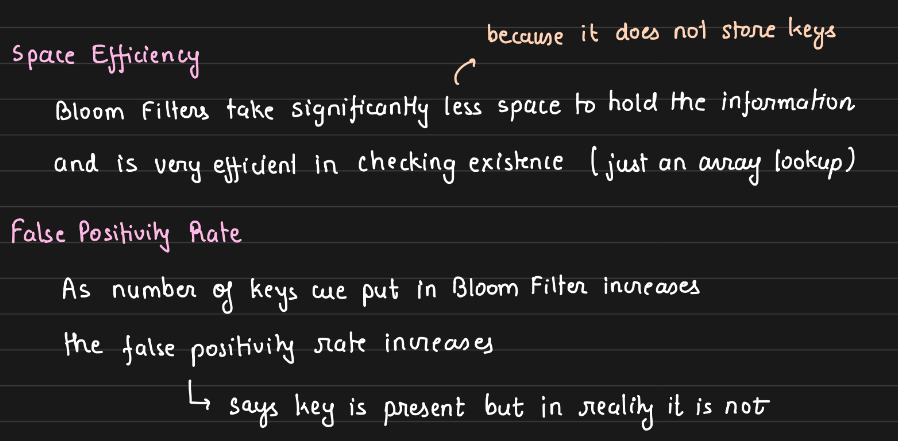
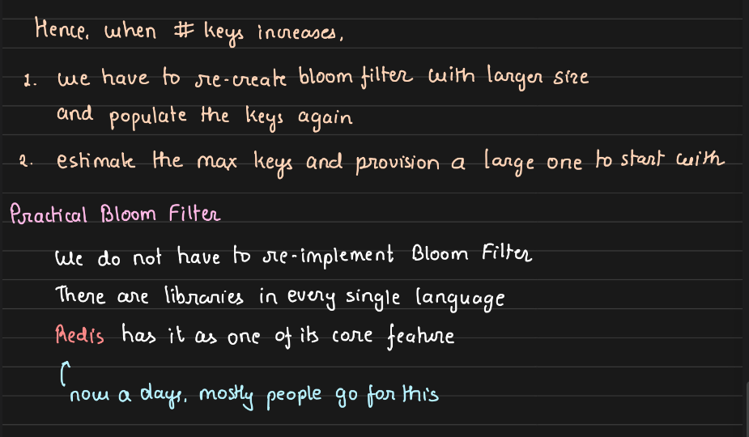
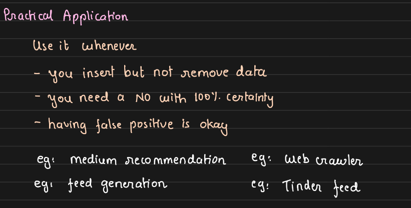
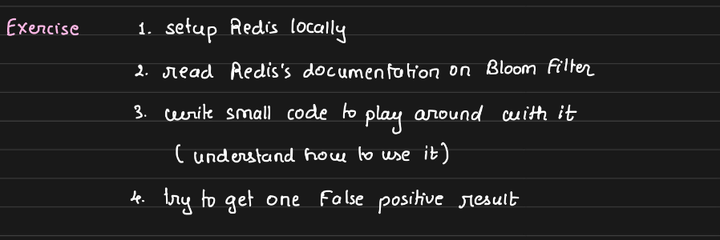

# 8.1 Bloom Filters

[Data Structures for Big Data in Interviews - Bloom Filters, Count-Min Sketch, HyperLogLog](<https://www.youtube.com/watch?v=IgyU0iFIoqM>)

**Bloom Filters** (often used within "Bloom Tables" or SSTables)

[Bloom Filters \| Hashtable \| System Design](<https://www.youtube.com/watch?v=GT0En1dGntY&pp=ygUWaGFzaGluZyBzeXN0ZW1zIGRlc2lnbg%3D%3D>)

[What are Bloom Filters? \| System Design](<https://www.youtube.com/watch?v=vz0QUa4CS3o&pp=ygUWaGFzaGluZyBzeXN0ZW1zIGRlc2lnbg%3D%3D>)

