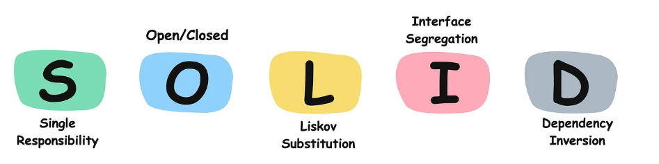
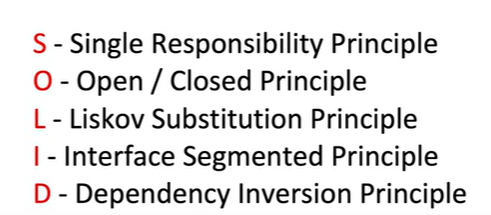
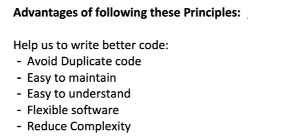

# 1.2 SOLID Principle

| SOLID Principles | [Solid Design Principle \| Low Level Design \| Interview Question for Java](<https://www.youtube.com/watch?v=laFju0MilSY>) | [Single Responsibility Principle with Easy Example \| SOLID \| Low Level System Design](<https://www.youtube.com/watch?v=twbNutezDzY>) | [OOPS AND SOLID PRINCIPLES ONE-SHOT \| Low Level Design](<https://www.youtube.com/watch?v=TsWvpMBDhEU>) | [LLD 02-Watch This Before Your Low-Level Design Interview \| Master SOLID Principles & Design Patterns](<https://www.youtube.com/watch?v=hXdzP5y_EKg>) | [1. SOLID Principles with Easy Examples \| OOPs SOLID Principles Interview Question - Low Level Design](<https://www.youtube.com/watch?v=XI7zep97c-Y>) | [Low Level Design 105 \| Single Responsibility Principle in SOLID \| 2022 \| System Design](<https://www.youtube.com/watch?v=-T0H--a8WnY>) | [SOLID Principles - Low Level Design \| Coding Interview Series \| The Code Mate](<https://www.youtube.com/watch?v=gumM1H4qLUM>) | [SOLID Design Principles \| Object Oriented Design Principles \| Systems Design \| Class Design](<https://www.youtube.com/watch?v=-RNkWv-d4zM>) | [Solid Design Principle \| Day 1 \| 5 Days Low Level System Design Challenge](<https://www.youtube.com/watch?v=9P52y4d8gWc>) | [Dependency Inversion Principle \| Chapter 6: Low Level Design](<https://www.youtube.com/watch?v=TSwWmpcF8ic>) | [Low Level Design 106 \| Inheritance and Polymorphism \| 2022 \| System Design](<https://www.youtube.com/watch?v=tIavGKafBV8>) |
| --- | --- | --- | --- | --- | --- | --- | --- | --- | --- | --- | --- |

[SOLID Design Principles | Object Oriented Design Principles | Systems Design | Class Design](<https://www.youtube.com/watch?v=-RNkWv-d4zM&list=PLJN9ydlFnJsiEgyjO3D3yBhtiENymhF8G&index=10&pp=iAQB0gcJCX4JAYcqIYzv>)

[SOLID Principles in One Shot | LLD Series | Java | Low-Level Design & OOPS with Interview Examples](<https://www.youtube.com/watch?v=WNq-7nqwy_Y>)

[OOPS And SOLID Principle | Chapter 1: Low Level Design](<https://www.youtube.com/watch?v=hvcgj5Gp95A&list=PLaf8p8Hkzb_F2VUVsYnQUGzGQBrdYtuMr&index=17&pp=iAQB>)

[OOPS AND SOLID PRINCIPLES ONE-SHOT | Low Level Design](<https://www.youtube.com/watch?v=TsWvpMBDhEU&list=PLaf8p8Hkzb_F2VUVsYnQUGzGQBrdYtuMr&index=5&pp=iAQB>)

[Design Principles | SOLID | DRY | KISS | YAGNI ](<https://www.youtube.com/watch?v=uxe_0RFgT7A&list=PLpxM6m39X_t-Rk9lZVVD4U6JycAAIIEDW&index=3&pp=iAQB>)[🔥](<https://www.youtube.com/watch?v=uxe_0RFgT7A&list=PLpxM6m39X_t-Rk9lZVVD4U6JycAAIIEDW&index=3&pp=iAQB>)

Fundamental Concepts

  - [Basics OOP Concepts](<https://blog.algomaster.io/p/basic-oop-concepts-explained-with-code>)

  - [SOLID Principles with Pictures](<https://medium.com/backticks-tildes/the-s-o-l-i-d-principles-in-pictures-b34ce2f1e898>)

  - [SOLID Principles with Code](<https://blog.algomaster.io/p/solid-principles-explained-with-code>)

  - [DRY Principle](<https://blog.algomaster.io/p/082450d8-0e7b-4447-a8dc-b7308e45f048>)

  - [YAGNI Principle](<https://blog.algomaster.io/p/8c3c7da7-885b-4a9c-a6e4-70ee02de4772>)

  - [KISS Principle](<https://blog.algomaster.io/p/21b57678-b351-4ed4-b390-3b6308af2f7d>)

Writing clean, maintainable code is just as important as writing code that works.

The SOLID principles provide a blueprint for writing code that’s easy to adjust, extend, and maintain over time.

It was introduced by [Robert C. Martin (Uncle Bob)](<https://en.wikipedia.org/wiki/Robert_C._Martin>) in the early 2000s.

