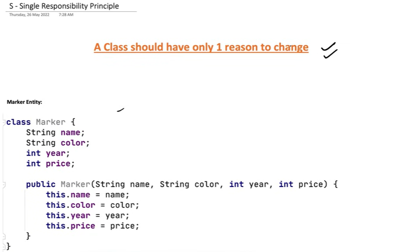
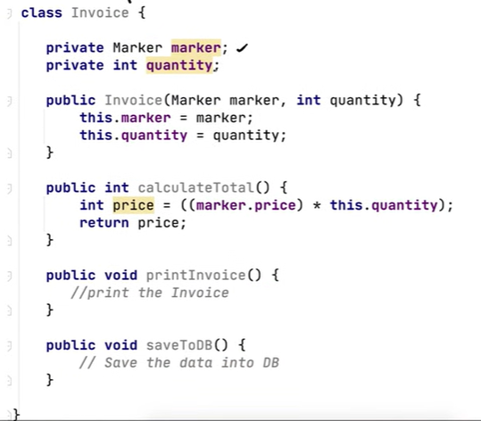
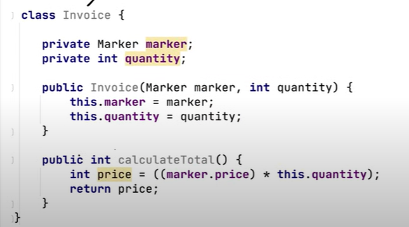
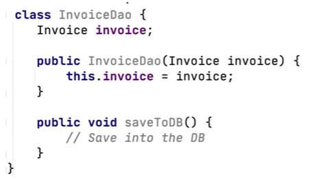
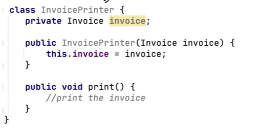
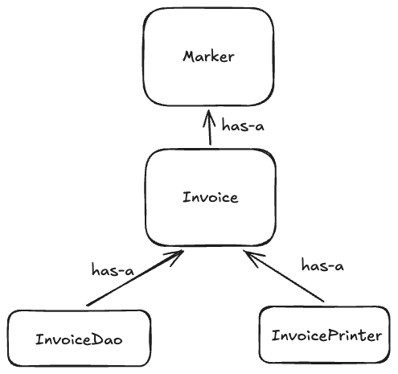

# 1.2.1 SINGLE RESPONSIBILITY PRINCIPLE

**SINGLE RESPONSIBILITY PRINCIPLE**

A class should have one, and only one, reason to change.

**This means that a class must have only one responsibility.**

When a class performs just one task, it contains a small number of methods and member variables making them more usable and easier to maintain.

If a class has multiple responsibilities, it becomes harder to understand, maintain, and modify and increases the potential for bugs because changes to one responsibility could affect the others.

INVOICE HAS A MARKER

INVOICE CLASS WILL GET CHANGED IF THE CALCULATION TOTAL FUNCTION CHANGES DUE TO GST OR DISCOUNT . IT WILL ALSO GET CHANGED if the requirements of printInvoice and SaveToDB function changes.

NOT FOLLOWING SRP

MAKE CHANGES:

Data Access Object Class --->

Now each of these class will be modified for only one reason.

Now, each class has a single, well-defined responsibility.

[Low Level Design 105 | Single Responsibility Principle in SOLID | 2022 | System Design](<https://www.youtube.com/watch?v=-T0H--a8WnY&list=PLTCrU9sGybupCpY20eked6blbHI4zZ55k&index=5&pp=iAQB>)

[Single Responsibility Principle | Chapter 2: Low Level Design](<https://www.youtube.com/watch?v=zwY02Mnl_S0&list=PLaf8p8Hkzb_F2VUVsYnQUGzGQBrdYtuMr&index=16&pp=iAQB>)
