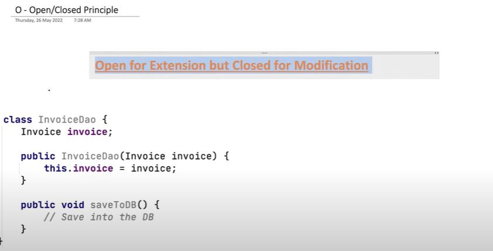
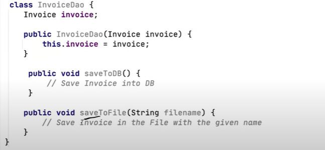
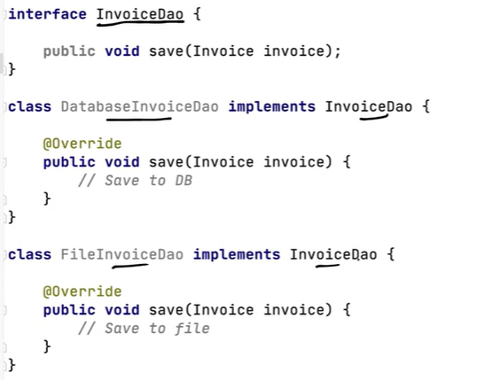
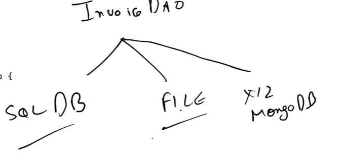

# 1.2.2 OPEN/CLOSED PRINCIPLE

[Open Closed Principle | Chapter 3: Low Level Design](<https://www.youtube.com/watch?v=tHh0SzCvHJI&list=PLaf8p8Hkzb_F2VUVsYnQUGzGQBrdYtuMr&index=15&pp=iAQB>)

**OPEN/CLOSED PRINCIPLE**

Software entities (classes, modules, functions, etc.) should be open for extension, but closed for modification.

This means the design of a software entity should be such that you can introduce new functionality or behavior without modifying the existing code since changing the existing code might introduce bugs.

Assume this class is already tested and is live, so if we need to make changes to it say we need to add another method that saves to file then should we do the changes below:

This is not following the Open Closed principle.  Extend the already live class.

Create an interface, and then extend them.

