# 1.2.3 LISKOV SUBSTITUTION PRINCIPLE

[Low Level Design 107 \| Liskov Substitution Principle \| 2022 \| System Design](<https://www.youtube.com/watch?v=HbGDobtxzWk&list=PLTCrU9sGybupCpY20eked6blbHI4zZ55k&index=7&pp=iAQB>)

[Liskov Substitution Principle \| Chapter 4: Low Level Design](<https://www.youtube.com/watch?v=rz7BVbMEdKU&list=PLaf8p8Hkzb_F2VUVsYnQUGzGQBrdYtuMr&index=14&pp=iAQB0gcJCX4JAYcqIYzv>)

**LISKOV SUBSTITUTION PRINCIPLE**

Objects of a superclass should be replaceable with objects of its subclasses without affecting the correctness of the program.

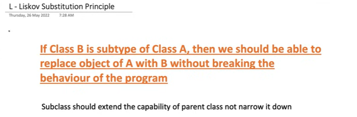

This means if you have a base class and a derived class, you should be able to use instances of the derived class wherever instances of the base class are expected, without breaking the application.

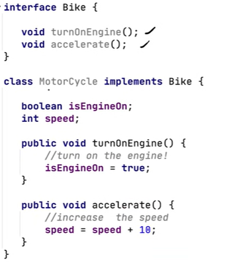

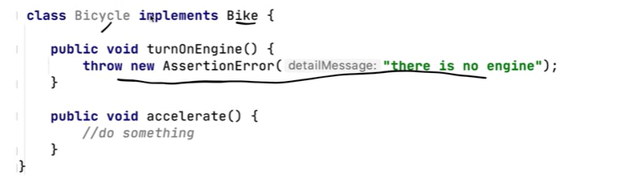

This cycle class is reducing the capability of the parent.

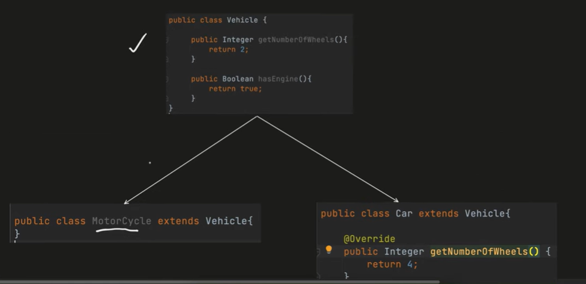

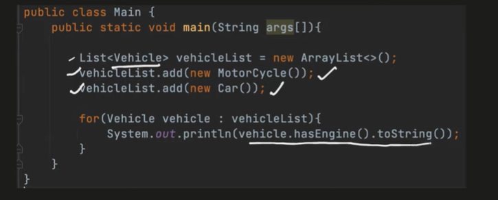

**PROBLEM:**

**Add another child which is downsiding the capability of the parent class:**

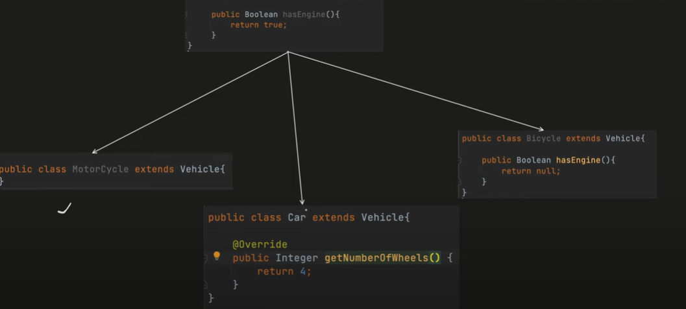

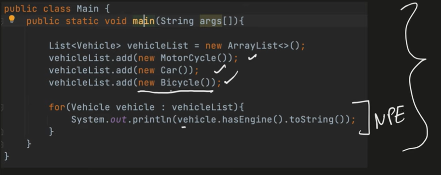

**This will throw null pointer exception, because bicycle has removed the  functionality of engine from vehicle class.  **

FIX IT:

Put only very generic methods in the parent class and the implement the differing functionalities individually in each of the child class.

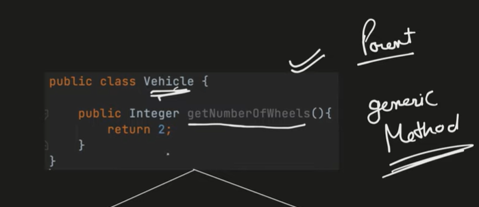

CREATE ENGINE VEHICLE FROM VEHICLE

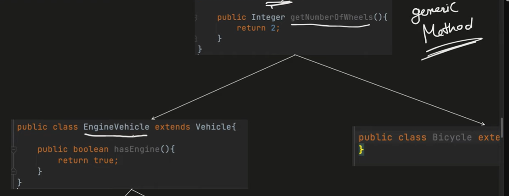

THEN CREATE CAR FROM ENGINE VEHICLE

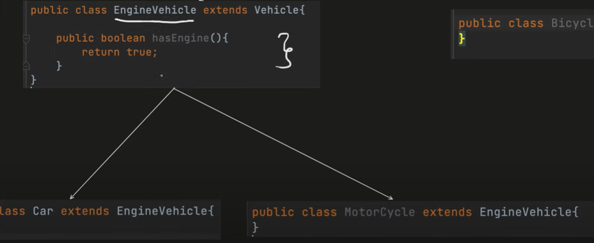

Client Code: This will work.

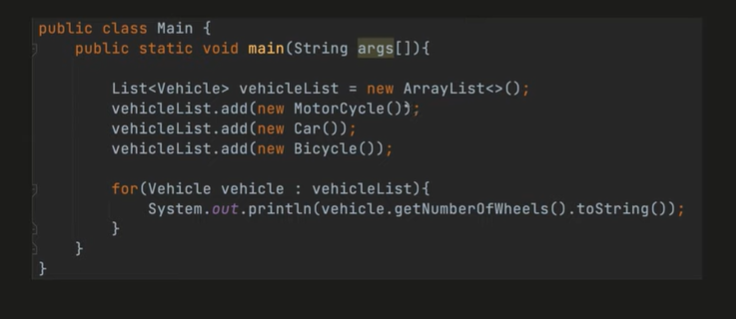

Client Code 2: Vehicle is not aware of hasEngine Method

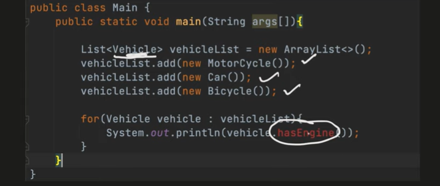

**Code 3: Compile time error - **

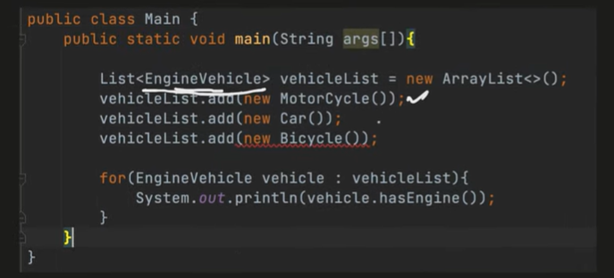
