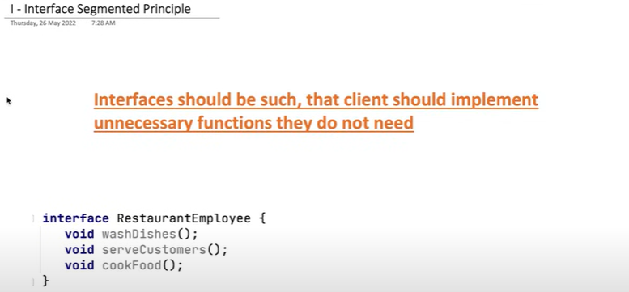
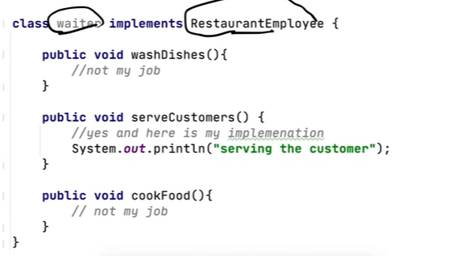
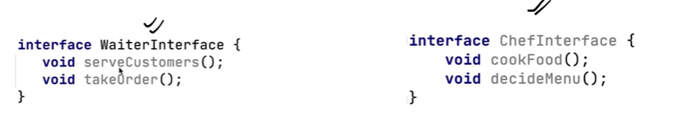
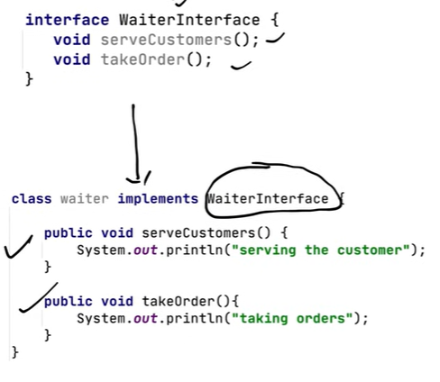

# 1.2.4 INTERFACE SEGMENTED PRINCIPLE

[Low Level Design 108 | Interface Segregation Principle | 2022 | System Design](<https://www.youtube.com/watch?v=-E-E6pd-psU&list=PLTCrU9sGybupCpY20eked6blbHI4zZ55k&index=8&pp=iAQB>)

[Interface Segregation Principle | Chapter 5: Low Level Design](<https://www.youtube.com/watch?v=eyzIATZNsG4&list=PLaf8p8Hkzb_F2VUVsYnQUGzGQBrdYtuMr&index=13&pp=iAQB>)

**INTERFACE SEGMENTED PRINCIPLE**

No client should be forced to depend on interfaces they don't use.

The main idea behind ISP is to prevent the creation of "fat" or "bloated" interfaces that include methods that are not required by all clients.

By segregating interfaces into smaller, more specific ones, clients only depend on the methods they actually need, promoting loose coupling and better code organization.

WAITER DOESNT HAVE THE FUNCTION OF WASHING THE DISHES OR COOKING THE FOOD. SO IT SHOULD NOT BE IMPLEMENTED IN THE INTERFACE.

INTERFACES SHOULD BE SEGMENTED INTO SMALL PARTS SO THAT CLEINT DOESNT HACVE TO IMPLEMENT UNNECESSARY FUCNTIONS.

By segregating the interfaces, each class only needs to implement the methods it actually requires. This not only makes the code more maintainable but also prevents clients from being forced to depend on methods they don't use.
