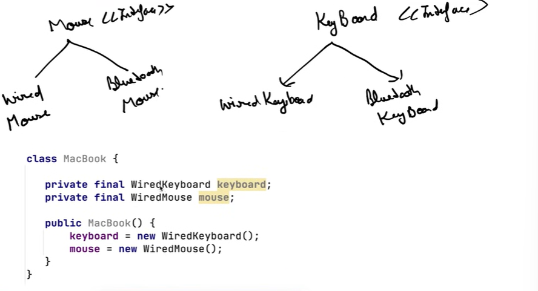
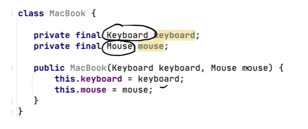

# 1.2.5 DEPENDENCY INVERSION PRINCIPLE

[Low Level Design 109 | Dependency Inversion Principle | 2022 | System Design](<https://www.youtube.com/watch?v=_CQuOfIqaGE&list=PLTCrU9sGybupCpY20eked6blbHI4zZ55k&index=9&pp=iAQB>)

[Dependency Inversion Principle | Chapter 6: Low Level Design](<https://www.youtube.com/watch?v=TSwWmpcF8ic&list=PLaf8p8Hkzb_F2VUVsYnQUGzGQBrdYtuMr&index=12&pp=iAQB>)

**DEPENDENCY INVERSION PRINCIPLE**

High-level modules should not depend on low-level modules; both should depend on abstractions.

This means that a particular class should not depend directly on another class, but on an abstraction (interface) of this class.

Applying this principle reduces dependency on specific implementations and makes our code more reusable.

Here Wired mouse and wired keyboard are concrete classes and we are directly using them to generate another class instead of using an interface.

Fix them using constructor ingestion: Pass wiredMouse and WIredKeybaord to make them to be used accordingly in classes.

