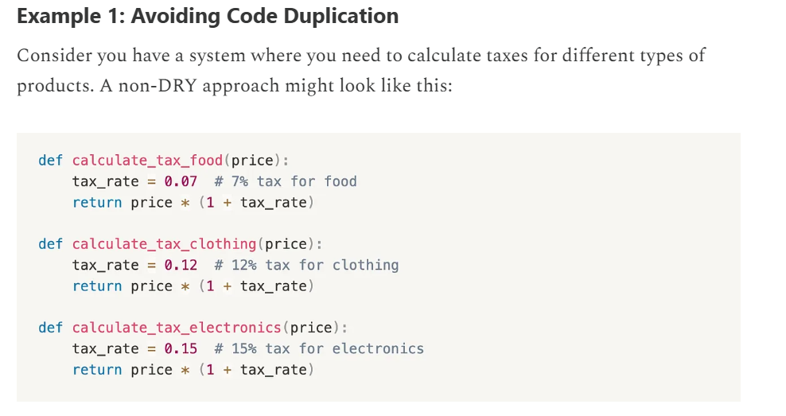
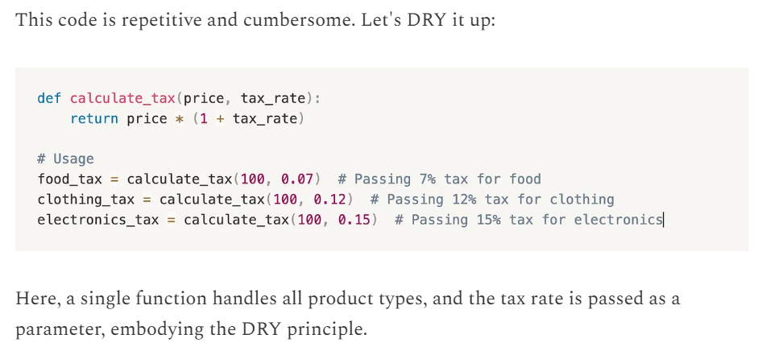
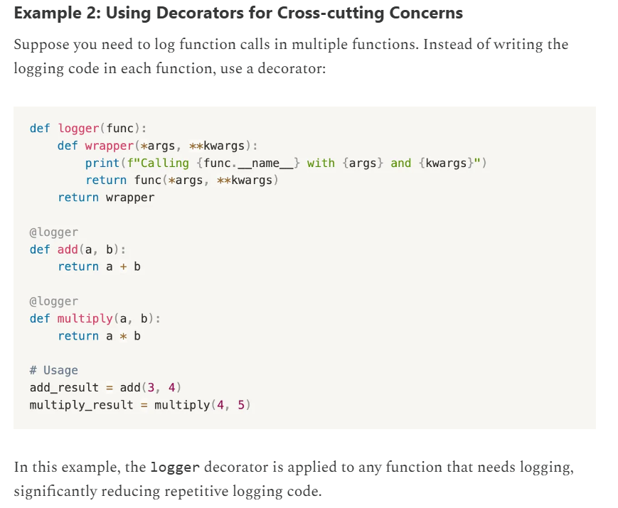
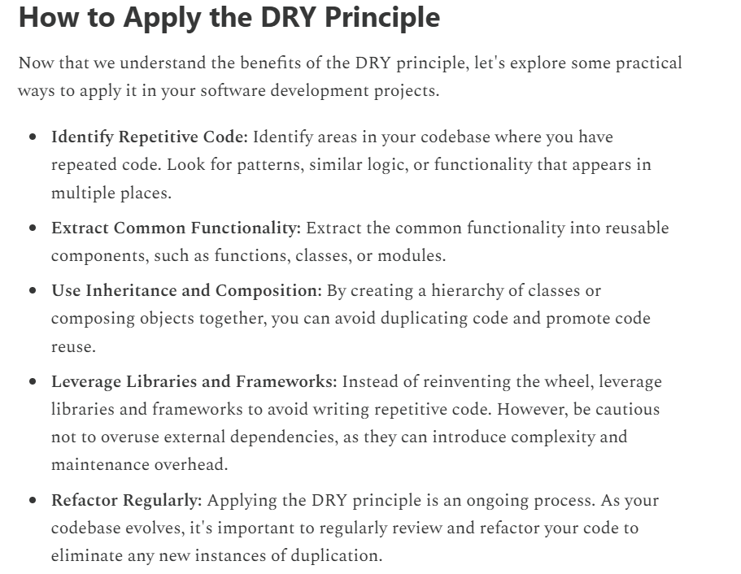
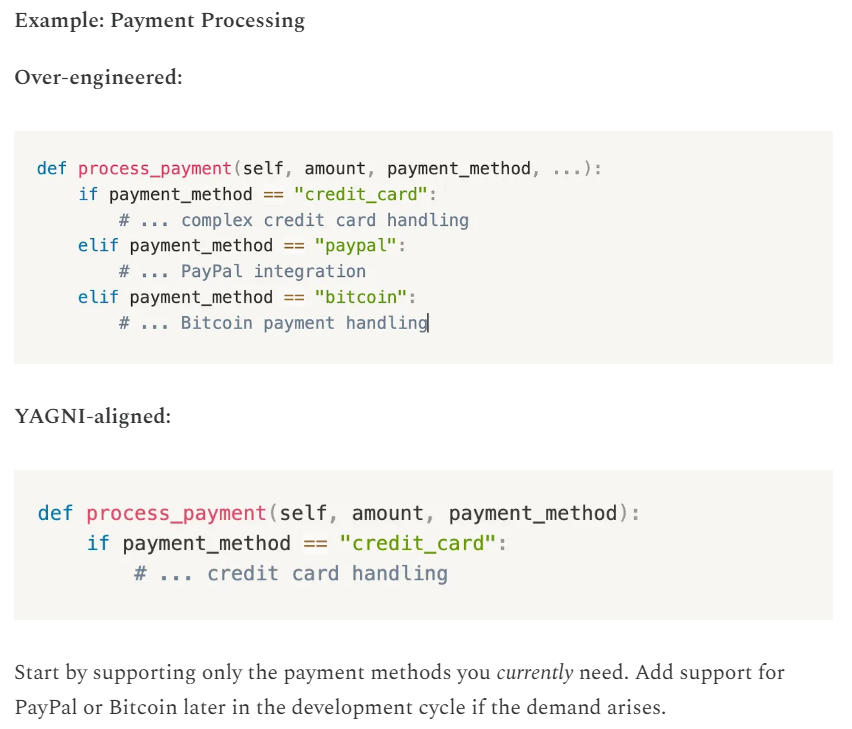

# 1.3 DRY/KISS/YAGNI

DONT REPEAT YOURSELF

"Every piece of knowledge must have a single, unambiguous, authoritative representation within a system."

In other words, the DRY principle encourages developers to write modular, reusable code and avoid duplicating the same functionality in multiple places.

It encourages us to minimize redundancy and write code that does one thing well, making our lives (and the lives of those who maintain our code) much easier.

IMPORTANCE:

Reduced code duplication, improved code reusability, easier bug fixing, improved consistency, faster development.

HOW TO APPLY:

**YOU ARENT GONNA NEED IT**

Always implement things when you actually need them, never when you just foresee that you might need them.

At its heart, YAGNI is about avoiding over-engineering and focusing strictly on the present requirements.

The rationale behind YAGNI is simple: every line of code we write comes with a cost. It needs to be developed, tested, maintained, and understood by other developers.

By adding unnecessary features or over-engineering solutions, we incur additional complexity, which can slow down development, increase the likelihood of bugs, and make the codebase harder to maintain.

BENEFITS:

Reduced Waste, Simplified codebase, faster development, improved adaptability.
