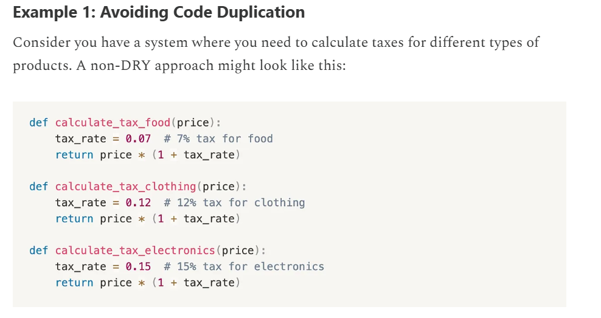
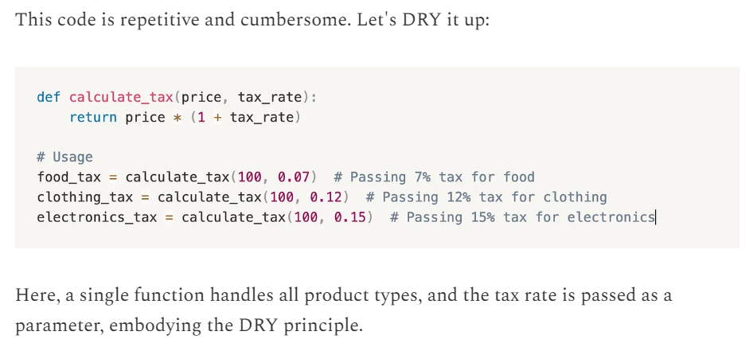
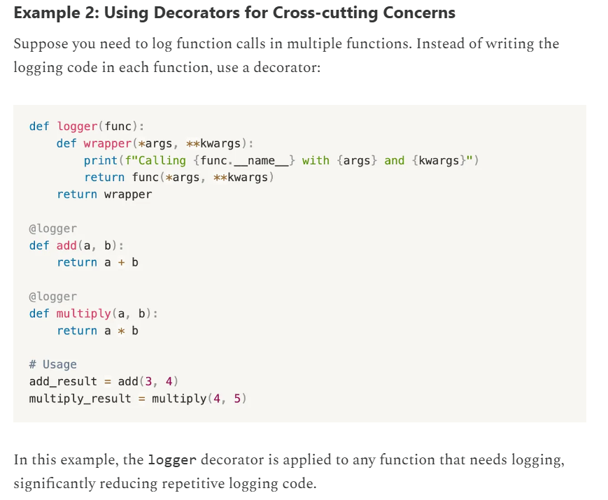
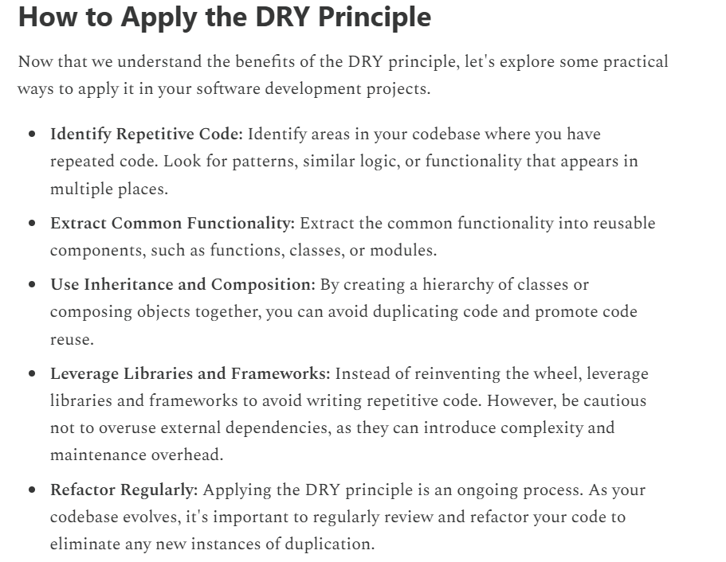

# 1.3.1 DRY

DONT REPEAT YOURSELF

"Every piece of knowledge must have a single, unambiguous, authoritative representation within a system."

In other words, the DRY principle encourages developers to write modular, reusable code and avoid duplicating the same functionality in multiple places.

It encourages us to minimize redundancy and write code that does one thing well, making our lives (and the lives of those who maintain our code) much easier.

IMPORTANCE:

Reduced code duplication, improved code reusability, easier bug fixing, improved consistency, faster development.

HOW TO APPLY:

