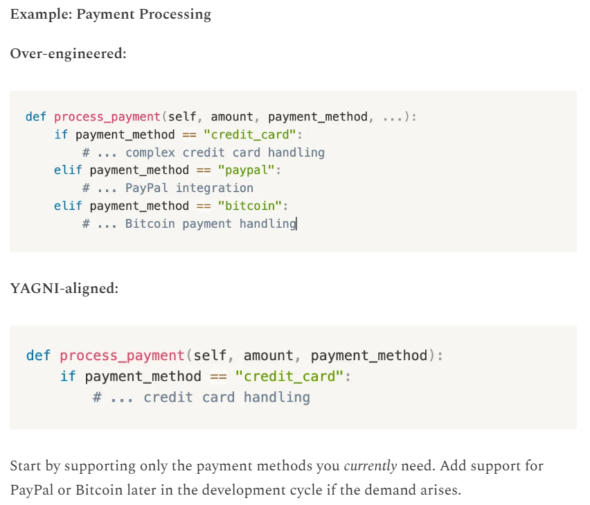

# 1.3.2 YAGNI

**YOU ARENT GONNA NEED IT**

Always implement things when you actually need them, never when you just foresee that you might need them.

At its heart, YAGNI is about avoiding over-engineering and focusing strictly on the present requirements.

The rationale behind YAGNI is simple: every line of code we write comes with a cost. It needs to be developed, tested, maintained, and understood by other developers.

By adding unnecessary features or over-engineering solutions, we incur additional complexity, which can slow down development, increase the likelihood of bugs, and make the codebase harder to maintain.

BENEFITS:

Reduced Waste, Simplified codebase, faster development, improved adaptability.
