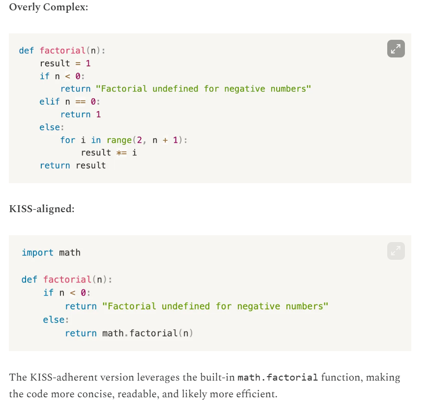

# 1.3.3 KISS

**KEEP IT SIMPLE STUPID**

The KISS principle, which stands for **"Keep it Simple, Stupid"** is a design philosophy that emphasizes the importance of simplicity in software development.

It suggests that software should be designed to be easy to understand, modify, and extend, rather than complex and convoluted.

