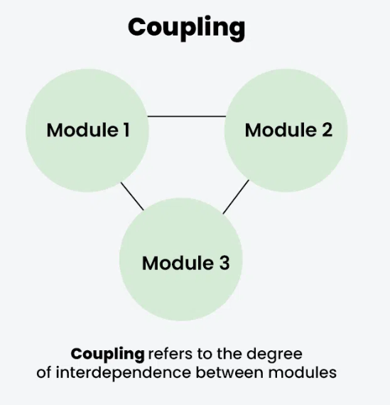
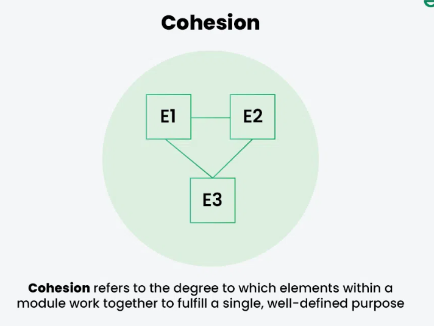

# 1.4 Coupling and Cohesion

COUPLING:

**Coupling** refers to the degree of interdependence between software modules. High coupling means that modules are closely connected and changes in one module may affect other modules. Low coupling means that modules are independent, and changes in one module have little impact on other modules.

COHESION:

**Cohesion** refers to the degree to which elements within a module work together to fulfill a single, well-defined purpose. High cohesion means that elements are closely related and focused on a single purpose, while low cohesion means that elements are loosely related and serve multiple purposes.

Both coupling and cohesion are important factors in determining the maintainability, scalability, and reliability of a software system. High coupling and low cohesion can make a system difficult to change and test, while low coupling and high cohesion make a system easier to maintain and improve.
