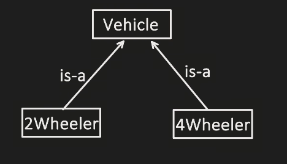

# 1.5 Has-a & Is-a relationship

- Is A

  - This means inheritance

  - 

  - Vehicle - parent class, 2wheeler - child class

- Has A

  - Shows link between two objects / relationship

  - It means Association

  - Association has two parts: Aggregation, Composition

Association:

  - General term for has-a relationship (shown by                 )

| **Weak Relationship (Aggregation)** | **Strong Relationship (Composition)** |
| --- | --- |
| Existence of one object is not dependent on another. | Existence of one object is dependent on another. |
| eg: Library has books  Here both are independent of each other. If books are not present, library can still exist, and similarly book can exist without library. | eg: House has rooms  Here room's existence depends on house. If house doesn't exist then room will also not exist. |
|  | public class House { List<Room> rooms; //also takes care of creation and managing of room objects public House(){ rooms = new ArrayList<>(); rooms.add(new Room("Living Room"); } } |
|  |  |
|  |  |
|  |  |

composition

aggregation

Association
