# 2.1 Interview

[Remove Hardcodings to Achieve Extensibility in Low Level Design \| LLD \| Udit Agarwal](<https://www.youtube.com/watch?v=oMNsP-l9XGk&list=PL564gOx0bCLqTolRIHIsR2JPv11w8LESW&index=20&pp=iAQB>)

[Creating Great Low-Level Design by preferring Composition over Inheritance \| OOPs Concepts](<https://www.youtube.com/watch?v=ltENzdsbsdA&list=PL564gOx0bCLqTolRIHIsR2JPv11w8LESW&index=13&pp=iAQB>)

https://www.youtube.com/watch?v=paNwoBzpYto&list=PLliXPok7Zonm0trweRA2UeSTTLVYiPzNG&index=7&pp=iAQB

[Introduction to Low-Level Design \| Learn How Real Apps Are Built!](<https://www.youtube.com/watch?v=LP7dwEgWink&list=PLpVAqPqryuRuiGSz7U7rbYvouCDoM5z_4&index=1&pp=iAQB>)

[Introduction to LLD \| How to Approach LLD Problems in an Interview ](<https://www.youtube.com/watch?v=xMNSTBGoGbU>)[🔥](<https://www.youtube.com/watch?v=xMNSTBGoGbU>)

UML

  - [Class Diagram](<https://blog.algomaster.io/p/uml-class-diagram-explained-with-examples>)

  - [Use Case Diagram](<https://www.visual-paradigm.com/guide/uml-unified-modeling-language/what-is-use-case-diagram/>)

  - [Sequence Diagram](<https://www.visual-paradigm.com/guide/uml-unified-modeling-language/what-is-sequence-diagram/>)

  - [Activity Diagram](<https://www.visual-paradigm.com/guide/uml-unified-modeling-language/what-is-activity-diagram/>)

  - [State Machine Diagram](<https://www.visual-paradigm.com/guide/uml-unified-modeling-language/what-is-state-machine-diagram/>)

https://blog.uditagarwal.com/2022-06-25-low-level-design-roadmap/ Udit Agarwal is Staff Engineer at Google.

INTERVIEW MISTAKES:

  - CLARIFY WHETHER THE INTERVIEWER WANTS A HIGH LEVEL DESIGN OR A LOW LEVEL DESIGN.

  - IF YOU KNOW THE SOLUTION, ASK THE FUNCTIONAL REQUIREMENTS. DESIGN WOULD CHANGE IF THE FUNCTIONAL REQUIREMENTS CHANGE. ALSO DISCUSS NON FUNCTIONAL REQUIREMENTS- EG: SCALE.

  - TIME YOUR SOLUTION VERY WELL. START WITH BASIC COMPONENTS, HOW THEY INTERACT WITH EACH OTHER. THEN DEEP DIVE INTO 1 OR 2 COMPONENTS. ASK THE INTERVIEWER WHICH FUNCTIONALITY THEY WANT ME TO GO DEEP INTO.

  - DONT MAKE ASSUMPTIONS ON THE FLY. KEEP ASKING IF WE ARE GOING IN THE RIGHT DIRECTION.

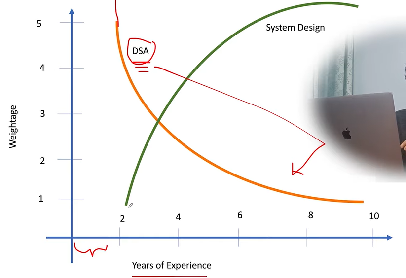

**What is a system design interview?**

  - In such kind of an interview, you are given a real-world problem and you are expected to come up with the required design for it.

  - Since no system in this world is best, so you are expected to come up with the tradeoffs of your design. Like where a design will work well and where not. Its pros and cons.

  - One of the major goals of system design interviews is to see whether candidate is able to identify these tradeoffs and fix cons.

**Low level design interviews:**

In such kind of interviews, we talk about low level design of the system being discussed. It mostly includes discussing the class structure that you will create for the problem. You will have to use some good design patterns and principles (JUDGING CRITERIA) in this round to excel at it. You have to make multiple classes that may interact with each other, and define attributes and methods in each one of them.

Expectations:

  - Whether you are able to come up with some good requirements (discuss the requirements with the interviewer and freeze them) or not. This involves requirement Gathering and defining system constraints.

  - Identifying and defining Entities and their associations.

  - Major criteria: Coupling (less [coupling](<onenote:#Coupling%20and%20Cohesion&section-id={8D1EA3C4-7C6C-48E2-9ACE-0DA6C87793FA}&page-id={21E70E96-B75A-4A28-8812-B5E1CC72D115}&end&base-path=https://iitk-my.sharepoint.com/personal/laveshg21_iitk_ac_in/Documents/CS%20TOPICS/LLD%20aka%20MACHINE%20CODING.one>) desirable), Extensibility, and System Maintainability.

  - Whether your design is following good design principles and patterns or not.

**Low-Level Design Learning strategy:**

  - **Concepts:** Understanding concepts is really important here. Try to learn underlying concepts first and then do practice problems. HOW WOULD YOU** DEFEND YOUR DESIGN**ED SYSTEM? HOW WOULD YOU SAY THAT IT IS CORRECT?

    1. **Design principles -** Used for analysis.

      - **SOLID: Learn principles of good designing like SOLID etc. Try to understand how they are helping you in coming up with some good designs.**

      - **If a design is following the principles, it is considered as a good design. **

    1. **Design patterns -** User for implementation

      - Most important design patterns needed to start with. If you can get good hold on these, then you can do really good design:

        - Strategy

        - [Builder](<https://youtube.com/watch?v=6Wi2XZeAf-Q&list=PL564gOx0bCLqTolRIHIsR2JPv11w8LESW>)

        - Singleton

        - Factory

        - [Composition over inheritance](<https://www.youtube.com/watch?v=ltENzdsbsdA&list=PL564gOx0bCLqTolRIHIsR2JPv11w8LESW>)

        - [Command Pattern](<https://www.youtube.com/watch?v=G7ErX_0eCkU&list=PL564gOx0bCLqTolRIHIsR2JPv11w8LESW>)

  - **Practice problems:** Practicing problems and try to come up with trade-offs in the design. Try to see how your designs compare to other people’s designs and try to find pros and cons in each one of them.

**Steps in a low level design interview:**

  - Step 1: Start with the model classes first. This about the entities that you have in the system that you are building. Create classes for those entities in the design.

  - Step 2: Then think about the properties of those classes. Try to what all fields those classes should have and create them.

  - Step 3: Then we have to think about the behavior of those classes. This means you have to define the methods in the classes.

    - But coming up with the methods for each model class is difficult to start with.

    - So, its always better to start top down here.

    - First think about the top level method you need, start implementing it and keep discovering new and new methods that you would need. (eg: gameStarter class is the main entrypoint of your game)

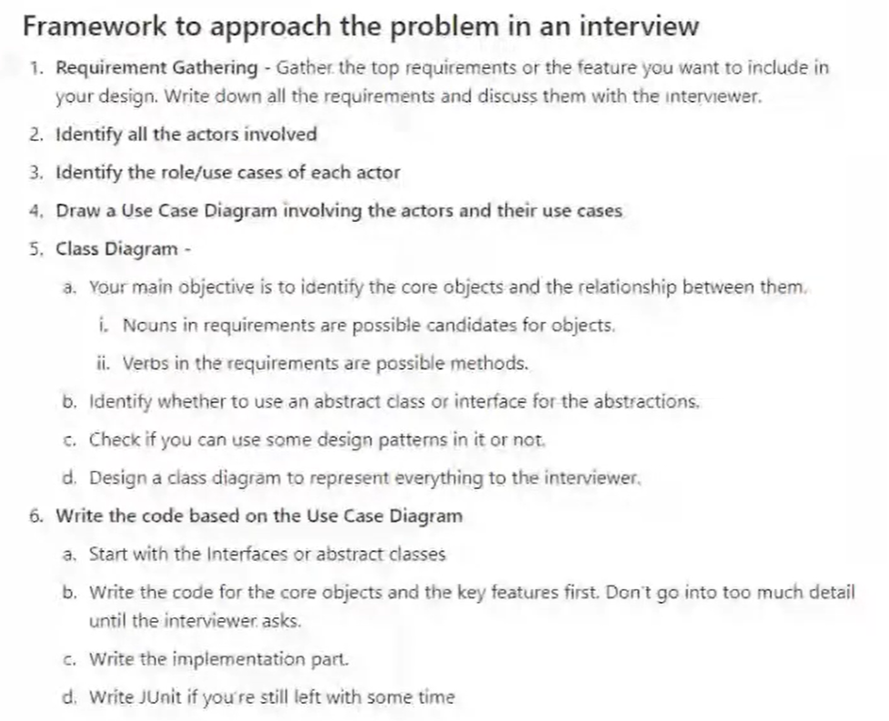

**Scalability differs between high-level and low-level design.**

- High-level design scalability focuses on increasing the load and adapting infrastructure to user growth.

- Low-level design scalability emphasizes creating maintainable and extensible systems for future requirements.

**Machine coding rounds require end-to-end design and coding solutions.**

- Candidates are given complex problems like parking lot or snakes and ladders to solve within a designated timeframe.

- In these rounds, you must write complete, compilable code, create classes, and implement unit tests.

**High-level system design focuses on scalability and no code is required.**

- Candidates must consider how to scale systems for increased user loads, such as handling millions of notifications.

- Design discussions include database and service scalability strategies to manage future growth in requests.

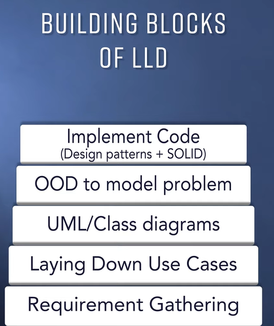

Object Oriented Programming != Object Oriented Design

OOP can be done while violating the OOD principles.

NOUN VERB TECHNIQUE (NVT)

Introduction of the NVT technique for designing applications.

- The NVT technique focuses on identifying nouns and verbs in problem statements to define objects and their actions.

- Applying this technique helps break down real-world problems into manageable components using object-oriented design.

Identifying nouns helps define domain and software classes in object-oriented design.

- In the driving license application use case, key nouns include users, slots, licenses, classes, and credit cards.

- These identified nouns represent real-world objects that can be converted into software classes for application development.

Identify classes and their behaviors using verbs in use cases.

- Verbs like 'booking' and 'adding' define the behavior and requirements of the classes.

- Understanding class interactions helps in determining relationships, such as composition and inheritance.

Example:

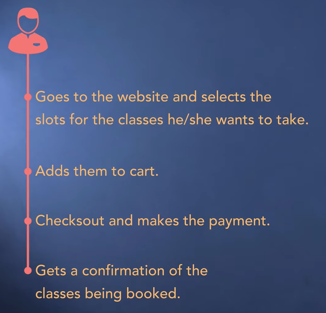

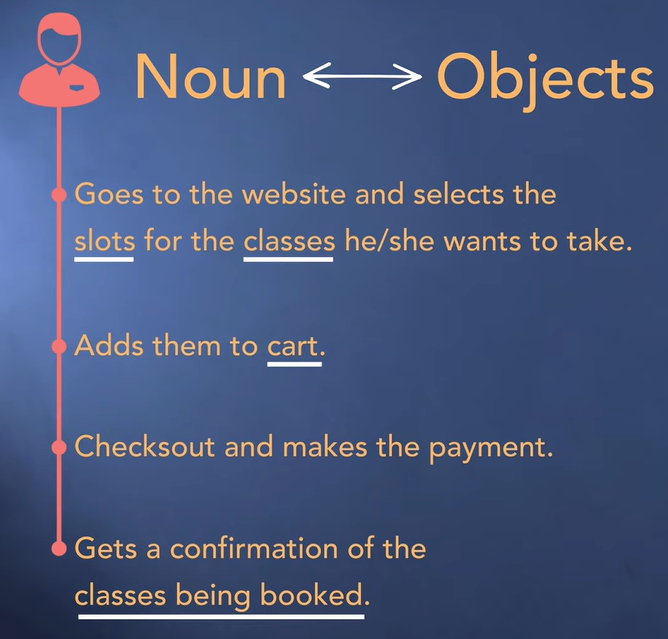

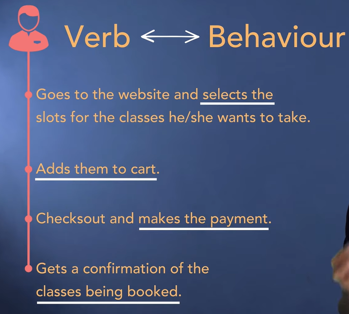

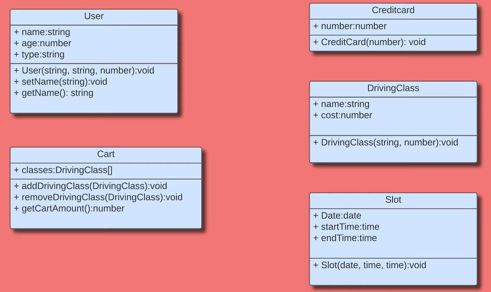

Understanding class responsibilities in object-oriented design.

- Explore relationships between classes and assign primary responsibilities to model real-world problems.

- Practice converting use cases into class models using the NVT technique for improved object-oriented modeling.

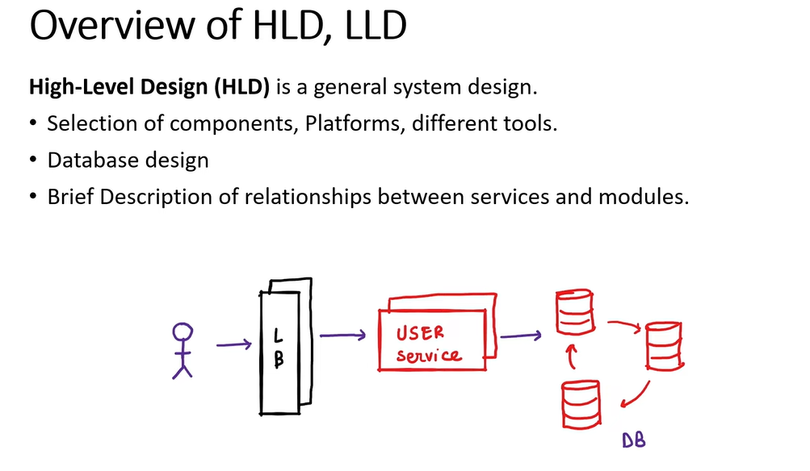

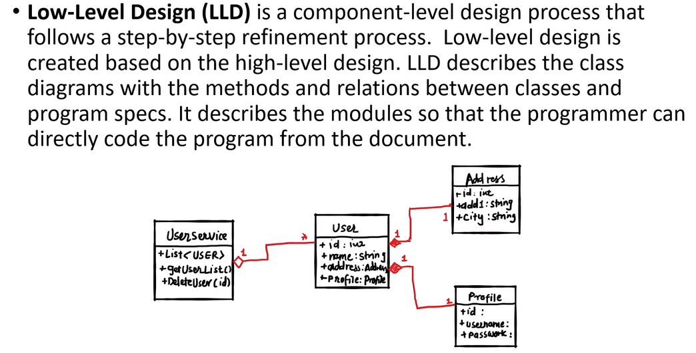

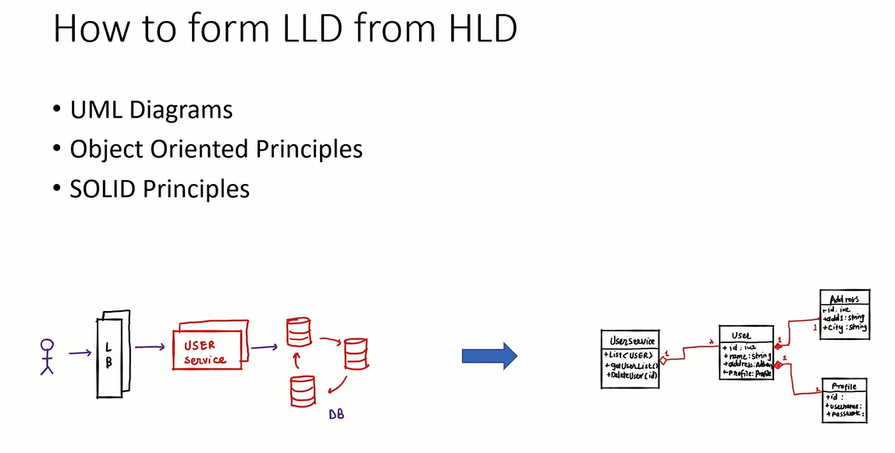

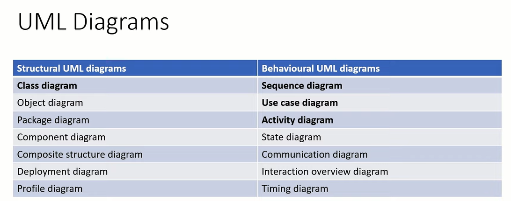

Different classes should not know a lot about each other. This is reduced coupling.

How to Assign Responsibilities to Classes in Object-Oriented Design

Classes in object-oriented design can have 'has a' or 'is a' relationships.

- The 'has a' relationship is sometimes referred to as compositional aggregation.

- Classes need to interact and depend on each other to fulfill use cases.

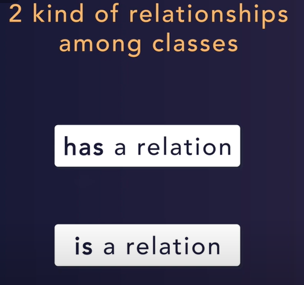

Customer and credit card have a composition relationship, while card and lessons have an aggregation relationship.

- A customer can have a credit card, but a credit card cannot exist without a customer.

- Multiple lessons can exist even without a card, as people can manually book classes.

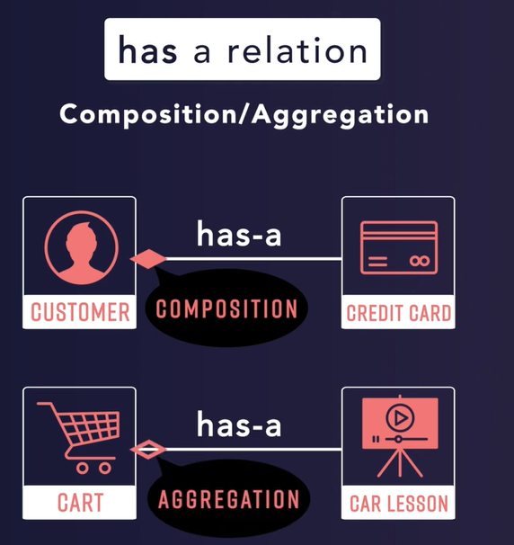

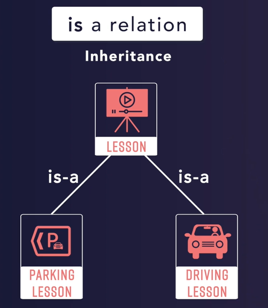

Is-a relation signifies inheritance

- Classes can be structured in a way that a specific type of class is a child class of a more general class

- This relationship is represented using the is-a relationship or inheritance

Association

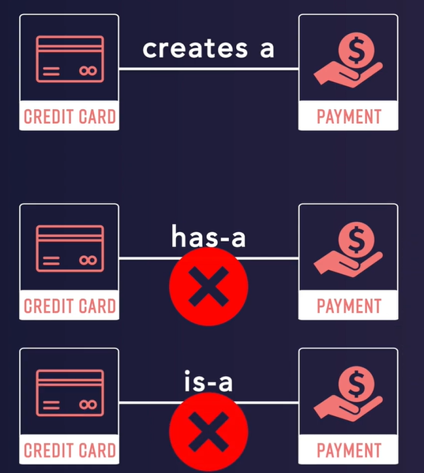

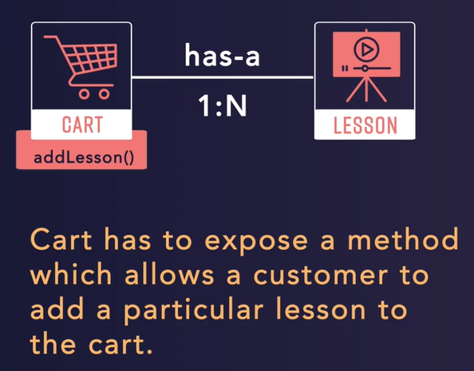

Understanding the responsibilities assigned to the Card class

- Card class should have a method called addLesson to add a specific lesson to the card.

- Card class should expose a method such as getTotalAmount to calculate the total value of the card.

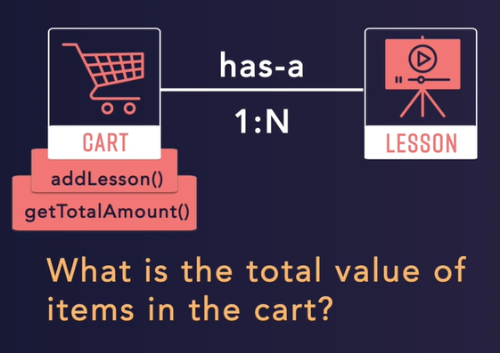

Assigning responsibilities for different classes and methods.

- Class design should consider where certain methods should be located and why.

- The calculation of discounts and checkout process involve different classes and methods.

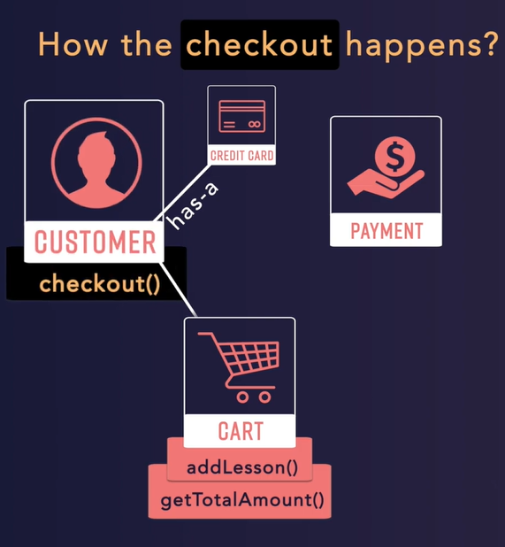

The responsibility of checkout is assigned to the customer class to reduce coupling.

- Putting the checkout method in the cart class would lead to the cart class knowing about the customer and credit card classes.

- By putting the checkout method in the customer class, the customer class already knows about the credit card class and the cart class knows about the customer class.

Abstraction and Encapsulation are key concepts in Object Oriented Design.

- Abstraction allows us to hide the implementation details and only expose the necessary information.

- Encapsulation ensures that each class is responsible for its own data and functionality, reducing dependency on other classes.

Encapsulation and abstraction are key concepts in object-oriented design.

- Encapsulation involves representing classes and objects in a way that they don't know about each other's details.

- Applying encapsulation in code is an implementation of the concept of abstraction.
