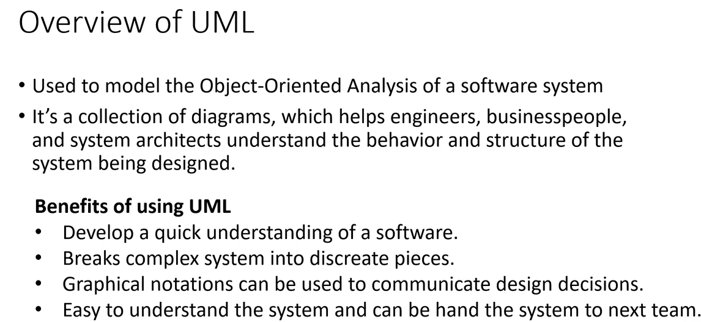
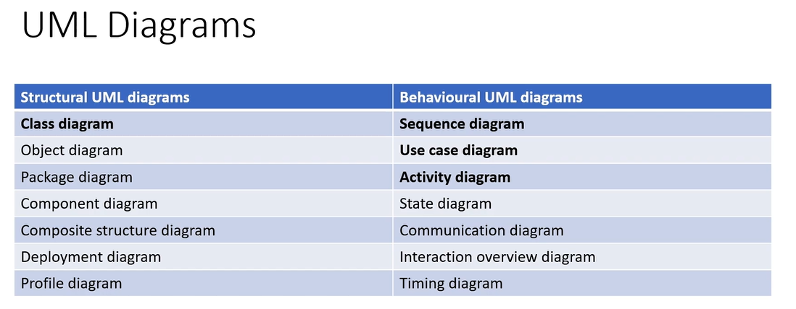
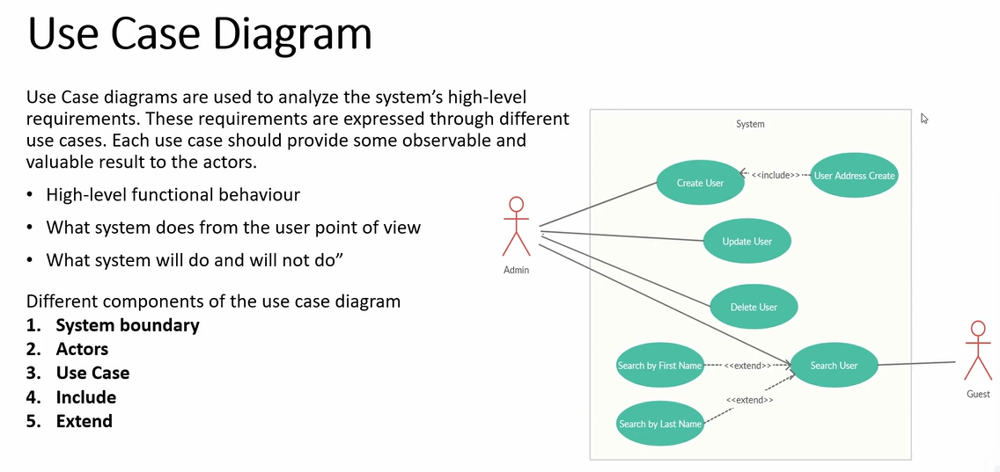
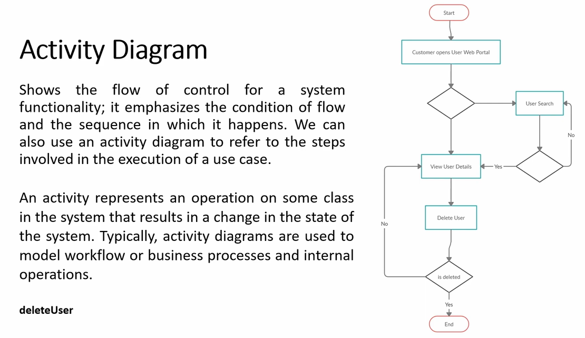
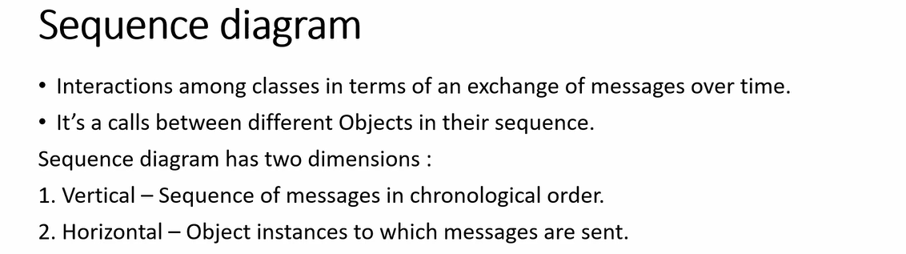
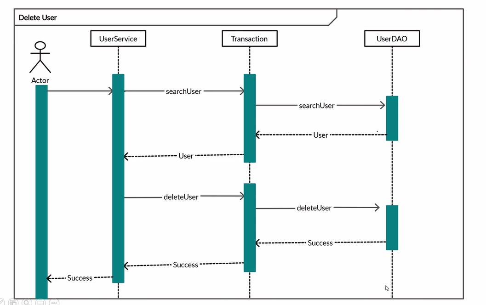

# 2.2 UML Diagram

| UML Diagram | [UML Diagram \| Chapter 7: Low Level Design](<https://www.youtube.com/watch?v=qLw7qsJfvoI>) | [UML Diagrams - Low Level Design \| Coding Interview Series \| The Code Mate](<https://www.youtube.com/watch?v=jlAuJSQOJ5I>) | [Basics of LLD \| UML Diagram in detail \| Association Vs Aggregation Vs Composition \| VERY imp!!](<https://www.youtube.com/watch?v=j84w5VM9GT8>) | [Basics of LLD \| UML Diagram in detail \| Association Vs Aggregation Vs Composition \| VERY imp!!](<https://www.youtube.com/watch?v=j84w5VM9GT8&list=PLliXPok7Zonm0trweRA2UeSTTLVYiPzNG&index=1&pp=iAQB>) | [UML Diagrams Full Course (Unified Modeling Language)](<https://www.youtube.com/watch?v=WnMQ8HlmeXc&t=579s&pp=ygUmY2xhc3MgZGlhZ3JhbSBmb3Igc29mdHdhcmUgZW5naW5lZXJpbmc%3D>) |
| --- | --- | --- | --- | --- | --- |

[UML Class Diagram for Beginners \| Must-Know LLD Concepts \| Basics of low level design with Notes](<https://www.youtube.com/watch?v=VDdxfgZVOSQ>)

[UML Diagram \| Chapter 7: Low Level Design](<https://www.youtube.com/watch?v=qLw7qsJfvoI&list=PLaf8p8Hkzb_F2VUVsYnQUGzGQBrdYtuMr&index=11&pp=iAQB>)

[Introduction to Unified Modeling Language (UML) \| Why it exists \| Diagrams \| What to use in LLD](<https://www.youtube.com/watch?v=TJZ75kHdtKg&list=PLpVAqPqryuRuiGSz7U7rbYvouCDoM5z_4&index=4&pp=iAQB0gcJCX4JAYcqIYzv>)

Behavioural Diagrams

