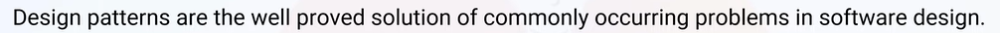
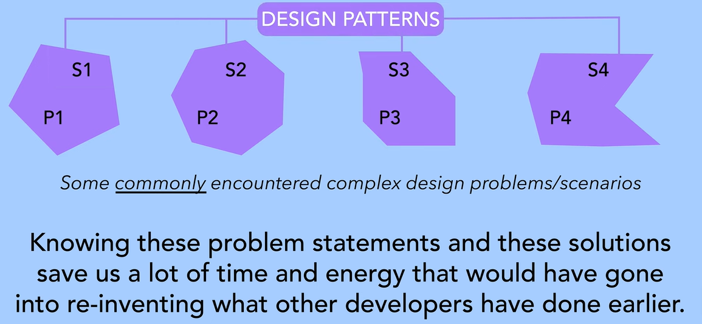
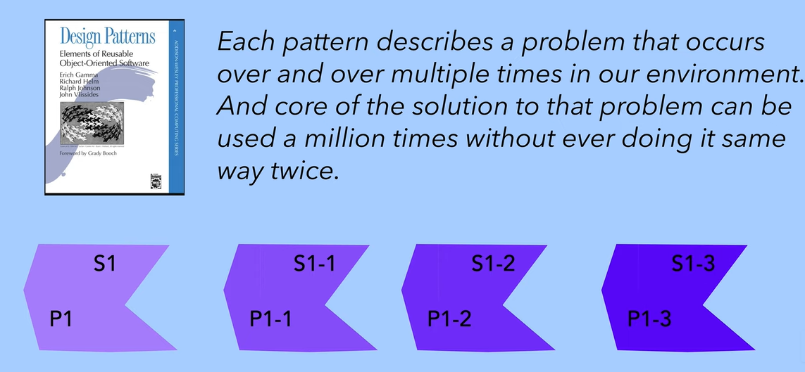
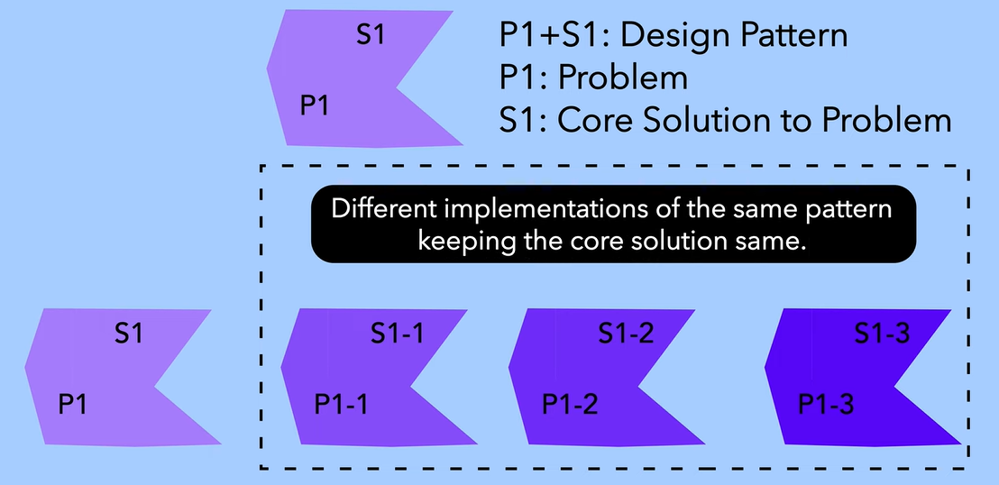
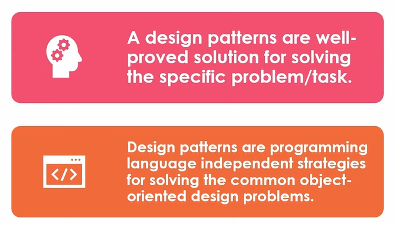
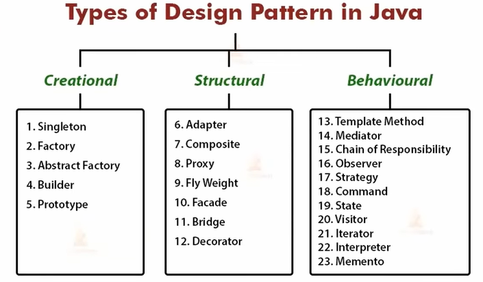
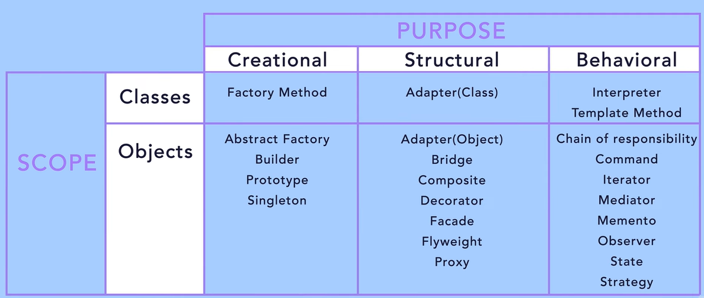

# 3.1 Design Patterns

**Design patterns provide standardized solutions for commonly occuring problems in Java development.**

  - Design patterns help developers address recurring challenges by providing proven templates for implementation.

  - Using design patterns ensures consistency and maintainability in code across different developers and projects.

  - Understanding design patterns requires clear requirement analysis to address common problems before starting development.

**Eg:**Factory design patterns create abstraction for business logic.

- Factory design patterns help to separate the instantiation of objects from their usage, enabling cleaner code architecture.

**Design patterns enhance Java development speed and readability.**

- Using established design patterns, particularly from the '**Gang of Four**' (a OOD book written by 4 people), simplifies code implementation and fosters reusability.

- The 23 design patterns identified promote object-oriented principles, making complex problems easier to manage.

Design patterns are essential for solving common programming problems effectively.

  - Design patterns provide language-independent strategies to tackle recurring object-oriented programming issues, emphasizing high-level planning before coding.

  - Implementing a test-driven development approach with design patterns enhances requirement analysis and improves overall development efficiency.

Design patterns help analyze and match requirements in Java develo pment.

  - Before development, requirements are analyzed to select appropriate design patterns based on their category.

  - Design patterns are used during the analysis and requirement phase of SDLC

  - The three main categories are creational, structural, and behavioral, each serving specific design purposes. Choose which deisgn pattern fits our usecase.

  - Like if we are creating any object, or are we changing its behaviour (object interaction - how to make objects interact while keeping them loosely coupled) or setting class structure, during the process.

Each design pattern has 4 properties associated with it:

  1. Pattern name: for communicating your design idea

  1. Problem: that the pattern tries to solve

  1. Solution: that the pattern provides

  1. Consequences: trade offs, pros, cons of using the pattern to solve the problem

Design Pattern are classified through:

  1. Purpose

    1. Creational: Used for creating or instantiating objects or classes.

    1. Structural:  Used for structuring more than one classes or objects together. Moreover, we will delve deep into inheritence, Interface Segregation Principle etc while we study this.

    1. Behavioral: Used for identifying and setting up common communication patterns among objects.

  1. Scope:

Creational patterns under Classes Scope tell us how to create classes. Those under Class Scope tells us how to instantiate objects.

Structural patterns under Class scope tell us how to apply inheritance while under Object scope tells us how to organise and assemble different objects.

Behavioral patterns under Class scope tell us how to use inheritance in order to implement the algorithms and the control and flow of the classes so as to fulfill a certain behaviour.  Those uder Object scope tell us how to write algorithms around objects in order to fulfill a task which one single object cant fulfill.

[Design Patterns for Beginners | Java | C++ | C | Oops | Low level system Design](<https://youtube.com/playlist?list=PLEI-q7w3s9gT0C6_DVhXN9A6FQNfOJ4MA&si=sjuXWtH0Kgk9GKYY>)

[SOLID principles For Beginners | System Design primer course | Low level System Design for freshers by SDE-V Adobe](<https://youtube.com/playlist?list=PLEI-q7w3s9gSumsDp3Ybt61DDqY7vp0p3&si=EqTWwofCaUjGvCHI>)

[Introduction to Design Patterns | What is, What is not, Why, Categories, Examples](<https://www.youtube.com/watch?v=7knvLzUOxb4&list=PLpVAqPqryuRuiGSz7U7rbYvouCDoM5z_4&index=8&pp=iAQB>)

⚙️ Design Patterns

| Creational Patterns | Structural Patterns | Behavioral Patterns |
| --- | --- | --- |
| [Singleton](<https://blog.algomaster.io/p/singleton-design-pattern>) | [Adapter](<https://refactoring.guru/design-patterns/adapter>) | [Iterator](<https://refactoring.guru/design-patterns/iterator>) |
| [Factory Method](<https://refactoring.guru/design-patterns/factory-method>) | [Bridge](<https://refactoring.guru/design-patterns/bridge>) | [Observer](<https://refactoring.guru/design-patterns/observer>) |
| [Abstract Factory](<https://refactoring.guru/design-patterns/abstract-factory>) | [Composite](<https://refactoring.guru/design-patterns/composite>) | [Strategy](<https://refactoring.guru/design-patterns/strategy>) |
| [Builder](<https://refactoring.guru/design-patterns/builder>) | [Decorator](<https://refactoring.guru/design-patterns/decorator>) | [Command](<https://refactoring.guru/design-patterns/command>) |
| [Prototype](<https://refactoring.guru/design-patterns/prototype>) | [Facade](<https://refactoring.guru/design-patterns/facade>) | [State](<https://refactoring.guru/design-patterns/state>) |
|  | [Flyweight](<https://refactoring.guru/design-patterns/flyweight>) | [Template Method](<https://refactoring.guru/design-patterns/template-method>) |
|  | [Proxy](<https://refactoring.guru/design-patterns/proxy>) | [Visitor](<https://refactoring.guru/design-patterns/visitor>) |
|  |  | [Mediator](<https://refactoring.guru/design-patterns/mediator>) |
|  |  | [Memento](<https://refactoring.guru/design-patterns/memento>) |
|  |  | [Chain of Responsibility](<https://refactoring.guru/design-patterns/chain-of-responsibility>) |

[Before You Learn Design Patterns, See THIS First – Paras Saini](<https://www.youtube.com/watch?v=NgVKO4M4kt4>)
