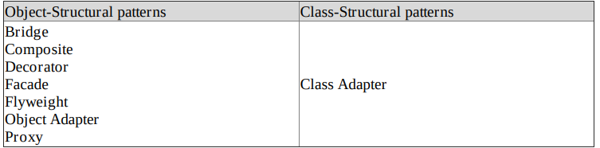

# 3.2 Structural

| **Structural Design Pattern** |
| --- |
| Bridge Design Pattern |
| Composite Design Pattern |
| Facade Design Pattern |
| Adapter Design Pattern |
| Flyweight Design Pattern |
| Decorator Design Pattern |
| Proxy Design Pattern |

| **Structural Design Pattern** |  | [32. All Structural Design Patterns \| Decorator, Proxy, Composite, Adapter, Bridge, Facade, FlyWeight](<https://www.youtube.com/watch?v=WxGtmIBZszk>) | [Structural Patterns (comparison) – Design Patterns (ep 12)](<https://www.youtube.com/watch?v=lPsSL6_7NBg>) |
| --- | --- | --- | --- |

[Structural Design Patterns: ](<https://www.youtube.com/watch?v=ahrT6J_faX8&list=PLpxM6m39X_t-Rk9lZVVD4U6JycAAIIEDW&index=21&pp=iAQB>)[🏗️](<https://www.youtube.com/watch?v=ahrT6J_faX8&list=PLpxM6m39X_t-Rk9lZVVD4U6JycAAIIEDW&index=21&pp=iAQB>)[ Everything You Need to Know ](<https://www.youtube.com/watch?v=ahrT6J_faX8&list=PLpxM6m39X_t-Rk9lZVVD4U6JycAAIIEDW&index=21&pp=iAQB>)[📖](<https://www.youtube.com/watch?v=ahrT6J_faX8&list=PLpxM6m39X_t-Rk9lZVVD4U6JycAAIIEDW&index=21&pp=iAQB>)

[Are You Making These COMMON Structural Design Pattern MISTAKES](<https://www.youtube.com/watch?v=PX-yNs3FHBE>)

https://drive.google.com/file/d/1lGaeNPYEUq6B_5KM0Z8IFQp-EXa5Qfyp/view?usp=drive_link, https://drive.google.com/file/d/121KW91_SI-TqMx74j8VbVMj7L-i3qSfv/view?usp=drive_link, https://drive.google.com/file/d/15kfRcegRAHBj7a5fmRR9vy1JQJcTbuXV/view?usp=drive_link, https://drive.google.com/file/d/1v6UN-Tn2fgdYxxK4MU49V_RjkU5pVbsH/view?usp=drive_link, https://drive.google.com/file/d/1bcFOftAdwwWniHqosFtfMHA7KV4I1zHE/view?usp=drive_link, https://drive.google.com/file/d/1y33wEBJHXUmaL1hO4W6r8U8wbjp_Vx-X/view?usp=drive_link, https://drive.google.com/file/d/1fs1DvQKzNg-qGjHVJamJwVVyr9sGrLy4/view?usp=drive_link

