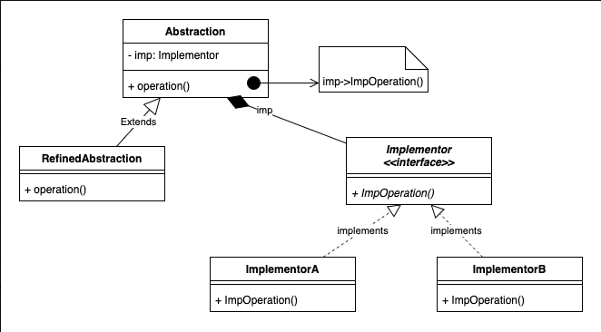

# 3.2.1 Bridge

| Bridge Design Pattern | [Bridge Design Pattern \| System Design Notification Service \| Object Oriented Design Patterns](<https://www.youtube.com/watch?v=SiUSGGUCWDU>) | [Bridge Pattern – Design Patterns (ep 11)](<https://www.youtube.com/watch?v=F1YQ7YRjttI>) | [26. Bridge Design Pattern \| LLD of Bridge Pattern with Example \| Low Level Design of Bridge Pattern](<https://www.youtube.com/watch?v=SOw1_W0taBg>) |
| --- | --- | --- | --- |

[Bridge \| Structural Design Pattern \| Intent, Examples, UML, Code & Trade-Offs](<https://www.youtube.com/watch?v=5S_k7nHnP5M&list=PLpVAqPqryuRuiGSz7U7rbYvouCDoM5z_4&index=18&pp=iAQB0gcJCX4JAYcqIYzv>)

[Bridge Design Pattern in Software Development: ](<https://www.youtube.com/watch?v=okr_avFJg8Y&list=PLpxM6m39X_t-Rk9lZVVD4U6JycAAIIEDW&index=26&pp=iAQB>)[🌉](<https://www.youtube.com/watch?v=okr_avFJg8Y&list=PLpxM6m39X_t-Rk9lZVVD4U6JycAAIIEDW&index=26&pp=iAQB>)[ A Complete Guide ](<https://www.youtube.com/watch?v=okr_avFJg8Y&list=PLpxM6m39X_t-Rk9lZVVD4U6JycAAIIEDW&index=26&pp=iAQB>)[📖](<https://www.youtube.com/watch?v=okr_avFJg8Y&list=PLpxM6m39X_t-Rk9lZVVD4U6JycAAIIEDW&index=26&pp=iAQB>)

