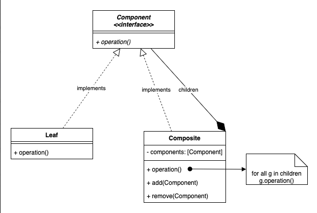

# 3.2.2 Composite

| Composite Design Pattern | [Composite Pattern – Design Patterns (ep 14)](<https://www.youtube.com/watch?v=EWDmWbJ4wRA>) | [Difference Between Composite and Decorator Pattern – Design Patterns (ep 15)](<https://www.youtube.com/watch?v=EECfgFQ44Kg>) | [19. Design File System using Composite Design Pattern \| Low Level Design Interview Question \| LLD](<https://www.youtube.com/watch?v=FLkCkUY7Wu0>) |
| --- | --- | --- | --- |

[Composite Pattern | Structural Design Pattern | Intent, Examples, UML, Code & Trade-Offs](<https://www.youtube.com/watch?v=D54q1Nxj6go&list=PLpVAqPqryuRuiGSz7U7rbYvouCDoM5z_4&index=16&pp=iAQB>)

[Composite Design Pattern Explained: ](<https://www.youtube.com/watch?v=78270FDPlZg&list=PLpxM6m39X_t-Rk9lZVVD4U6JycAAIIEDW&index=23&pp=iAQB>)[🌳](<https://www.youtube.com/watch?v=78270FDPlZg&list=PLpxM6m39X_t-Rk9lZVVD4U6JycAAIIEDW&index=23&pp=iAQB>)[ Real-World Applications ](<https://www.youtube.com/watch?v=78270FDPlZg&list=PLpxM6m39X_t-Rk9lZVVD4U6JycAAIIEDW&index=23&pp=iAQB>)[🏢](<https://www.youtube.com/watch?v=78270FDPlZg&list=PLpxM6m39X_t-Rk9lZVVD4U6JycAAIIEDW&index=23&pp=iAQB>)[ & Advantages ](<https://www.youtube.com/watch?v=78270FDPlZg&list=PLpxM6m39X_t-Rk9lZVVD4U6JycAAIIEDW&index=23&pp=iAQB>)[✅](<https://www.youtube.com/watch?v=78270FDPlZg&list=PLpxM6m39X_t-Rk9lZVVD4U6JycAAIIEDW&index=23&pp=iAQB>)

## Composite Design Pattern
