# 3.2.3 Facade

[Facade Design Pattern SAVED My Overengineered Project - Paras Saini](<https://www.youtube.com/watch?v=u4kfj4m8bhw>)

Structural design pattern so used to structure our application. Refactoring pattern. Make complex APIs easy to use.

Intent: Provide a simplified, unified interface to a set of interfaces in a subsystem. Facade defines a higher level interface that makes the subsystem easier to use. It hides the complexity of the system and exposes only what is necessary.

Client only has to deal with facade system interface, and not with each underlying subsystem and implementation details of subsystems are hidden from the clients. Facade delegates requests to appropriate subsystems.

Subsystems are unaware of facade. They think that client has made the call. All subsystems act independently. Facade is acting like an orchestrator. It simplifies operation and gives one single interface to the clients.

Facade is like a simplified interface / helper class / abstraction on top of sub-classes, which internally uses some of the functions of sub-classes, and provides abstraction by reducing complexity, and hiding internal workflow/implementation and complexity of operation that happens behind the scenes.

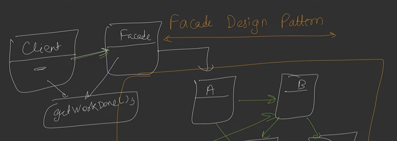

Example Use Cases:

  - Payment Processors

  - GraphQL

  - Weather App

Trade-offs:

  - Strength: Simplicity, Decoupling client to subsystem,

  - Weakness: Additional Layer of Code, Single Point of failure

Principle of least knowledge:

  - Talk only to your immediate linked friends.

  - We want less interaction between components, to make it loosely coupled.

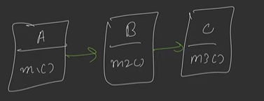

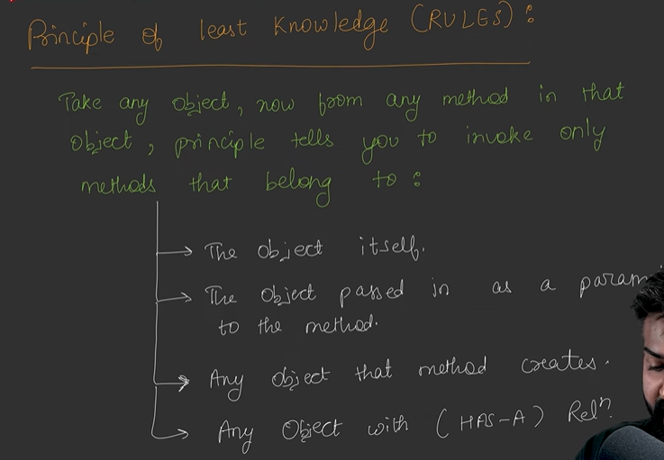

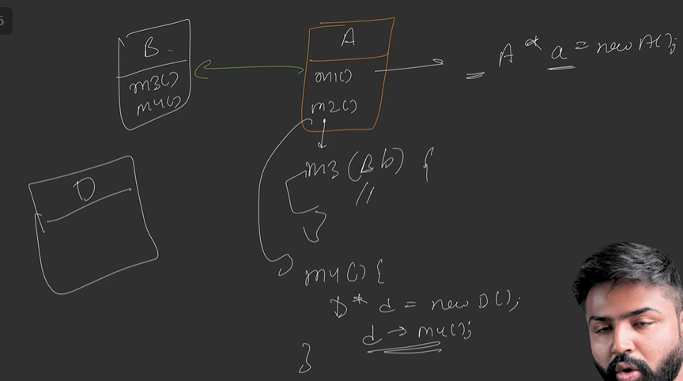

Class Diagram:

  - Facade system composes all the subsystem (private, protected) which are required for its use.

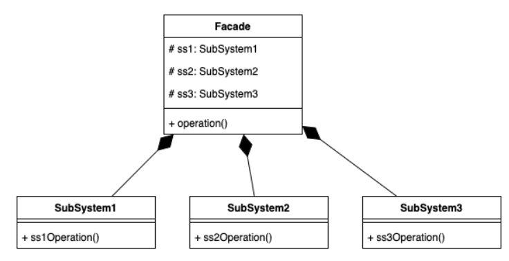

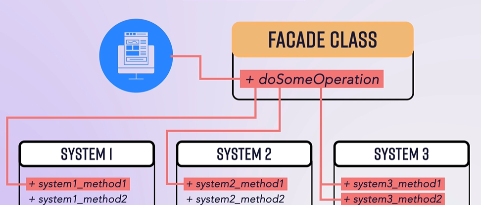

Sequence Diagram:

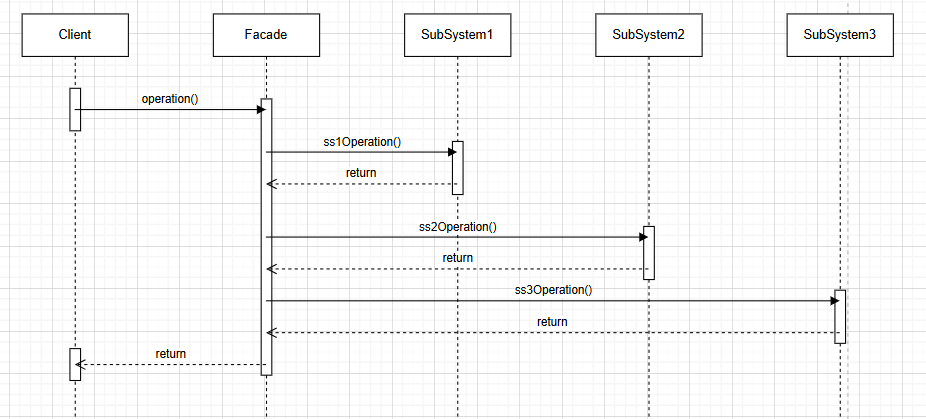

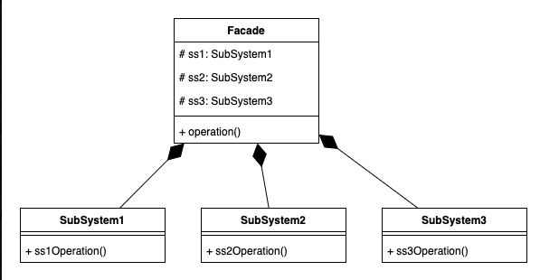

Example:

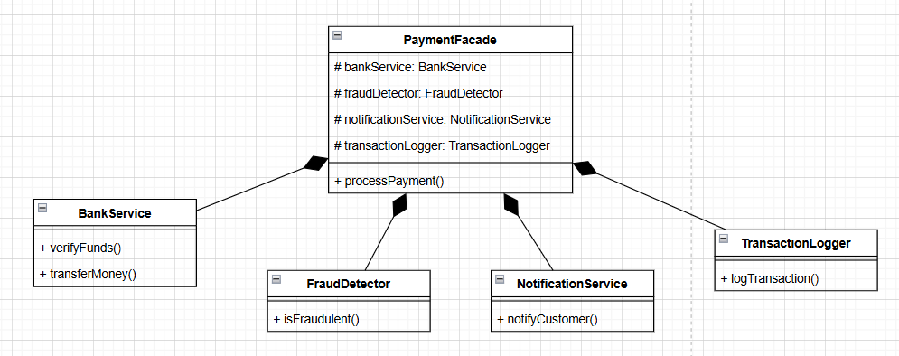

| // Subsystem 1: Bank Service class BankService { public: bool verifyFunds(const string& accountId, double amount) { cout << "Verifying funds for account " << accountId << " amount: $" << amount << endl; return true; // Simplified implementation } bool transferMoney(const string& fromAccount, const string& toAccount, double amount) { cout << "Transferring $" << amount << " from account " << fromAccount << " to account " << toAccount << endl; return true; // Simplified implementation } }; |
| --- |
| // Subsystem 2: Fraud Detection Service class FraudDetector { public: bool isFraudulent(const string& accountId, double amount) { cout << "Checking for fraud on account " << accountId << " for amount: $" << amount << endl; return false; // Simplified implementation } }; |
| // Subsystem 3: Customer Notification Service class NotificationService { public: void notifyCustomer(const string& customer, const string& message) { cout << "Notifying customer " << customer << ": " << message << endl; } }; |
| // Subsystem 4: Transaction Logger class TransactionLogger { public: void logTransaction(const string& fromAccount, const string& toAccount, double amount) { cout << "Logging transaction: $" << amount << " from " << fromAccount << " to " << toAccount << endl; } }; |
| // Payment Facade class PaymentFacade { **private:** **BankService**** bankService;** **FraudDetector**** fraudDetector;** **NotificationService**** notificationService;** **TransactionLogger**** transactionLogger;** public: bool processPayment(const string& fromAccount, const string& toAccount, double amount, const string& customerEmail) { // Step 1: Verify funds if (!bankService.verifyFunds(fromAccount, amount)) { notificationService.notifyCustomer(customerEmail, "Payment failed: Insufficient funds"); return false; } // Step 2: Check for fraud if (fraudDetector.isFraudulent(fromAccount, amount)) { notificationService.notifyCustomer(customerEmail, "Payment failed: Fraud detected"); return false; } // Step 3: Transfer money if (!bankService.transferMoney(fromAccount, toAccount, amount)) { notificationService.notifyCustomer(customerEmail, "Payment failed: Transfer error"); return false; } // Step 4: Log the transaction transactionLogger.logTransaction(fromAccount, toAccount, amount); // Step 5: Notify customer of success notificationService.notifyCustomer(customerEmail, "Payment processed successfully"); return true; } }; |
| // Client code int main() { PaymentFacade paymentFacade; string fromAccount = "123456"; string toAccount = "789012"; double amount = 1000.00; string customerEmail = "customer@example.com"; // Process a payment using the facade bool success = paymentFacade.processPayment( fromAccount, toAccount, amount, customerEmail ); if (success) { cout << "\\nPayment transaction completed successfully!" << endl; } else { cout << "\\nPayment transaction failed!" << endl; } return 0; } |

Example (Java):

performAction(Facade.action ---> calls subsystem1.task1 , subsystem2.task1)

client.startComputer() --calls--> computerFacade.startComputer()

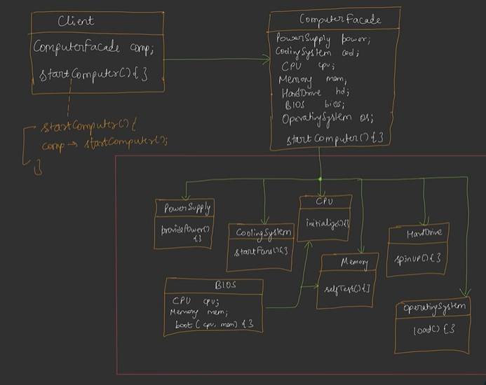

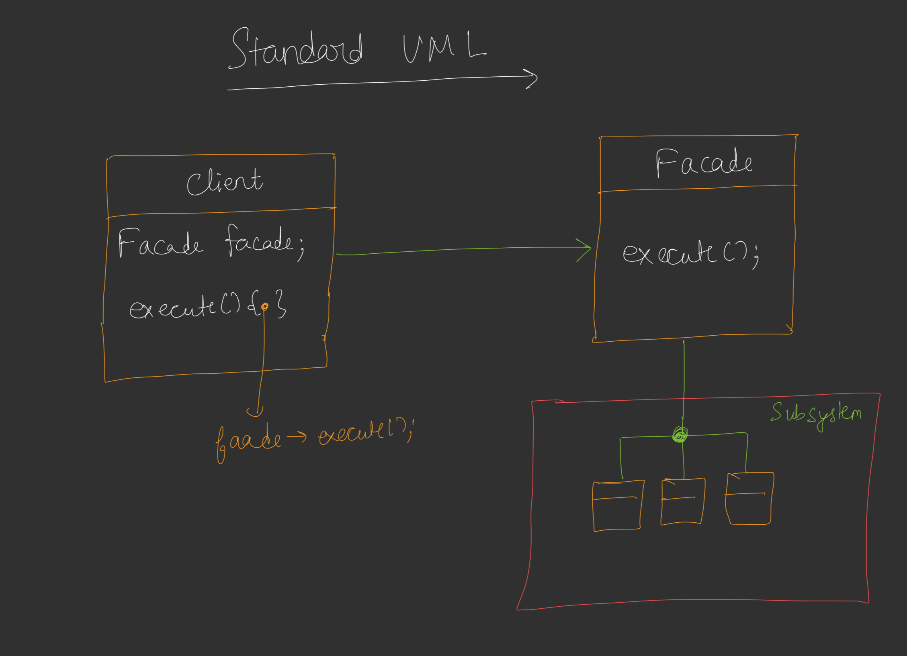

| package DesignPatterns.Facade; public class MotherBoard { boolean checkMotherBoardOnBoot(){ System.out.println("checking mother board on boot"); return true; } } |
| --- |
| package DesignPatterns.Facade; public class RAM { boolean checkRAMOnBoot(){ System.out.println("checking RAM on boot"); return true; } } |
| package DesignPatterns.Facade; public class OSCheckOnBoot { boolean checkOSOnBoot(){ System.out.println("checking OS on boot"); return true; } } |
| package DesignPatterns.Facade; public class DriverCheck { boolean checkDriverOnBoot(){ System.out.println("checking Driver on boot"); return true; } } |
| package DesignPatterns.Facade; public class HardwareChecks { MotherBoard motherBoard; RAM ram; public HardwareChecks() { this.motherBoard = new MotherBoard(); this.ram = new RAM(); } boolean checkAllHardware(){ return motherBoard.checkMotherBoardOnBoot() && ram.checkRAMOnBoot(); } } |
| package DesignPatterns.Facade; public class SoftwareCheck { OSCheckOnBoot osCheckOnBoot; DriverCheck driverCheck; public SoftwareCheck() { this.osCheckOnBoot = new OSCheckOnBoot(); this.driverCheck = new DriverCheck(); } boolean checkSoftwareOnBoot(){ return osCheckOnBoot.checkOSOnBoot() && driverCheck.checkDriverOnBoot(); } } |

| package DesignPatterns.Facade; public class LaptopOnSwitch { SoftwareCheck softwareCheck; HardwareChecks hardwareChecks; public LaptopOnSwitch() { this.softwareCheck = new SoftwareCheck(); this.hardwareChecks = new HardwareChecks(); } void switchOnLaptop(){ if(hardwareChecks.checkAllHardware() && softwareCheck.checkSoftwareOnBoot()){ System.out.println("Switching on laptop"); } } } \[FACADE\] |
| --- |
| package DesignPatterns.Facade; public class Laptop { public static void main(String\[\] args) { LaptopOnSwitch laptopOnSwitch = new LaptopOnSwitch(); laptopOnSwitch.**switchOnLaptop()**; } } \[CLIENT CODE\] |

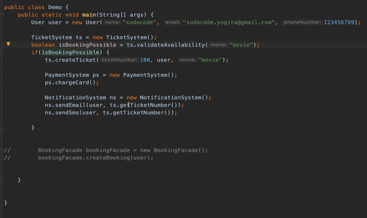

Refactor:

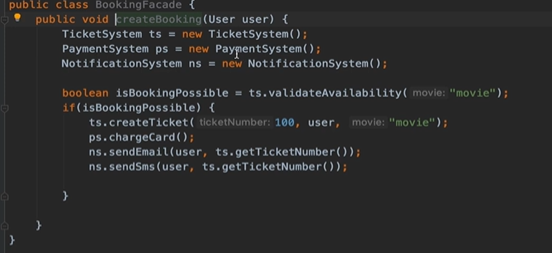

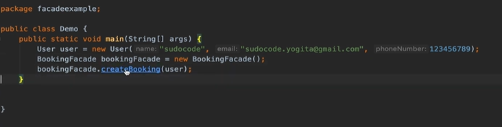

FACADE VS ADAPTER:

  - Facade hides complexity of subsystem

  - Adapter makes interaction between two completely different interfaces

Direct Web Remoting (DWR)

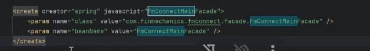

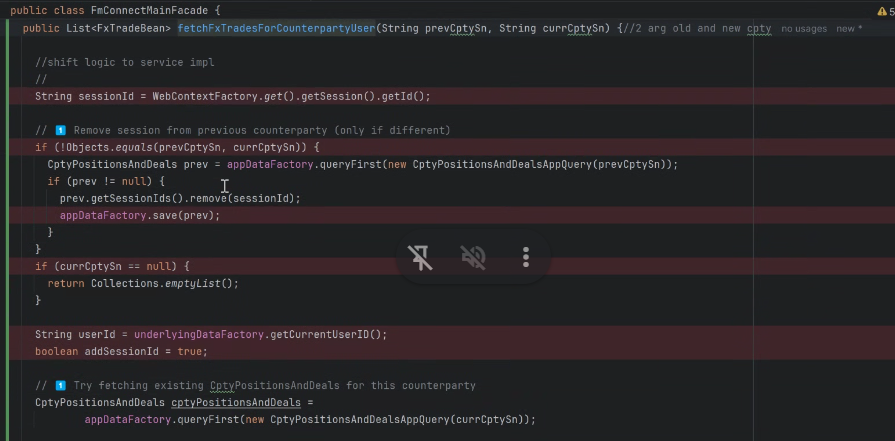

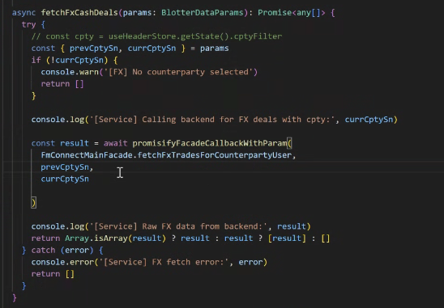

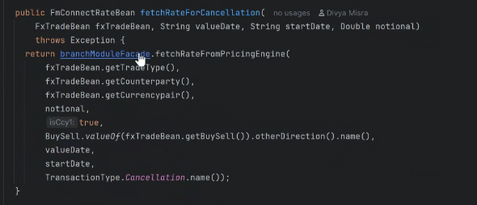
