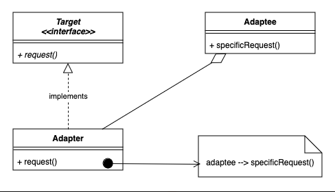

# 3.2.4 Adapter

| Adapter Design Pattern | [System Design - LLD - Strategy & Adapter Pattern](<https://www.youtube.com/watch?v=FNvIrTyBJfc>) | [🔥Adapter Design Pattern \| Adapter pattern with example \| Important Interview Question \| Hin](<https://www.youtube.com/watch?v=sWQOvX-kYTE>)di | [LLD 08-Seamless Integration with the Adapter DP \| Stripe, PayPal, Databases & More in Java #coding](<https://www.youtube.com/watch?v=xxVZYDxUmWg>) | [20. Adapter Design Pattern with Examples, LLD \| Low Level Design Interview Question \| System Design](<https://www.youtube.com/watch?v=8wrg7IsILhQ>) | [Why adapter design pattern is simpler to understand without charger analogy \| LLD \| Low Level Design](<https://www.youtube.com/watch?v=eR22JuwTa54>) | [Adapter Design Pattern \| System Design Media player \| Object Oriented Programming](<https://www.youtube.com/watch?v=VNL1NsS5Prs>) | [Adapter Design Pattern \| Explanation with Code in Easy Way! ✌🏻](<https://www.youtube.com/watch?v=JxveJ1pI5fc>) | [Adapter Pattern – Design Patterns (ep 8)](<https://www.youtube.com/watch?v=2PKQtcJjYvc>) |
| --- | --- | --- | --- | --- | --- | --- | --- | --- |

[Adapter Design Pattern FIXED My Worst Integration Nightmare - Paras Saini](<https://www.youtube.com/watch?v=B-eiOzIhN-E>)

[Adapter Pattern | Structural Design Pattern | Intent, Examples, UML, Code & Trade-Offs](<https://www.youtube.com/watch?v=gltbToLtZGg&list=PLpVAqPqryuRuiGSz7U7rbYvouCDoM5z_4&index=14&pp=iAQB>)

[Adapter Design Pattern: ](<https://www.youtube.com/watch?v=DPohrgR-SD0&list=PLpxM6m39X_t-Rk9lZVVD4U6JycAAIIEDW&index=22&pp=iAQB>)[🔌](<https://www.youtube.com/watch?v=DPohrgR-SD0&list=PLpxM6m39X_t-Rk9lZVVD4U6JycAAIIEDW&index=22&pp=iAQB>)[ Examples & Implementations in Java ](<https://www.youtube.com/watch?v=DPohrgR-SD0&list=PLpxM6m39X_t-Rk9lZVVD4U6JycAAIIEDW&index=22&pp=iAQB>)[☕](<https://www.youtube.com/watch?v=DPohrgR-SD0&list=PLpxM6m39X_t-Rk9lZVVD4U6JycAAIIEDW&index=22&pp=iAQB>)

