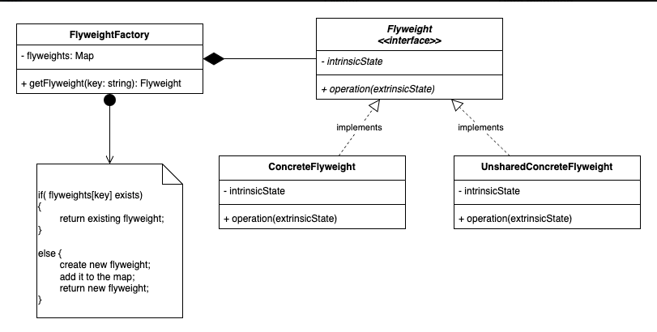

# 3.2.5 Flyweight

| Flyweight Design Pattern | [LLD 10-Flyweight Design Pattern with Pokémon Go & PUBG \| Memory Optimization #codingintelugu #lld](<https://www.youtube.com/watch?v=EAomVc-qazc>) | [How flyweight pattern helps in memory optimisation \| Design Patterns \| sudoCODE](<https://www.youtube.com/watch?v=8cL9KbHS5kE>) | [30. Design Word Processor using Flyweight Design Pattern \| Low Level System Design FlyWeight Pattern](<https://www.youtube.com/watch?v=Mwm6tB3x1do>) |
| --- | --- | --- | --- |

[Flyweight | Structural Design Pattern | Intent, Examples, UML, Code & Trade-Offs](<https://www.youtube.com/watch?v=btjQfYJ7CIA&list=PLpVAqPqryuRuiGSz7U7rbYvouCDoM5z_4&index=20&pp=iAQB>)

[Flyweight Design Pattern Explained: Optimize Memory & Performance in Software Development ](<https://www.youtube.com/watch?v=tLw0A1rYDXg&list=PLpxM6m39X_t-Rk9lZVVD4U6JycAAIIEDW&index=28&pp=iAQB0gcJCX4JAYcqIYzv>)[🚀💾](<https://www.youtube.com/watch?v=tLw0A1rYDXg&list=PLpxM6m39X_t-Rk9lZVVD4U6JycAAIIEDW&index=28&pp=iAQB0gcJCX4JAYcqIYzv>)

