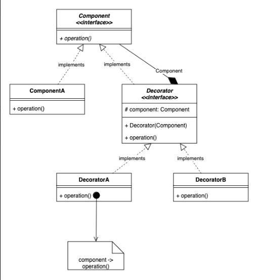

# 3.2.6 Decorator

[Decorator Design Pattern | Low Level Design | OOPS  | Java | Best Video to Understand](<https://www.youtube.com/watch?v=GN5Px0aK6zA>)

| Decorator Design Pattern | [Decorator Pattern – Design Patterns (ep 3)](<https://www.youtube.com/watch?v=GCraGHx6gso>) | [Decorator Design Pattern \| Low Level Design \| OOPS \| Java \| Best Video to Understan](<https://www.youtube.com/watch?v=GN5Px0aK6zA>)d | [LLD 09-Java Decorator Design Pattern Explained \| Dynamic Features in Real-Life Apps #codingintelugu](<https://www.youtube.com/watch?v=ot3GSIkhjCQ>) | [4. Decorator Design Pattern Explanation with Java Coding, LLD System Design, System design interview](<https://www.youtube.com/watch?v=w6a9MXUwcfY>) | [Decorator Design Pattern \| Starbucks \| Coffee House System Design](<https://www.youtube.com/watch?v=3rI5n2hwz2o>) |
| --- | --- | --- | --- | --- | --- |

[Decorator Design Pattern | LLD Series | Low-Level Design with Code & Class Diagram Beginner Friendly](<https://www.youtube.com/watch?v=OavKNbNcKiE>)

[🔥](<https://www.youtube.com/watch?v=EdaJXvRas7M&list=PL76zRLpXzDOGAFvCDSfaF28XL_d-WO08t&index=15&pp=iAQB>)[ Decorator Design Pattern in 15 Minutes | Low Level System Design Interview Questions](<https://www.youtube.com/watch?v=EdaJXvRas7M&list=PL76zRLpXzDOGAFvCDSfaF28XL_d-WO08t&index=15&pp=iAQB>)

[Decorator Pattern | Structural Design Pattern | Intent, Examples, UML, Code & Trade-Offs](<https://www.youtube.com/watch?v=Y1qLtu68R0g&list=PLpVAqPqryuRuiGSz7U7rbYvouCDoM5z_4&index=15&pp=iAQB>)

[Decorator Design Pattern Simplified: ](<https://www.youtube.com/watch?v=dgww0AiHAY0&list=PLpxM6m39X_t-Rk9lZVVD4U6JycAAIIEDW&index=25&pp=iAQB>)[🎨](<https://www.youtube.com/watch?v=dgww0AiHAY0&list=PLpxM6m39X_t-Rk9lZVVD4U6JycAAIIEDW&index=25&pp=iAQB>)[ How & When to Use It ](<https://www.youtube.com/watch?v=dgww0AiHAY0&list=PLpxM6m39X_t-Rk9lZVVD4U6JycAAIIEDW&index=25&pp=iAQB>)[✅](<https://www.youtube.com/watch?v=dgww0AiHAY0&list=PLpxM6m39X_t-Rk9lZVVD4U6JycAAIIEDW&index=25&pp=iAQB>)

