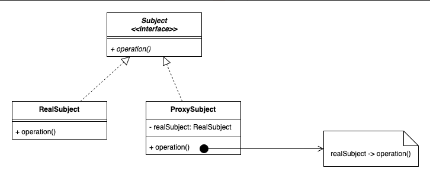

# 3.2.7 Proxy

| Proxy Design Pattern | [13. Proxy Design Pattern Explanation \| LLD System Design \| System Design Interview Question \| Java](<https://www.youtube.com/watch?v=9MxHKlVc6ZM>) | [Proxy Pattern – Design Patterns (ep 10)](<https://www.youtube.com/watch?v=NwaabHqPHeM>) |
| --- | --- | --- |

[Proxy Pattern \| Structural Design Pattern \| Intent, Examples, UML, Code & Trade-Offs](<https://www.youtube.com/watch?v=JgLjr8QxC5g&list=PLpVAqPqryuRuiGSz7U7rbYvouCDoM5z_4&index=17&pp=iAQB>)

[Proxy Design Pattern Explained: Benefits, Examples & Use Cases ](<https://www.youtube.com/watch?v=4z2LRJ-QPuI&list=PLpxM6m39X_t-Rk9lZVVD4U6JycAAIIEDW&index=27&pp=iAQB>)[😊🚀](<https://www.youtube.com/watch?v=4z2LRJ-QPuI&list=PLpxM6m39X_t-Rk9lZVVD4U6JycAAIIEDW&index=27&pp=iAQB>)

