# 3.3.1 Singleton

[Singleton Design Pattern Explained \| Double Checking \| Concurrency \| Java  \| Imp Interview Question](<https://www.youtube.com/watch?v=2Dw1v9QC408&t=953s>)

| Singleton Design Pattern | [Singleton and Prototype Design Patterns \| Systems Design \| Object oriented Design Patterns](<https://www.youtube.com/watch?v=P4losX0HxwE>) | [Singleton Design Pattern - Part 1 (In Depth Analysis) \| Very Important Java Interview Concept](<https://www.youtube.com/watch?v=-GGugARLxIQ>) | [How to Break Singleton Design Pattern - Part 2](<https://www.youtube.com/watch?v=J7nDtrjAiAE>) | [System Design - LLD - Singleton Pattern](<https://www.youtube.com/watch?v=WdCZMWL4fm0>) | I | [🔥Singleton Design Pattern in Detail \| Multi-Threaded Environments \| Hind](<https://www.youtube.com/watch?v=fs6ZUcF-nuc>)i | [🔥3 Ways to break singleton pattern \| Solution of Problem in detail \| Hindi](<https://www.youtube.com/watch?v=zHWusHi9Nt0>) | [LLD 04-Master Singleton Design Pattern \|\| Netflix Config, DB & Logger Examples \| Multi-threaded Envs](<https://www.youtube.com/watch?v=PDN3utCl4B8>) | [28. BUG in Double-Checked Locking of Singleton Pattern & its Fix \| Low Level System Design Question](<https://www.youtube.com/watch?v=upfrQvOgC24>) | [Story of Singleton Design Pattern and a Prime Minister \| LLD Series \| Low Level Design \|](<https://www.youtube.com/watch?v=EZDeEHXUf8w>) | [Singleton Design Pattern Explained \| Double Checking \| Concurrency \| Java \| Imp Interview Questio](<https://www.youtube.com/watch?v=2Dw1v9QC408>)n | [Singleton Design Pattern \| Implementation with details & code ✌🏻](<https://www.youtube.com/watch?v=oeQWxhlnCHM>) | [Singleton Pattern – Design Patterns (ep 6)](<https://www.youtube.com/watch?v=hUE_j6q0LTQ>) |
| --- | --- | --- | --- | --- | --- | --- | --- | --- | --- | --- | --- | --- | --- |

[Singleton Design Pattern with Thread Safety & interview imp questions \| code implementation \| simple](<https://www.youtube.com/watch?v=AmGYCt4NmvE>)

[Singleton Design Pattern \| Chapter 12: Low Level Design](<https://www.youtube.com/watch?v=h66OLeDGP3g&list=PLaf8p8Hkzb_F2VUVsYnQUGzGQBrdYtuMr&index=9&pp=iAQB>)

[🔥](<https://www.youtube.com/watch?v=TTf3K7XW1uI&list=PL76zRLpXzDOGAFvCDSfaF28XL_d-WO08t&index=10&pp=iAQB0gcJCX4JAYcqIYzv>)[ SINGLETON DESIGN PATTERN in 8 Minutes | Multi-Threaded Environments | SYSTEM DESIGN INTERVIEW](<https://www.youtube.com/watch?v=TTf3K7XW1uI&list=PL76zRLpXzDOGAFvCDSfaF28XL_d-WO08t&index=10&pp=iAQB0gcJCX4JAYcqIYzv>)

[Singleton Pattern \| Creational Design Pattern \| Intent, Examples, UML Diagrams, Code & Trade-Offs](<https://www.youtube.com/watch?v=qo2c6F19onM&list=PLpVAqPqryuRuiGSz7U7rbYvouCDoM5z_4&index=9&pp=iAQB>)

[Singleton Design Pattern in Java ](<https://www.youtube.com/watch?v=1HCUDQTQrC0&list=PLpxM6m39X_t-Rk9lZVVD4U6JycAAIIEDW&index=8&pp=iAQB>)[🔁](<https://www.youtube.com/watch?v=1HCUDQTQrC0&list=PLpxM6m39X_t-Rk9lZVVD4U6JycAAIIEDW&index=8&pp=iAQB>)[ | Efficient & Thread-Safe Object Creation Explained](<https://www.youtube.com/watch?v=1HCUDQTQrC0&list=PLpxM6m39X_t-Rk9lZVVD4U6JycAAIIEDW&index=8&pp=iAQB>)[🚀](<https://www.youtube.com/watch?v=1HCUDQTQrC0&list=PLpxM6m39X_t-Rk9lZVVD4U6JycAAIIEDW&index=8&pp=iAQB>)

[TOP 6 Singleton Design Pattern Implementations You Need to Know](<https://www.youtube.com/watch?v=MfhqK6Q65Fw>)

Creational Design Pattern - Creating objects of the class.

In software development, we often require classes that can only have **one object**. For example: thread pools, caches, loggers etc.

Creating more than one objects of these could lead to issues such as incorrect program behavior, overuse of resources, or inconsistent results.

**Singleton Pattern is a creational design pattern that guarantees a class has only one instance and provides a global point of access to it.**

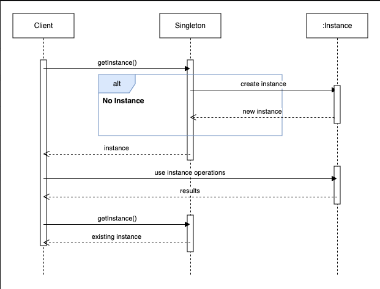

**Create a single instance of the class. **

How to make sure that no other instances of the class exist.

eg: DB Connection that we want a single db connection for all our modules.

eg: Single configuration manager, single logger should be there for the entire project.

Classic Example of Logger:

logger.hpp

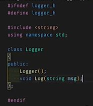

logger.cpp

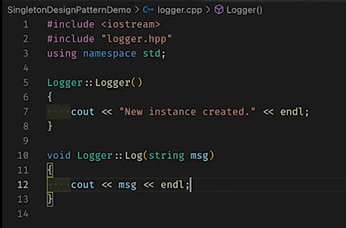

user.cpp

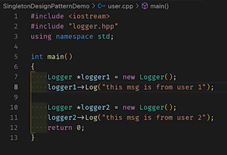

Run the code.

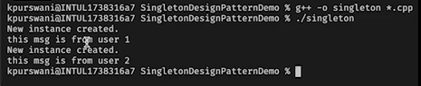

Single requires only single instance.

How to count no. of instances of class? 2

Keep a static counter in the class.

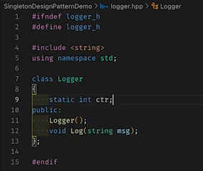

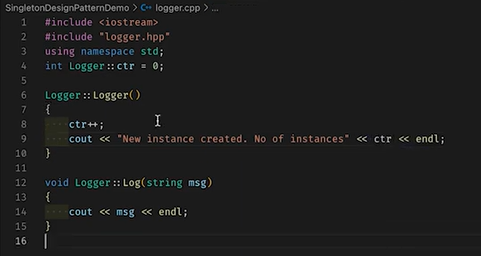

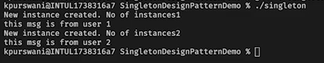

Since we used a static counter so it will get incremented  at every new instance.

IMPLEMENTATION:

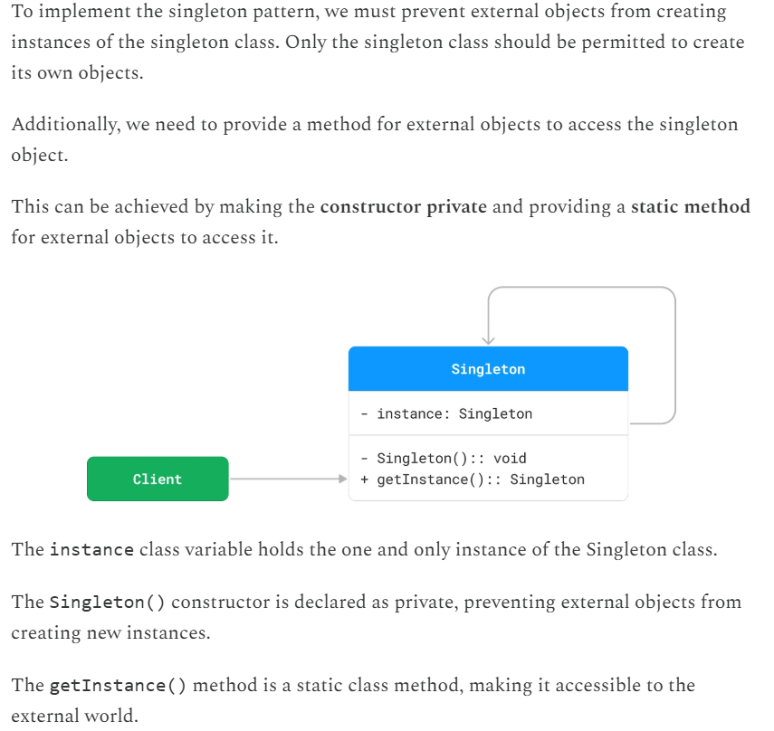

MAKING LOGGER CLASS SINGLETON:

  - Restrict users from instantiation of Class i.e. restrict from making objects. We cant give liberty to the users to call the constructor directly.

Make constructor private.

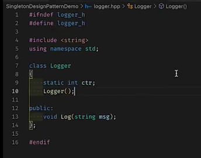

But is this the fix? We do need a single instance of Logger class right? Use static function which will return a particular instance. So, we create a private static logger instance and a static logger getInstance() function

logger.hpp

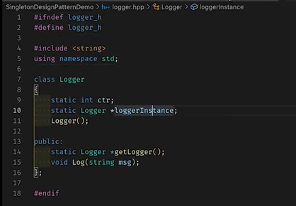

logger.cpp

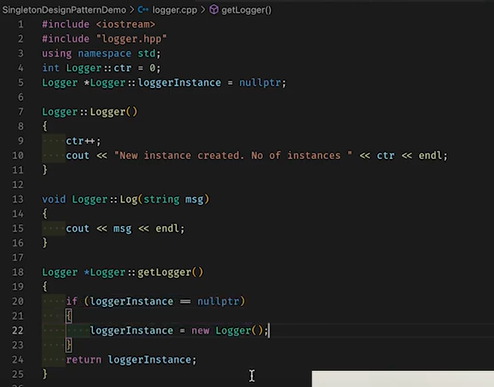

if loggerInstance already exists then return it as it is. If it doesn't exist (i.e. loggerIsntance == nullptr) then create it and return it.

Now, users can get logger using the class method itself and do not have to create a new logger object.

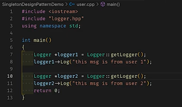

run the code:

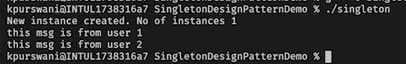

only single instance of logger, no matter how many times the logger is called/created, only a single instance would be there.

**STEPS TO IMPLEMENT SINGLETON DESIGN PATTERN**

**STEP 1:**

**Make constructor private.**

**STEP 2:**

**Make a static instance. **

**STEP 3:**

**Make sure that only "that" static instance get used by making a static function which now all the users will use. **

**THE CODE THAT WE HAVE WRITTEN IS NOT THREAD SAFE.**

MULTITHREADING CASE:

There's a possibility that two instances can get created by two threads.

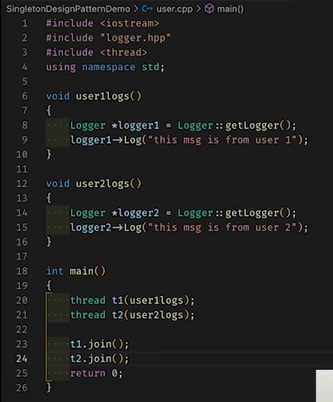

execute again and get diff output:

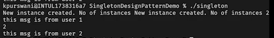

We can see that the number of instances have now become two.

Lock the code that creates the instance so that when one thread is accessing the code, the other thread doesnt do it. Use mutex.

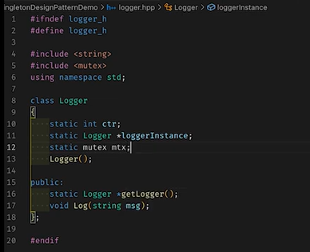

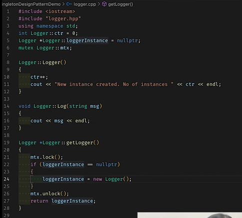

now run the code:

New instance created. Number of instance 1

this is from user 1

this is from user 2

**Double checked locking**

the first time the instance is created we need a lock, after that do we need the lock at all (locks are expensive)?  Now we put the lock only once, when the first time the logger was instantiated.

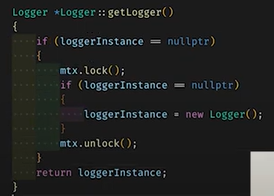

More problems:

  1. Default constructor is not the only way to call a constructor. Make the copy constructor also private and make the equal to operator overloading also private.

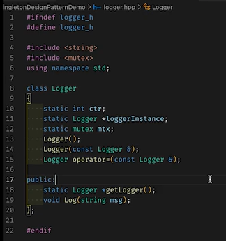

USAGE EXAMPLES:

  - **Logger Classes**: Many logging frameworks use the Singleton pattern to provide a global logging object. This ensures that log messages are consistently handled and written to the same output stream.

  - **Database Connection Pools**: Connection pools help manage and reuse database connections efficiently. A Singleton can ensure that only one pool is created and used throughout the application.

  - **Cache Objects**: In-memory caches are often implemented as Singletons to provide a single point of access for cached data across the application.

  - **Thread Pools:** Thread pools manage a collection of worker threads. A Singleton ensures that the same pool is used throughout the application, preventing resource overuse.

  - **File System**: File systems often use Singleton objects to represent the file system and provide a unified interface for file operations.

  - **Print Spooler**: In operating systems, print spoolers manage printing tasks. A single instance coordinates all print jobs to prevent conflicts.
